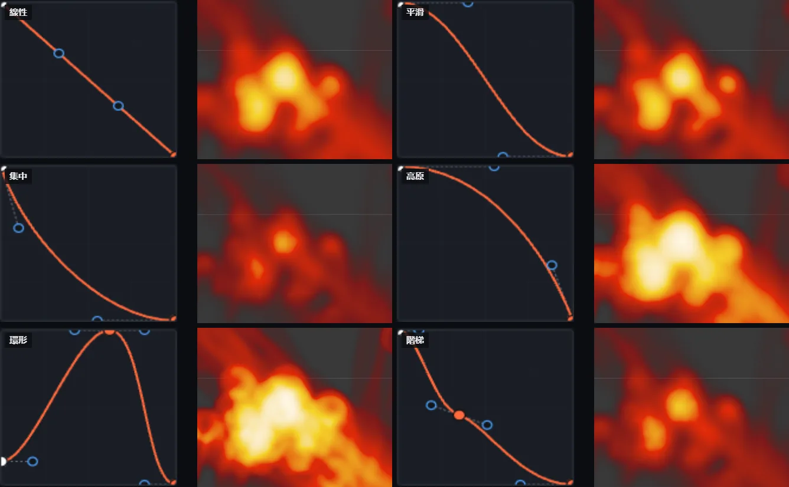

# Sprite 形狀

每個資料列都會被繪製成一個圓形 Sprite，且永遠面向攝影機。它的大小，以及從中心到邊緣的輪廓（**漸變**），決定熱點看起來是緊密的點、柔和的雲、圓盤或是環形。這些控制項位於側邊欄的**熱度形狀**與 **Sprite 像素限制**區段，適用於[熱度](heat.md)、[差異](difference.md)、[隊伍熱度](team-heat.md)，以及作為線條半寬的[線條熱度](line-heat.md)。

變更其中任何一項都會重新開始累積（必須以新的形狀重新繪製熱度場）。

可以把每個點想像成一團柔和的光。小的光團只顯示單一的點；大的光團會把相鄰的點合併成一片雲。形狀決定邊緣有多柔和。



## Sprite 半徑 {#sprite-radius}

Sprite 的半徑以**世界單位**（標示為公尺）表示。預設值為 6，且每次載入時會設為資料的水平範圍 / 120，使沿路徑的相鄰樣本能合併成一條帶狀，而不是讀起來像一條細線。對數滑桿範圍為 0.05-2000，拖曳把手可到 50,000。


遠處的東西看起來較小，因此 Sprite 會隨距離在螢幕上縮小。在平行投影下，它在任何地方都是相同大小，這也是平行視角適合用來比較熱點的部分原因（[鏡頭](camera.md#projection)）。

## 像素限制 {#pixel-clamps}

**Sprite 像素限制**（預設關閉）會在上述換算之後，限制螢幕上的半徑範圍。

| 控制項 | 預設值 | 範圍（撥動） | 原因 |
|---|---|---|---|
| **最小像素半徑** | 1 px | 0-16（512） | 避免遠處的資料縮小到不到一個像素而消失。 |
| **最大像素半徑** | 96 px | 2-1024，對數刻度（8192） | 過度繪製防護。覆蓋 N 個像素的 Sprite 會耗費 N 次混色運算，因此靠近攝影機且未限制的半徑，會讓快速的影格變慢。超過視埠高度後，就不再限制任何東西。 |

**任何縮放下密度一致**（位於熱度形狀區段，預設開啟）與像素限制一同運作。被限制而變大（遠處）或變小（近處）的 Sprite，仍會加入它真實大小所應加入的熱度，因此在任何縮放下，顏色所代表的資料列數量，都會對應到相同面積的地面。關閉時，被限制的 Sprite 會以其被限制後的大小加入完整權重，因此飛近時畫面會改變。

## 中心與邊緣強度 {#centre-and-edge-intensity}

Sprite 在其正中心加入的熱度（**中心強度**，預設 1，範圍 0-10，撥動 1000）以及在其邊緣加入的熱度（**邊緣強度**，預設 0，範圍 -2-10，撥動 1000）。漸變值 *t*（中心為 1，邊緣為 0，由衰減或下方的曲線塑形）在兩者之間混合（公式見[給開發者](#for-developers)）。

**負的邊緣強度**會讓邊緣相減，在每個熱點周圍雕出一圈冷色光暈，並使各個群集之間的界線更清楚。可見度包含[遮擋](depth-and-culling.md)與[切片](slice.md)；淡出是[存續期](timeline.md#history)的淡出；正負號在[差異](difference.md)中為 ±1。

## 漸變形狀：衰減或曲線 {#ramp-shape-falloff-or-curve}

**漸變形狀**可在兩種方式之間切換，用來塑造 *t* 在 Sprite 上的分布。設 *d* 為距中心（0）到邊緣（1）的距離：

### 衰減 {#falloff}

選取*衰減*時顯示（預設）。

- **衰減**（預設 1.6，範圍 0.1-8，撥動 64）：`t = (1 - d) ^ falloff`。1 為筆直的線性漸變；數值越高，熱度越往中心集中，熱點越緊；低於 1 則會把它壓成圓盤。
- **平滑漸變**（預設開啟）：對 *t* 套用 smoothstep 的 S 形曲線，使 Sprite 在邊緣處淡入，而不是在可見的邊界處結束。

### 曲線編輯器 {#the-curve-editor}

選取*曲線*時顯示。這是 Sprite 截面的實際剖面：橫跨的距離（左側為*中心*，右側為*邊緣*），熱度向上。曲線是穿過控制點的分段三次貝茲曲線，每個控制點各有兩個控制柄。

| 動作 | 效果 |
|---|---|
| 在圖上雙擊 | 在該距離新增一個點（保持在 0.02 到 0.98 之間），位於曲線上，並具有該處曲線的斜率，因此新增時不會改變任何東西，直到你拖曳它。 |
| 拖曳一個點 | 移動它。高度保持在 0 到 1 之間。 |
| 拖曳一個小圓圈 | 彎曲其旁邊的線段（移動該控制柄）。 |
| Alt-點擊或右鍵點擊一個點 | 移除它。兩個端點無法移除。 |
| 按一個預設按鈕 | 以該預設取代曲線。 |

端點固定在中心與邊緣；但它們的高度仍由你決定。

**預設**（[`curve.ts`](https://github.com/Holdi601/3DHeat/blob/main/src/state/curve.ts)）：

| 預設 | 形狀 | 用途 |
|---|---|---|
| **線性** | 從 1 直線降到 0 | 與*衰減*為 1 且*平滑漸變*關閉時相同。 |
| **平滑** | S 形曲線 | 預設曲線；衰減為 1 時*平滑漸變*所得到的結果。 |
| **集中** | 陡峭的核心，加上長而淡的裙邊 | 稀疏的資料。 |
| **高原** | 平坦，然後快速滾降 | 讀起來像圓盤，而不是光團。 |
| **環形** | 中心為 0.15，半徑 62% 處為 1，邊緣為 0 | 中空的 Sprite：顯示路徑經過之處，而非停止之處。 |
| **階梯** | 兩段式衰減，35% 處為 0.45 | 把密集的核心與其周圍分開。 |

## 將地面壓平 {#flatten-onto-ground-plane}

**將地面壓平**（預設關閉）會忽略每個資料列的高度，並把所有熱度繪製在同一高度，也就是資料集的最低 Y 值，即傳統的 2D 地圖熱度圖。開啟後，深度遮擋與*隱藏地形後方*都會關閉（每個點都會正好位於用來測試它的表面上），深度區段也會說明這一點。

## 給開發者 {#for-developers}

### 公式 {#formulas}

螢幕上的半徑（像素）：`radius × P[1][1] / w × viewport height / 2`，其中 `P` 是投影矩陣，`w` 是該點的視圖深度。

一個 Sprite 加入的熱度：

```
heat added = mix(edge, centre, t) × sample weight × sign × fade × visibility
```

### 曲線 {#the-curve}

控制柄會水平地限制在它們自己的線段內，因此曲線永遠是距離的函式：把控制柄拖得遠遠超過下一個點，它會貼平在那個點上，而不會讓曲線折回；否則結果會取決於求解器恰好找到哪個根。

### 曲線如何繪製 {#how-the-curve-is-drawn}

曲線每次變更時都會烘焙成一個 256 項的表格，以 16 位元浮點紋理上傳，並在每個片段以線性過濾取樣，且加入半個紋素的內縮，使兩端保持精確。對 x 求解貝茲曲線需要迭代，這不適合放在程式中最頻繁執行的著色器裡；而表格查找也比衰減所用的 `pow()` 更便宜。使用 16 位元而非 8 位元，是因為當數千個 Sprite 相加後，8 位元會出現色階斷層；16 位元半精度浮點數在核心 WebGL2 中可以過濾，而 32 位元則需要擴充功能。
