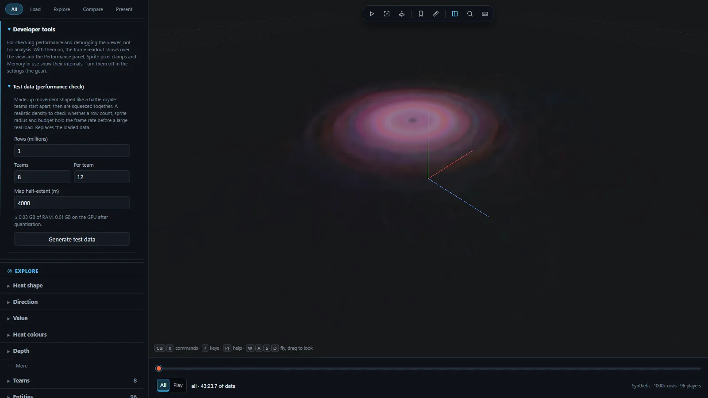

# 合成資料產生器

沒有自己的資料嗎？按一個按鈕，3DHeat 就會為你虛構一場假想的戰鬥，大小隨你決定。

1. 打開熱度側邊欄中的 **資料集** 面板（位於 **來源** 下方）。
2. 捲動到 **合成資料產生器**。
3. 設定 **資料列（百萬）**。建議先試 1：預設的 800 萬對第一次嘗試來說太重了。
4. 按下 **產生**。

**資料集** 面板可以產生資料集，而不是載入一個。它有兩個用途：在沒有自己資料的情況下試用檢視器，以及在把大型真實資料載入機器*之前*，先檢查某個資料列數量、sprite 半徑與預算，能否在該機器上維持可用的影格率。它的移動方式模仿大逃殺式的比賽：隊伍一開始彼此分開，然後被逐漸壓縮在一起——因為均勻雜訊在任何預算下看起來都沒問題，反而會把真正值得抓出來的瑕疵隱藏起來。

## 控制項 {#controls}

| 控制項 | 預設 | 意義 |
|---|---|---|
| **資料列（百萬）** | 8 | 要產生的資料列數。每位玩家都會向下取整到完整的時間刻數。 |
| **隊伍** | 8 | 群組數量（至少 1）。 |
| **每隊人數** | 12 | 每個群組的玩家數（至少 1）。 |
| **地圖半寬（m）** | 4000 | X 與 Z 上可遊玩區域寬度的一半。 |
| 估算行 | | 「≈ X GB 的 RAM，量化後在 GPU 上佔 Y GB。」（每筆資料列約 26 位元組的 RAM 與 8 位元組的 GPU）。 |
| **產生** | | 在匯入工作執行緒中產生，並顯示進度，且會取代任何已載入的資料集。 |

產生作業在背景工作執行緒中進行，所以數千萬筆資料列不會讓頁面凍結。

## 產生的內容 {#what-it-generates}

來自 [`src/data/synth.ts`](https://github.com/Holdi601/3DHeat/blob/main/src/data/synth.ts)：

- **欄位：** 位置、時間、人員（`P000`、`P001`……）、群組（`Team 1`、`Team 2`……）、偏航與俯仰，以及生命週期。沒有工作階段欄位，也沒有過濾器欄位。
- **時間：** 每位玩家每 0.25 秒一個樣本，從 0 開始（相對時間，沒有掛鐘時間）。
- **移動：** 每支隊伍從一個環形上的專屬扇區開始，位於半寬的 55–95% 處。一個安全圓圈大致位於中央附近（隨機偏移最多為半寬的四分之一），會分六個階段收縮到半寬的 8%，每個階段中間有停留期；每位玩家都朝圓圈內一個漫遊的點移動，並帶有阻尼與雜訊。高度會在 0 到 220 公尺之間起伏。
- **視線方向：** 偏航沿著移動方向，俯仰由垂直速度決定。
- **可重複：** 隨機種子固定為 1337，所以相同的設定總是產生相同的資料。

所有熱度模式、箱形重播與線條熱度（整條軌跡，因為沒有事件欄位）都能用於它。生命週期歷程也能用。
