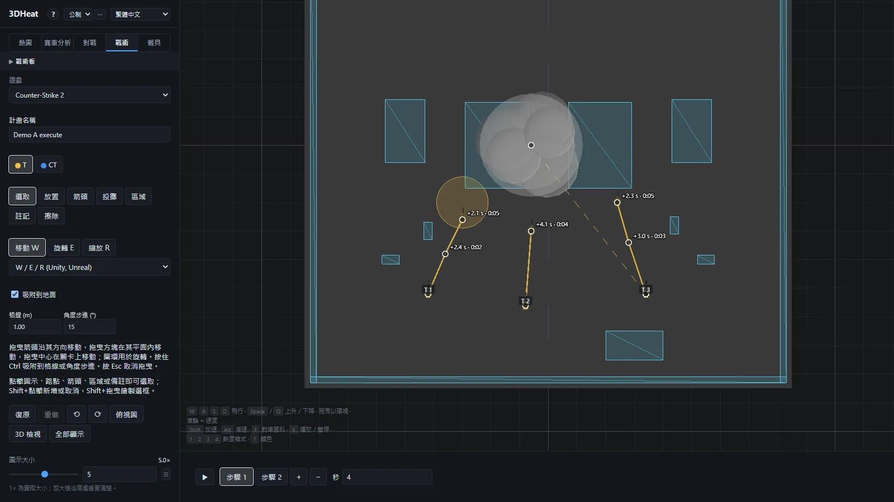

# 戰術板

**戰術** 分頁是一塊用來繪製團隊計畫的畫板：你在地圖上放置小小的圖示，用箭頭畫出它們要前往的方向，然後按下播放，觀看它的進行。用它在比賽前規劃一回合或一次進攻。它只與其他分頁共用畫布、攝影機與[關卡](levels.md)，此外別無其他；計畫不是資料，也不會繪製熱度。

## 你的第一個計畫 {#your-first-plan}

1. 開啟 **戰術** 分頁。選擇 **遊戲**（例如 Counter-Strike 2），若是 Valorant，則按下 **載入 Valorant 地圖**，然後選擇一個 **地圖**。或者先載入一個[關卡](levels.md)。
2. 選擇 **陣營**（它會決定顏色），然後按下 **俯視圖**。
3. 選擇 **地點**，在 **圖示** 中挑選一個圖示（可用 **搜尋圖示** 尋找），然後在地圖上點擊。放置兩到三個。
4. 選擇 **箭頭**，點擊一個圖示，沿著它應該前進的路線依序點擊，然後按下 **Enter** 結束箭頭。
5. 在視圖下方按下 **+** 以新增第二步。每個圖示都會從其箭頭結束之處開始。在那裡再畫更多箭頭。
6. 按下 **▶**（或 `K`），從所示的步驟播放計畫直到結束。
7. 在 **計畫名稱** 中為計畫命名，然後按下 **儲存**。

## 開始一個計畫 {#starting-a-plan}

| 控制項 | 作用 |
|---|---|
| **遊戲** | 選擇調色盤提供的陣營與圖示：Counter-Strike 2（T、CT；玩家與輔助道具）、Valorant（進攻、防守；玩家與通用技能）、Battlefield、Squad、Arma（步兵、地面載具、飛機、船隻）、DCS／War Thunder／IL-2（噴射機、螺旋槳飛機、直升機、防空、地面、艦船、武器），以及其他。已有圖示的計畫在更換遊戲時會保留其陣營。 |
| **計畫名稱** | 儲存計畫時使用的名稱。 |
| **地圖**、**載入 Valorant 地圖** | 選擇 Valorant 時：**載入 Valorant 地圖** 會從 [valorant-api.com](https://valorant-api.com) 取得地圖清單；**地圖** 隨後會把所選地圖的小地圖作為關卡放下，並從上方取景。圖片在被選取時才會下載，且從不隨檔案發布。畫面上顯示時，會同時顯示 Riot 的聲明（見下文）。 |
| **陣營** | 下一個圖示、箭頭或區域所屬的陣營；它會採用該陣營的顏色。 |

沒有關卡時，戰術板就是平坦的地面。若要在真實地圖上規劃，請在 **關卡** 下載入一個關卡：以 CS2 工具匯出的 CS2 地圖、關卡庫中的一個關卡，或一張地圖圖片。

## 工具 {#tools}

| 工具 | 點擊 | 說明 |
|---|---|---|
| **選取** | 點擊圖示、路點、箭頭、區域或註記即可選取它。 | Shift+點擊可新增或移除；Shift+拖曳可畫出一個方框，框住要加入的項目。被選取的項目會獲得一個變換操縱器（見下文）；`Delete` 或 `Backspace` 會將其刪除。`M` 會把被選取的圖示移到下一次點擊的位置。 |
| **地點** | 放下所選的圖示。 | 圖示在 **圖示** 調色盤中選取（可用 **搜尋圖示**）。沒有任何選取時，`R` 會在放置前把下一個圖示旋轉 15°（`Shift+R` 則為反向）。 |
| **箭頭** | 每次點擊新增一個點；Enter、雙擊或右鍵結束，Esc 則捨棄。 | **移動**、**進攻**（箭頭較寬）或 **監視**（眼睛高度的細線）。從某個圖示開始的箭頭，即是該圖示在此步驟中的路線：播放時，圖示會沿著它行走，而下一步會從它結束之處開始。 |
| **投擲** | 投擲者，然後是落點。 | 兩者之間會出現一條虛線弧，所選的輔助道具（煙霧、閃光、燃燒瓶等）會出現在落點，並從此步驟起一直保留。 |
| **區域** | 中心，然後是邊緣。 | 以陣營顏色繪製的圓盤。 |
| **註記** | 註記的位置；會要求輸入其文字。 | 以圖釘顯示，其文字顯示於其上。 |
| **擦除** | 圖示、箭頭、區域或註記。 | 從此步驟起將其移除；若在其第一步，則直接移除。 |

**復原** 與 **重做**（`Ctrl+Z`；`Ctrl+Y` 或 `Ctrl+Shift+Z`）會逐步經過每一項變更。計畫下方的一行會顯示它有多少圖示、箭頭與步驟。**俯視圖** 會直接朝下看（正交投影），**3D 檢視** 則回到透視投影，**影格** 會把視圖調整為計畫的範圍，計畫為空時則為關卡的範圍。

**圖示大小** 會縮放板上的每一個圖示；1× 為實際大小，從高處看，一個人只有幾個像素寬。

## 移動、旋轉與縮放 {#moving-turning-and-scaling}

板上的所有項目都能像在 3D 編輯器中一樣移動：圖示、輔助道具、標記、單一路點與整個箭頭、區域與註記。被選取的項目，其中心會出現一個操縱器：

| 模式 | 按鍵 | 把手 |
|---|---|---|
| **移動** | W（或 G） | 每個軸各一支箭頭（X 為紅色，Y 為綠色且朝上，Z 為藍色），沿該軸移動；一個方塊則在其平面內移動；中心則在指標下方的關卡上移動。 |
| **旋轉** | E（或 R） | 每個軸各一個圓環，繞該軸旋轉。單一圖示的圓環為其自身的偏航、俯仰與翻滾；一組項目則繞世界軸、以其中心旋轉。 |
| **縮放** | R（或 S） | 從選取項目的中心沿某軸或全方向擴散或收攏；區域的半徑隨之增大或縮小。 |

**按鍵** 可在 W / E / R（Unity、Unreal）與 G / R / S（Blender）之間切換；只有在有東西被選取時，按鍵才會選擇模式，否則它們會操控攝影機飛行。因此，在選取某物時，`R` 在 W / E / R 配置中為**縮放**，在 G / R / S 配置中為**旋轉**；沒有選取時，則會旋轉下一個要放置的圖示。戰術板所有的按鍵都列在[鍵盤參考](keyboard-reference.md#tactics-board)中。拖曳時按住 **Ctrl**，可將移動貼齊到**格線**（公尺），或將旋轉貼齊到**角度步進**。**吸附到地面**（預設開啟）會把移動的人員、載具、標記、路點與區域放到關卡表面；飛機與直升機保持其高度，沿 Y 軸箭頭的拖曳絕不會吸附。拖曳把手時絕不會移動攝影機。**Esc** 會取消拖曳，每一項變更都是一步復原。

路點會以圓點顯示在所示步驟的箭頭上：點擊可選取它，拖曳可移動它，按 Delete 可將其移除。**所選** 區段會以公尺顯示所選項目的位置、以度數顯示圖示的偏航、俯仰與翻滾，以及區域的半徑，每一項都可以直接輸入。

## 計時 {#timing}

圖示的路線會被計時：每一段的時間，是其長度（沿關卡量測，每隔幾公尺在表面上取樣，因此兩點之間的山丘或樓梯也會計入）除以該圖示在該遊戲中**移動方式**的速度，再加上在路點停留的任何**等待**時間。步兵可以爬行、蹲行、慢走（無聲）、跑步或衝刺；載具與船隻可以慢行、謹慎行駛、正常行駛或急速衝刺；飛機與直升機可以低速飛行、巡航、以戰鬥速度飛行或全速飛行。遊戲沒有的移動方式（CS2 沒有衝刺）會採用它最接近的一種。坡度如何減速，取決於遊戲：在 CS2 與 Valorant 中，只計算水平距離，與遊戲本身一致；軍事模擬類遊戲會讓步兵在上坡時減速（Tobler 的步行函數），載具則依坡度減速。

速度來自各遊戲的速度表及其來源（參閱[移動速度](tactics-speeds.md)）：CS2 依所持武器，取自遊戲的武器定義；Valorant 依武器；Battlefield、Squad、Arma 與空戰類遊戲依載具種類與等級。**移動方式** 會選取圖示的設定檔（一種武器、一種載具種類）；**自訂 (m/s)** 則會為該圖示覆寫任何模式。模式名稱與戰術板顯示的相同：*爬行*、*蹲行*、*慢走（無聲）*、*跑步*、*衝刺*；*謹慎*、*正常*、*急速*；*低速*、*巡航*、*戰鬥*、*最高速*。

每個路點會顯示其與上一個路點之間的時間，以及與計畫開始之後的時間（「+3.9 秒 · 0:12」）。被選取的圖示，其路線會列出每一段的模式、長度與時間、等待時間與抵達時間。**計時** 下的 **抵達** 會把每一個有路線的圖示放在同一條時間線上，最早抵達的排在最上方。啟用 **即時播放**（預設開啟）時，一步會持續到其最慢的路線抵達為止，而每個圖示都以自己的速度移動；此時 **秒** 為該步的最短長度。**每公尺關卡單位數** 說明關卡的單位：CS2 地圖為 39.37（遊戲單位），公尺制地圖為 1。

## 與對戰資料比較 {#compare-with-match-data}

**載入對戰檔案…** 會讀取該地圖的 CS2 對戰表格（CS2 工具產生的 Parquet 檔案，數量不限；只讀取所需的欄位，並在背景進行）；**使用已載入資料** 則會採用檢視器中已載入的資料。之後：

- **地圖上最早抵達** 會依玩家首次到達每個地點的時間（自回合開始起算）為地圖上色——**最快** 按鈕顯示所有回合中最快的，**典型（中位數）** 則顯示中位數的回合——早到為綠色，晚到為紅色，可選擇單一陣營或兩個陣營。它顯示在什麼時候什麼是可能的。
- 所選的路線會與玩家實際達成的結果比較：從其起點（或回合開始）到其終點，每個終點為一個指定半徑的圓盤：「觀察到的最快為 14.2 秒，p10 為 15.0 秒，中位數為 18.3 秒，共 41 次；你的計畫為 15.1 秒」。
- 玩家實際移動的速度——跑步、步行、蹲行，取自表格的步行與蹲下欄位——以 m/s 表示。

## 步驟 {#steps}

視圖下方的列放著各個步驟。計畫一開始只有一步；**+** 會新增一步，每個圖示都從其在上一步的路線結束之處開始；**−** 會移除目前所示的那一步。**秒** 是所示步驟播放時所需的時間。**▶**（K）會從所示步驟播放到結束：有路線的圖示會沿其行走，在下一步移到新地點的圖示會滑到該處，其餘則保持靜止。顯示某一步驟時，每個圖示在下一步的位置會以淡淡的虛影畫出，而上一步的箭頭則會淡淡地顯示在這一步的箭頭之下。

## 儲存 {#saving}

**檔案** 區段包含 **儲存**、**開啟** 與 **清除**。**儲存** 會把計畫寫成 `<name>.h3dplan.json`（純 JSON：陣營、步驟、每一步各有位置的圖示、箭頭、區域、註記）；**開啟** 則讀回一個計畫。其他版本的檔案，或不是計畫的檔案，會被拒絕並說明原因。**清除** 會清空計畫；復原可以將其帶回。

## 圖示 {#figures}

每個圖示都由檢視器自己建立：簡單的形狀，並依已發布的類型大小製作，帶有能與其鄰近圖示區分的特徵——坦克的路輪與砲塔、防空車輛的砲、飛彈與雷達，飛機的機翼平面、尾翼與引擎，直升機的旋翼與短翼。沒有任何東西取自遊戲。遊戲自創的設計，則以其等級的通用圖示顯示。資料如何找到其圖示，參閱[圖示](figures.md#which-figure-a-unit-gets)。

## Riot 的聲明 {#riots-notice}

Valorant 地圖依 Riot Games 的「Legal Jibber Jabber」政策顯示，該政策允許免費的社群專案使用它們，並要求在其出現之處附上此聲明：*3DHeat 依 Riot Games 的「Legal Jibber Jabber」政策，使用 Riot Games 擁有的素材製作。Riot Games 不認可或贊助此專案。* 板上的技能為通用形狀，而非 Riot 的美術作品。
