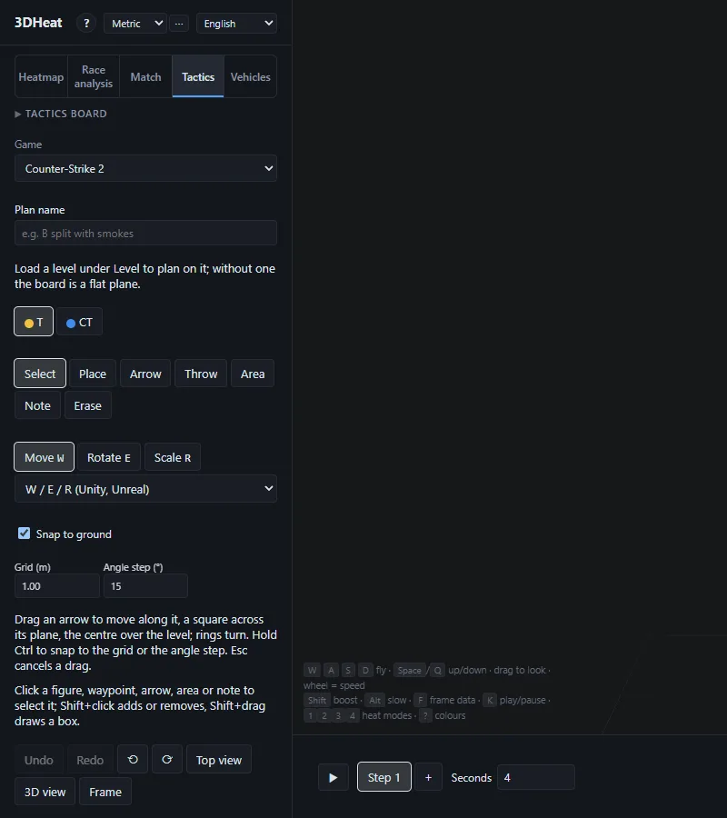

# 戰術板

**戰術**頁籤是團隊計畫的繪圖板：你在地圖上放置小型模型，畫出它們要前往的箭頭，然後按下播放，看它實際發生。用它在比賽前規劃一回合或一次進攻。它與其他頁籤只共用畫布、攝影機與[關卡](levels.md)，此外沒有其他共用；計畫不是資料，也不會繪製任何熱度。

## 你的第一個計畫 {#your-first-plan}

1. 開啟**戰術**頁籤。選擇**遊戲**（例如 Counter-Strike 2），若是 Valorant，則按**載入 Valorant 地圖**並選擇一張**地圖**。或者先載入一個[關卡](levels.md)。
2. 選擇一個**陣營**（它會決定顏色），然後按**俯視圖**。
3. 選擇**地點**，在**圖示**中挑選一個模型（使用**搜尋圖示**可以找到），然後點擊地圖。放置兩到三個。
4. 選擇**箭頭**，點擊某個模型，沿著它應該前往的路徑依序點擊，然後按 **Enter** 結束箭頭。
5. 按檢視下方的 **+** 新增第 2 步。每個模型都從其箭頭結束的位置開始。在那裡再畫更多箭頭。
6. 按 **▶**（或 `K`）從目前顯示的步驟播放計畫到結束。
7. 在**計畫名稱**中為計畫命名，然後按**儲存**。

## 建立計畫 {#starting-a-plan}

| 控制項 | 功能 |
|---|---|
| **遊戲** | 決定陣營與調色盤提供的模型：Counter-Strike 2（T、CT；玩家與道具）、Valorant（進攻、防守；玩家與通用技能）、Battlefield、Squad、Arma（步兵、地面載具、飛機、船隻）、DCS / War Thunder / IL-2（噴射機、螺旋槳飛機、直升機、防空、地面、艦艇、武器），以及其他。已有模型的計畫，在變更遊戲時會保留其陣營。 |
| **計畫名稱** | 儲存計畫時使用的名稱。 |
| **地圖**、**載入 Valorant 地圖** | 選取 Valorant 時：**載入 Valorant 地圖**會取得來自 [valorant-api.com](https://valorant-api.com) 的地圖清單；**地圖**接著會把所選地圖的小地圖鋪成關卡，並從俯視框住它。圖片在選取時才下載，絕不隨附。Riot 的聲明會在它顯示於畫面上時一併出現（見下文）。 |
| **陣營** | 下一個模型、箭頭或區域所屬的陣營；它會採用該陣營的顏色。 |

沒有關卡時，計畫板就是平坦的地面。若要在真實地圖上規劃，請在**關卡**下載入一個關卡：以 CS2 工具匯出的 CS2 地圖、關卡庫中的關卡，或地圖圖片。

## 工具 {#tools}

| 工具 | 點擊 | 說明 |
|---|---|---|
| **選取** | 點擊模型、路徑點、箭頭、區域或註記即可選取它。 | Shift+點擊可加入或移除；Shift+拖曳可框選要加入的內容。被選取的項目會出現變換操作器（見下文）；`Delete` 或 `Backspace` 可刪除。`M` 會把選取的模型移動到下一次點擊的位置。 |
| **地點** | 放下所選的模型。 | 模型在**圖示**調色盤中選取（可搭配**搜尋圖示**）。沒有選取任何東西時，`R` 會在放置前將下一個模型旋轉 15°（`Shift+R` 則相反方向）。 |
| **箭頭** | 每次點擊新增一個點；Enter、雙擊或右鍵結束，Esc 則捨棄。 | **移動**、**進攻**（較寬的箭頭）或**監視**（在眼睛高度的細線）。從模型上開始的箭頭，就是該模型在此步驟中的路線：播放時，模型會沿其行走，而下一步會從它的終點開始。 |
| **投擲** | 投擲者，然後是落點。 | 從一者到另一者的虛線弧，所選的道具（煙霧、閃光、燃燒瓶等）會出現在落點，並從此步驟起一直保留。 |
| **區域** | 中心，然後是邊緣。 | 以陣營顏色繪製的圓盤。 |
| **註記** | 註記放置的位置；會要求輸入文字。 | 以圖釘顯示，並在其上顯示文字。 |
| **擦除** | 模型、箭頭、區域或註記。 | 從此步驟起移除它；若在其第一個步驟，則直接移除。 |

**復原**與**重做**（`Ctrl+Z`；`Ctrl+Y` 或 `Ctrl+Shift+Z`）可逐步還原每次變更。計畫下方的一行會顯示它有多少模型、箭頭與步驟。**俯視圖**會垂直向下看（正交），**3D 檢視**會回到透視，**影格**會框住計畫；若計畫為空，則框住關卡。

**圖示大小**會縮放板上的每個模型；1× 為真實大小，從高空看來，一個人只有幾個像素。

## 移動、旋轉與縮放 {#moving-turning-and-scaling}

板上的所有東西都可以像 3D 編輯器一樣移動：模型、道具、標記、單一路徑點與整條箭頭、區域和註記。被選取的項目會在其中心出現操作器：

| 模式 | 按鍵 | 把手 |
|---|---|---|
| **移動** | W（或 G） | 每個軸各有一個箭頭（X 紅、Y 綠且向上、Z 藍），沿該軸移動；一個方塊會在其所在平面移動；中心會在指標下方的關卡表面上移動。 |
| **旋轉** | E（或 R） | 每個軸各有一個圓環，繞該軸轉動。單一模型的圓環為其自身的偏航、俯仰與翻滾；群組則繞其中心，依世界座標軸轉動。 |
| **縮放** | R（或 S） | 從選取範圍的中心，沿某一軸或各方向展開或收攏；區域的半徑也會隨之變化。 |

**按鍵**可在 W / E / R（Unity、Unreal）與 G / R / S（Blender）之間切換；只有在有東西被選取時，按鍵才會切換模式，否則會移動攝影機。因此，在選取了東西時，`R` 在 W / E / R 按鍵下是**縮放**，在 G / R / S 按鍵下是**旋轉**；沒有選取時，則會把下一個要放置的模型旋轉。所有戰術板按鍵都列在[鍵盤參考](keyboard-reference.md#tactics-board)中。拖曳時按住 **Ctrl**，可讓移動對齊到**格線**（公尺），或讓旋轉對齊到**角度步進**。**吸附到地面**（預設開啟）會把移動過的人員、車輛、標記、路徑點與區域放到關卡表面；飛機與直升機會保持其高度，沿 Y 箭頭拖曳時絕不吸附。拖曳把手時絕不會移動攝影機。**Esc** 會取消拖曳，且每次變更都是一個復原步驟。

路徑點會以點的形式顯示在目前步驟的箭頭上：點擊可選取，拖曳可移動，按 Delete 可移除。**已選取**區段會以公尺顯示選取項目的位置、以度數顯示模型的偏航、俯仰與翻滾，並顯示區域的半徑，每個數值都可以直接輸入。

## 計時 {#timing}

模型的路線是有時間的：每一段的時間等於其長度（在關卡上計算 - 每隔幾公尺在表面上取樣，因此兩點之間的山丘或樓梯也會計算在內）除以該模型在該遊戲中**移動方式**所對應的速度，再加上在路徑點的任何**等待**時間。步兵可爬行、蹲伏、走路（無聲）、跑步或衝刺；載具與船隻可爬行、謹慎前進、正常或快速衝刺；飛機與直升機可低速飛行、巡航、戰鬥速度或最大速度。若遊戲沒有某種模式（CS2 沒有衝刺），則採用最接近的一種。坡度如何減速取決於遊戲：在 CS2 與 Valorant 中，只計算水平距離，與遊戲本身一致；軍事模擬類遊戲則會讓步兵上坡減速（Tobler 步行函數），並依坡度讓載具減速。

速度來自各遊戲的速度表，並附上來源（請參閱[移動速度](tactics-speeds.md)）：CS2 依所持武器，來自遊戲的武器定義；Valorant 依武器；Battlefield、Squad、Arma 與空戰類遊戲依載具類型與類別。**移動方式**會為模型選取一種設定檔（武器、載具類型）；**自訂 (m/s)**則會為該模型覆寫任何模式。模式名稱與板上顯示的一致：*爬行*、*蹲伏*、*走路（無聲）*、*跑步*、*衝刺*；*謹慎*、*正常*、*快速*；*低速*、*巡航*、*戰鬥*、*最大*。

每個路徑點都會顯示距上一個路徑點的時間，以及距計畫開始的時間（「+3.9 s · 0:12」）。被選取模型的路線會列出每一段的模式、長度與時間、等待與抵達時間。**計時**下的**抵達**會把每個有路線的模型放在同一條時間線上，最早抵達的在最上方。開啟**依真實時間播放**（預設開啟）時，一個步驟會持續到其最慢的路線抵達為止，每個模型以自己的速度移動；此時**秒**即為該步驟最短的長度。**每公尺關卡單位數**說明關卡使用的單位：CS2 地圖為 39.37（遊戲單位），公尺制地圖為 1。

## 與比賽資料比較 {#compare-with-match-data}

**載入比賽檔案…**會讀取該地圖的 CS2 比賽表（CS2 工具輸出的 Parquet 檔案，數量不限；只讀取所需的欄位，並在背景進行）；**使用已載入資料**則會採用檢視器中已載入的資料。之後：

- **地圖上最早抵達**會依玩家首次到達每個位置時，距回合開始的時間來為地圖上色：按鈕**最快**顯示所有回合中最快的時間，**典型（中位數）**顯示中位數回合，綠色表示早、紅色表示晚，可選擇一方或雙方。它顯示什麼是可能的，以及何時可能。
- 所選路線會與玩家從其起點（或回合開始）到其終點實際達成的時間比較，每個終點都是設定半徑的圓盤：「最快觀察為 14.2 s，p10 為 15.0 s，中位數為 18.3 s，共 41 次；你的計畫為 15.1 s」。
- 玩家實際移動的速度（跑步、走路、蹲伏，取自資料表的走路與蹲下欄位），單位為 m/s。

## 步驟 {#steps}

檢視下方的列包含各個步驟。計畫一開始會有一個步驟；**+** 會新增一個，每個模型都會從上一步驟中其路線的終點開始；**−** 會移除目前顯示的步驟。**秒**是播放時顯示的步驟所需時長。**▶**（K）會從目前顯示的步驟播放到結束：有路線的模型會沿路線行走，在下一步驟被移到新位置的模型會滑到那裡，其餘的則保持靜止。在顯示某一步驟時，每個模型在下一步驟中的位置會以淡色幽靈顯示，而上一步驟的箭頭會淡淡地疊在本步驟下方。

## 儲存 {#saving}

**檔案**區段包含**儲存**、**開啟**與**清除**。**儲存**會把計畫寫成 `<name>.h3dplan.json`（純 JSON：陣營、步驟、每個步驟中每個模型的位置、箭頭、區域、註記）；**開啟**則會讀回計畫。其他版本的檔案，或不是計畫的檔案，會被拒絕並附上原因。**清除**會清空計畫；按復原即可還原。

## 模型 {#figures}

每個模型都由檢視器自己建構：依類型的公開尺寸製作簡單的形狀，並加上能與其鄰近模型區分的特徵：戰車的負重輪與砲塔、火砲、防空車輛的飛彈與雷達、飛機的翼面、尾翼與引擎、直升機的旋翼與短翼。沒有任何東西取自遊戲。若某個設計是遊戲自創的，則會顯示為其類別的通用模型。資料如何找到模型，請參閱[模型](figures.md#which-figure-a-unit-gets)。

## Riot 的聲明 {#riots-notice}

Valorant 地圖依 Riot Games 的「Legal Jibber Jabber」政策顯示，該政策允許免費的社群專案使用它們，並要求在其出現的任何地方附上此聲明。聲明原文如下（保持英文，以符合政策要求）：*3DHeat was created under Riot Games' "Legal Jibber Jabber" policy using assets owned by Riot Games. Riot Games does not endorse or sponsor this project.* 板上的技能是通用形狀，並非 Riot 的美術作品。
