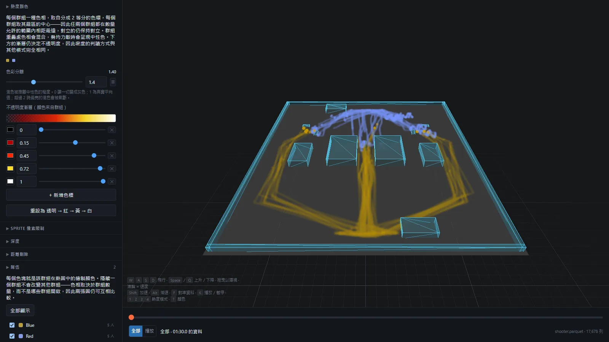

# 隊伍熱度

隊伍熱度會顯示每支隊伍曾經在哪裡，每支隊伍各用自己的顏色。隊伍重疊的地方，顏色會混合。

**隊伍熱度**（按鍵 3）是 [熱度](heat.md) 的密度場，並為每個[群組](glossary.md)指定各自的色相。群組重疊時，色相會混合；勢均力敵的地方會呈現中性色。不透明度仍然與其他模式一樣承載密度，因此畫面可以同時回答*有多少*與*是誰的*。此模式需要群組欄位。

它不是[模型疊加](box-replay.md)：後者為每個人畫一個模型；此模式則是以同一欄位上色的熱度場。

## 使用方法 {#how-to-use-it}

1. 按 `3`（或在模式列中選取**隊伍熱度**）。
2. 開啟**熱度顏色**。色票會顯示每個群組的顏色；將滑鼠移到色票上可看到隊伍名稱。
3. 如果一切看起來都是灰色的，請提高**色彩分離**。
4. 在[隊伍清單](teams-list.md)中取消勾選某個群組即可將其移除；其他顏色會維持原位。

## 控制項 {#controls}

在**熱度顏色**區段中：

| 控制項 | 預設值 | 意義 |
|---|---|---|
| 色票 | | 每個群組的顏色，最多顯示前 12 個群組，其後為 *+N 個更多*。將滑鼠移上去可看到群組名稱與顏色。 |
| **色彩分離** | 1.4 | 混合色被推離中性色的距離，範圍 0-4。0 會讓所有顏色都變成灰色；1 為真正的平均值；超過約 2 時，最亮的混合色會超出可顯示的範圍，並逐通道被截斷，因而改變其色相。 |
| **不透明度漸層（顏色來自群組）** | 預設熱度漸層 | 此處只使用漸層的 **alpha**：沒有東西的地方透明，頂端不透明。其顏色會被忽略。 |

其他所有熱度控制項（形狀、飽和度、響應、最低熱度、深度、剔除）的運作方式都與[熱度](heat.md)相同。

在此模式中，[隊伍清單](teams-list.md)會以每個群組的隊伍熱度顏色作為其色票。隱藏某個群組不會改變其他群組的顏色：色相取決於群組的總數，而不是目前開啟了哪些群組，因此兩張圖片仍可相互比較。

## 色盤 {#the-palette}

來自 [`colors.ts`](https://github.com/Holdi601/3DHeat/blob/main/src/render/colors.ts)：

- 顏色位於 **Oklab** 色彩平面上，明度（0.7）與彩度（0.115）固定，因此每個群組的亮度相同，紅色群組不會看起來比藍色群組更熱。
- 若有 *n* 個群組，色相環會被分成 *n* 等份，群組 *i* 取其所在區段的**中心**，即 `(i + 0.5) / n` 圈。任意兩個群組之間的距離都盡可能遠，且無論數量多少，相對的色相仍然相對。
- 最多使用 **16** 種不同的色相。群組更多時，id 會以反覆二分的方式安排（位元反轉 id：0、½、¼、¾、⅛、…），使相鄰的 id 不會共用同一色相；超過 16 個的群組必然會共用色相。
- 標籤意思為「沒有群組」的群組（不分大小寫的 `0`、空白、`none`、`unknown`、`null` 或 `-1`）會被繪製為**中性灰**，而不是佔用色相環的一段。群組清單中只有第一個這類標籤會以此方式處理。

預設分離值為 1.4 而非 1，是因為在 1 時，五個均勻分布的色相混合*確實*會是灰色：正確，但無法辨識。略高於 1 的值可保留平手的誠實性，同時讓 60/40 的分割看得見。

## 運作方式 {#how-it-works}

在此模式中，熱度目標有四個通道。每個 Sprite 會把其密度 *v* 加到第一個通道，並把 *v* × 群組的 Oklab *a* 與 *b* 座標分別加到第二與第三個通道。合成時，像素的混合色為密度加權平均：*a* = G / R，*b* = B / R，依色彩分離值縮放，並在色盤的明度下轉換為 sRGB。除以累積密度可讓色相不受資料量影響，這也是為什麼所有密度控制項仍只作用於不透明度。

在相同解析度下，四通道目標所需的 GPU 記憶體是單通道熱度目標的四倍。
