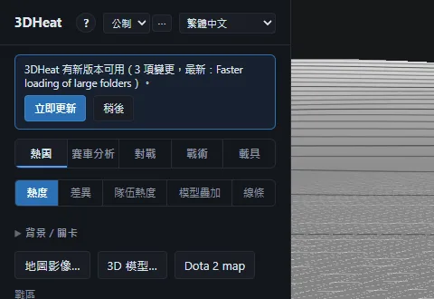

# 更新

檢視器會在有較新版本時告訴你，並且只有在你同意時才會自行更新。你的答覆之前，你的電腦上不會有任何東西被變更。

## 更新檢視器 {#update-the-viewer}

1. **在頁面中。** 當有較新的版本時，側欄頂端名稱下方會出現一個方框：「3DHeat 有較新的版本可用」。點擊 **立即更新**。完成後頁面會自行重新載入。**稍後** 會隱藏此方框，直到你重新載入頁面為止。
2. **若它要求執行 restart.bat**，請關閉伺服器視窗（由 `start.bat` 開啟的黑色視窗），然後連按兩下 `restart.bat`。
3. **當你啟動檢視器時。** `start.bat` 也會檢查。若有較新的版本，它會詢問 **Update now? [Y/N]**。按 `Y` 即更新。按 `N`，或等待 60 秒不作答，則以你目前的版本啟動。



對於你自己有修改的副本，絕不會替你自動更新；此方框只會告訴你有更新在等待，並建議你提交或暫存（stash）你的變更，然後執行 `git pull`。非 git 安裝的副本（例如 zip 檔），則不會顯示任何東西。

檢查的運作步驟如下：

```
page ---(after 4 s, then every 6 h)---> dev server ---> git fetch
   behind?  no  -> nothing is shown
            yes -> your own changes or commits?  yes -> tell you only
                                                 no  -> [Update now] -> git pull
                                                        -> reload, or "run restart.bat"
```

## 安全規則 {#the-safety-rules}

- **只允許快進（Fast-forward only）**（`git pull --ff-only`）：更新永遠不會合併、變基或改寫任何東西。
- **沒有本機變更**：若副本中對已追蹤檔案有未提交的變更（`git status --porcelain --untracked-files=no` 的結果不為空），則永遠不會自動更新——他人的工作不應被更新覆寫。它只會被告知有更新在等待。未追蹤的檔案（資料、匯出檔）不算變更。
- **沒有本機提交**：若副本含有上游沒有的提交（「分岔」），則不會更新——快進無法把它帶上去，而合併應由你手動以 `git pull` 處理。頁面與 `start.bat` 都會以相同的文字說明這一點，而 `start.bat` 會以目前的版本啟動。
- **只能從頁面本身**：開發伺服器的更新請求必須帶有自訂標頭；若瀏覽器送出 `Origin`，則必須來自伺服器自己的主機（見下文）。
- 只有具有上游分支的 git 副本才會被更新；其他任何情況（沒有 `.git` 的副本、未安裝 git、靜態建置）都會被保持原狀，且不說任何話。

## start.bat 的作用 {#what-startbat-does}

`start.bat`（連按兩下；該視窗即為伺服器）依序執行以下工作：

1. 尋找 Node.js——在 `PATH` 上，或在 `%ProgramFiles%\nodejs`、`%ProgramFiles(x86)%\nodejs` 或 `%LOCALAPPDATA%\Programs\nodejs` 中——若缺少，則提議以 `winget install -e --id OpenJS.NodeJS.LTS` 安裝（會詢問 Y/N；之後必須重新開啟視窗，Windows 才會讀取新的 `PATH`）。
2. **更新**，當已安裝 git 且資料夾中有 `.git` 時：
   - `git fetch --quiet`（沒有網路或沒有上游：會靜默略過）；
   - 計算 `git rev-list --count HEAD..@{u}`；若落後為零：不說任何話；
   - 有本機變更：「3DHeat 有較新的版本可用（N 項變更），但此副本有本機變更，因此不會更新。請提交或暫存它們，然後執行 git pull。」——並以目前的版本啟動；
   - 有自己的提交（`git rev-list --count @{u}..HEAD` 不為 0）：「3DHeat 有較新的版本可用（N 項變更），但此副本有最新版本沒有的自有提交，因此不會更新。請以 git pull 更新。」——並以目前的版本啟動；
   - 其他情況：「3DHeat 有較新的版本可用（N 項變更）。」並提出 **Update now? [Y/N]** 的問題。`N`，或 60 秒內沒有答覆，會印出「Not updated; starting the version you have.」並以目前的版本啟動。若選 `Y`：印出「Updating...」，註明 `package.json` 或 `package-lock.json` 是否有變更，執行 `git pull --ff-only`（若仍失敗——例如網路問題——則印出「The update did not go through; starting the version you have.」），接著執行 `git submodule update --init`（固定版本的工具，參閱[維護文件](maintaining.md#the-tools-under-exporters)），若套件檔案有變更且 `node_modules` 存在，則執行 `npm install`，最後印出「Updated.」。
3. 拒絕啟動第二個伺服器：若連接埠 **5273** 已有程式在監聽，它會說明並指向 `restart.bat` / `stop.bat`。
4. 首次執行時（沒有 `node_modules`），會在下載相依套件前詢問（約 300 MB，放在 `node_modules\` 中，不會影響系統層級）。
5. 在 `127.0.0.1:5273` 啟動開發伺服器（`--strictPort`），並在就緒時開啟瀏覽器。

`restart.bat` 會停止伺服器（依連接埠），然後再次執行 `start.bat`，因此它會問同樣的問題。`stop.bat` 只會停止伺服器。


## 給開發者 {#for-developers}

### 執行中：更新路由 {#while-it-runs-the-update-route}

開發伺服器（位於 `vite.config.ts` 中的 Vite 外掛 `heat3d-self-update`）提供 `/__heat3d/update`。它只存在於開發伺服器上——不在靜態建置中，也不在 `vite preview` 中。

**`GET /__heat3d/update`** 回答副本是否落後：

```json
{ "checkout": true, "upstream": "origin/main", "behind": 3, "ahead": 0, "dirty": false, "latest": "the newest commit's subject" }
```

- 若資料夾不是 git 副本，則為 `checkout: false`；
- 它**最多每 30 分鐘**執行一次 `git fetch --quiet`（期間的請求會以上次抓取的結果回答）；
- `behind` / `ahead` 來自 `git rev-list --count HEAD..@{u}` / `@{u}..HEAD`，`dirty` 來自 `git status --porcelain --untracked-files=no`，`latest` 為上游最新提交的主旨；
- 若沒有上游分支，則為 `upstream: null` 且 `behind: 0`。

**`POST /__heat3d/update/apply`** 會把副本更新到最新：

1. 除非請求帶有標頭 `X-Heat3d-Update: 1`，且（若帶有 `Origin`）該來源的主機與請求的 `Host` 相同，否則以 `403 { ok: false, reason: "forbidden" }` 拒絕。跨站表單若沒有 CORS 預檢，無法送出自訂標頭，而此伺服器從不授予 CORS。
2. 無事可做（不是副本、沒有上游、未落後）：`{ ok: true, updated: false }`。
3. 有本機變更：`{ ok: false, reason: "dirty" }`；有本機提交：`{ ok: false, reason: "diverged" }`。
4. 否則：列出將會變更的檔案（`git diff --name-only HEAD @{u}`），執行 `git pull --ff-only`（逾時 2 分鐘），`git submodule update --init`（失敗會被忽略），當 `package.json` 或 `package-lock.json` 有變更時執行 `npm install`（逾時 15 分鐘），並回覆 `{ ok: true, updated: true, restart }`——`restart` 說明為何執行中的伺服器無法套用此更新：相依套件被重新安裝時為 `"dependencies"`，只有 `vite.config` 檔案變更時為 `"config"`，不需要重新啟動時為 `false`。
5. 失敗的 git 或 npm 指令會回覆 `{ ok: false, reason: "<錯誤內容，最多 300 個字元>" }`。

回應為 JSON，並帶有 `Cache-Control: no-store`。伺服器只在 `127.0.0.1` 上監聽，因此此路由無法從網路存取。

### 頁面中的通知 {#the-notice-in-the-page}

`UpdateBanner`，位於側欄頂端名稱之下：

- 頁面載入後 **4 秒**向路由詢問（不在最初幾秒內：頁面還要載入資料集並啟動 GPU），之後頁面保持開啟時，**每 6 小時**再詢問一次。
- 若沒有此路由（靜態建置）、資料夾不是副本，或沒有任何較新的內容，則**不顯示任何東西**——每次啟動都出現的通知，只會讓人學會忽略它。
- 落後，且沒有本機變更：「3DHeat 有較新的版本可用（N 項變更，最新：<主旨>）。」並附上 **立即更新** 與 **稍後**（*稍後* 會隱藏它，直到頁面重新載入為止）。
- 落後，且有本機變更：同樣的句子，加上「此副本有本機變更，因此不會自動更新；請提交或暫存它們，然後執行 git pull。」——沒有按鈕。
- 按下 **立即更新** 會送往 `/apply`（顯示「正在更新...」）。之後：
  - 「已更新。頁面將重新載入。」——並於 1.5 秒後重新載入（伺服器已在提供新的檔案）；
  - 若相依套件已被重新安裝：「已更新。其相依套件有變更：請關閉伺服器視窗，並執行 **restart.bat** 以完成。」；
  - 若只有伺服器的設定有變更：「已更新。其伺服器設定有變更：請關閉伺服器視窗，並執行 **restart.bat** 以完成。」；
  - 最後其實沒有需要帶入的內容（`updated: false`——例如 `start.bat` 已在此期間完成更新）：「沒有需要更新的內容：此副本已是最新版本。」——且不重新載入；
  - 被拒絕：*dirty* 的句子，或「此副本有最新版本沒有的自有提交；請以 git pull 更新。」，或「更新未成功：<原因>」。
