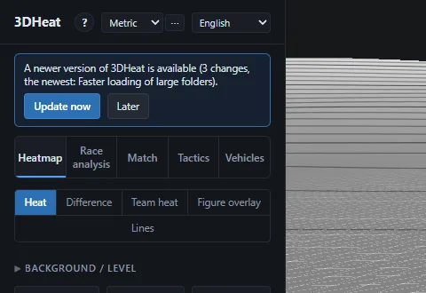

# 更新

檢視器會在有較新版本時告訴你，而且只有在你同意時才會自行更新。沒有你的同意，你的電腦上不會有任何東西被變更。

## 更新檢視器 {#update-the-viewer}

1. **在頁面中。** 有較新版本時，側邊欄頂端的名稱下方會出現一個方塊：「3DHeat 有較新的版本可用」。點擊**立即更新**。完成後頁面會自行重新載入。**稍後**會隱藏此方塊，直到你重新載入頁面為止。
2. **若它要求你執行 restart.bat**，請關閉伺服器視窗（由 `start.bat` 開啟的黑色視窗），然後連按兩下 `restart.bat`。
3. **啟動檢視器時。** `start.bat` 也會檢查。若有較新版本，它會詢問 **Update now? [Y/N]**（立即更新？[Y/N]）。按 `Y` 即可更新。按 `N`，或等待 60 秒不作回答，則會啟動你目前擁有的版本。



有你自己修改內容的副本絕不會替你自動更新；方塊只會告訴你有更新在等待，並說明要提交或暫存你的變更，然後執行 `git pull`。不是透過 git 安裝的副本（例如 zip 檔案）則不會顯示任何內容。

檢查運作的步驟如下：

```
page ---(after 4 s, then every 6 h)---> dev server ---> git fetch
   behind?  no  -> nothing is shown
            yes -> your own changes or commits?  yes -> tell you only
                                                 no  -> [Update now] -> git pull
                                                        -> reload, or "run restart.bat"
```

## 安全規則 {#the-safety-rules}

- **只允許快轉**（`git pull --ff-only`）：更新絕不會合併、重新基底或改寫任何東西。
- **沒有本機變更**：若簽出版本中，已追蹤檔案有未提交的變更（`git status --porcelain --untracked-files=no` 的結果不是空的），則絕不會自動更新 - 他人的工作不應被更新覆寫。它只會被告知有更新在等待。未追蹤的檔案（資料、匯出）不算變更。
- **沒有本機提交**：若簽出版本包含上游沒有的提交（「已分岔」），則不會更新 - 快轉無法使其更新，而合併應由你手動執行 `git pull`。頁面與 `start.bat` 都會以相同的文字說明此情況，而 `start.bat` 會啟動目前所在的版本。
- **只接受來自頁面本身的請求**：開發伺服器的更新請求必須帶有自訂標頭，且當瀏覽器送出 `Origin` 時，必須來自伺服器自己的主機（見下文）。
- 只有具有上游分支的 git 簽出版本才會被更新；其他任何情況（沒有 `.git` 的副本、未安裝 git、靜態建置）都會保持不變，且不會有任何訊息。

## start.bat 做了什麼 {#what-startbat-does}

`start.bat`（連按兩下即可；該視窗就是伺服器）依序執行：

1. 尋找 Node.js - 在 `PATH` 中，否則在 `%ProgramFiles%\nodejs`、`%ProgramFiles(x86)%\nodejs` 或 `%LOCALAPPDATA%\Programs\nodejs` 中尋找 - 若找不到，會提議以 `winget install -e --id OpenJS.NodeJS.LTS` 安裝（會詢問，Y/N；之後必須重新開啟視窗，Windows 才會讀取新的 `PATH`）。
2. **更新**，前提是已安裝 git 且資料夾中有 `.git`：
   - `git fetch --quiet`（無網路或沒有上游時會靜默略過）；
   - 計算 `git rev-list --count HEAD..@{u}`；若沒有落後，則不顯示任何訊息；
   - 有本機變更：「3DHeat 有較新的版本可用（N 項變更），但此副本有本機變更，因此不會更新。請提交或暫存後，再執行 git pull。」- 然後啟動目前所在的版本；
   - 有自己的提交（`git rev-list --count @{u}..HEAD` 不為 0）：「3DHeat 有較新的版本可用（N 項變更），但此副本有最新版本沒有的自身提交，因此不會更新。請使用 git pull 更新。」- 然後啟動目前所在的版本；
   - 其他情況：「3DHeat 有較新的版本可用（N 項變更）。」並詢問 **Update now? [Y/N]**。按 `N`，或 60 秒內沒有回答，會印出「未更新；正在啟動你目前擁有的版本。」並啟動目前所在的版本。按 `Y` 時：會印出「正在更新...」，說明 `package.json` 或 `package-lock.json` 是否會變更，執行 `git pull --ff-only`（若仍然失敗，例如網路問題：「更新未完成；正在啟動你目前擁有的版本。」），接著執行 `git submodule update --init`（已釘選的工具，見[維護文件](maintaining.md#the-tools-under-exporters)），若套件檔案有變更且 `node_modules` 存在，則執行 `npm install`，最後印出「已更新。」。
3. 拒絕啟動第二個伺服器：若連接埠 **5273** 已有程式在監聽，它會說明並指向 `restart.bat` / `stop.bat`。
4. 第一次執行時（沒有 `node_modules`），會先詢問是否下載相依套件（約 300 MB，安裝到 `node_modules\`，不會安裝到系統層級）。
5. 在 `127.0.0.1:5273` 啟動開發伺服器（`--strictPort`），並在準備就緒後開啟瀏覽器。

`restart.bat` 會（依連接埠）停止伺服器，然後再次執行 `start.bat`，因此它會詢問相同的問題。`stop.bat` 只會停止伺服器。

## 給開發者 {#for-developers}

### 執行期間：更新路由 {#while-it-runs-the-update-route}

The dev server (Vite plugin `heat3d-self-update` in `vite.config.ts`) serves
`/__heat3d/update`. It exists only on the dev server - not in a static build
and not in `vite preview`.

**`GET /__heat3d/update`** answers whether the checkout is behind:

```json
{ "checkout": true, "upstream": "origin/main", "behind": 3, "ahead": 0, "dirty": false, "latest": "the newest commit's subject" }
```

- `checkout: false` when the folder is not a git checkout;
- it runs `git fetch --quiet` **at most every 30 minutes** (asks in between
  answer from what was last fetched);
- `behind` / `ahead` from `git rev-list --count HEAD..@{u}` / `@{u}..HEAD`,
  `dirty` from `git status --porcelain --untracked-files=no`, `latest` the
  subject of the upstream's newest commit;
- with no upstream branch, `upstream: null` and `behind: 0`.

**`POST /__heat3d/update/apply`** brings the checkout up:

1. Refused with `403 { ok: false, reason: "forbidden" }` unless the request has
   the header `X-Heat3d-Update: 1` and, when it carries an `Origin`, that
   origin's host is the request's `Host`. A cross-site form cannot send a
   custom header without a CORS preflight, which this server never grants.
2. Nothing to do (not a checkout, no upstream, not behind):
   `{ ok: true, updated: false }`.
3. Local changes: `{ ok: false, reason: "dirty" }`; local commits:
   `{ ok: false, reason: "diverged" }`.
4. Otherwise: notes the files that change (`git diff --name-only HEAD @{u}`),
   `git pull --ff-only` (2 min timeout), `git submodule update --init`
   (failure ignored), `npm install` when `package.json` or
   `package-lock.json` changed (15 min timeout), and answers
   `{ ok: true, updated: true, restart }` - `restart` says why the running
   server cannot pick the update up: `"dependencies"` when they were
   reinstalled, `"config"` when only a `vite.config` file changed, `false`
   when nothing needs a restart.
5. A failing git or npm command answers `{ ok: false, reason: "<the error,
   up to 300 characters>" }`.

Responses are JSON with `Cache-Control: no-store`. The server listens on
`127.0.0.1` only, so the route is not reachable from the network.

### 頁面中的通知 {#the-notice-in-the-page}

`UpdateBanner`, under the name at the top of the sidebar:

- It asks the route **4 seconds** after the page loads (not in the first
  seconds: the page has a dataset to load and a GPU to start) and again
  **every 6 hours** while the page stays open.
- It shows **nothing** when there is no such route (a static build), the
  folder is not a checkout, or nothing is newer - a notice on every start is
  one people learn to ignore.
- Behind, with no local changes: "A newer version of 3DHeat is available (N
  changes, the newest: <subject>)." with **Update now** and **Later**
  (*Later* hides it until the page is reloaded).
- Behind, with local changes: the same sentence and "This copy has local
  changes, so it is not updated automatically; commit or stash them, then
  run git pull." - no button.
- **Update now** posts to `/apply` ("Updating..."). Then:
  - "Updated. The page reloads." - and it reloads 1.5 s later (the server
    already serves the new files);
  - when the dependencies were reinstalled: "Updated. Its dependencies
    changed: close the server window and run **restart.bat** to finish.";
  - when only the server's settings changed: "Updated. Its server settings
    changed: close the server window and run **restart.bat** to finish.";
  - nothing to bring in after all (`updated: false` - the copy was brought up
    meanwhile, by `start.bat` say): "Nothing to update: this copy is already
    the newest version." - and no reload;
  - refused: the *dirty* sentence, or "This copy has commits of its own that
    the newest version does not; update it with git pull.", or "The update
    did not go through: <reason>".
