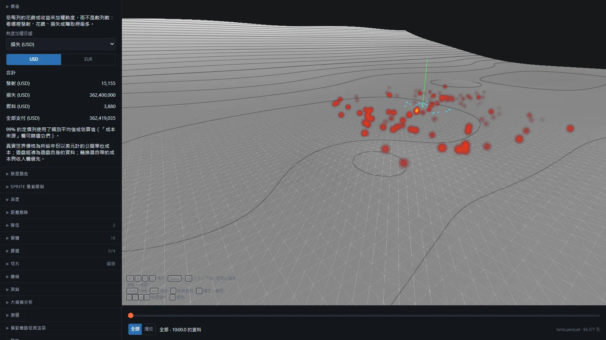

# 數值加權

每一發射擊、每一枚彈藥、每一輛損失的車輛、每一公升燃油都有價格。檢視器會算出每一列的成本或獲得，並可依此為熱度加權，讓地圖顯示**錢花在哪裡**，而不是資料列在哪裡。

## 使用方式 {#how-to-use-it}

1. 載入帶有事件（射擊、擊殺、死亡）以及車輛或武器名稱的資料。
2. 打開熱度側邊欄中的 **數值**。
3. 選擇 **熱度加權依據**，例如 *損失（USD）*。熱度現在會加上每一列的價格，而不是 1。
4. 查看 **合計**：所顯示內容中每個數值欄位的總和（套用過濾器與時間視窗）。
5. 若價格是真實世界的金額，會出現 **USD / EUR** 切換。

選擇選單中空白的第一項，即可恢復為計算列數。

## 可以加權的內容 {#what-can-be-weighed}

數值欄位會在載入時依每一種類別與貨幣加入：

| 類別 | 落在哪些列 | 如何定價 |
|---|---|---|
| **發射** | 射擊與發射 | 該武器，否則取該類彈藥的平均值 |
| **花費** | 購買、重生 | 遊戲的金錢欄位（例如射手遊戲的購買選單） |
| **損失** | 死亡、被摧毀 | 自己的車輛，否則取其類別的平均值 |
| **被摧毀** | 擊殺 | 目標車輛 |
| **造成傷害** | 命中 | 目標價值的一部分 |
| **燃油** | 位置 | 所用燃油，取自燃油欄位，或依類別與時間估算 |
| **全部支付** | | 發射 + 花費 + 損失 + 燃油 |
| **獲得** | 獎勵 | 遊戲自己的獎勵欄位（`earn_…`） |
| **淨額** | | 獲得減去支付；以有正負號的熱度繪製（獲得較多處為正漸層，支付較多處為負） |

欄位名稱為 `cost_<類別>_<貨幣>`、`earn_<貨幣>` 與 `net_<貨幣>`。若轉換器知道遊戲自己的貨幣（例如寫入遊戲內點數的重播轉換器），則它會優先於內建的價格表。

## 價格表 {#the-price-tables}

| 表 | 貨幣 |
|---|---|
| 真實世界的軍事：飛彈、炸彈、彈藥、干擾裝置、飛機、直升機、地面車輛、船隻、燃油 | USD（EUR = USD × 0.92，即 [`cost.ts`](https://github.com/Holdi601/3DHeat/blob/main/src/data/cost.ts) 中固定的 `EUR_PER_USD`；這不是即時匯率） |
| 射手遊戲的購買選單與擊殺獎勵 | 遊戲的點數 |
| 坦克與船隻遊戲 | 遊戲的點數 |
| 策略遊戲（多種資源） | 每種資源一個欄位，另加一個合計欄位 |
| 戰爭遊戲 | 分數 |

遊戲是從資料中的名稱辨識出來的。真實世界的價格來自公開來源（預算文件、百科全書），或標示為估計值；它們沒有經過通貨膨脹調整。產生的表格清單見[數值表](ref-value-tables.md)。

## 估計值 {#estimates}

額外的類別欄位 **成本來源** 會說明每一列是如何定價的：`table`（表格）、`class average`（類別平均）、`estimate`（估計）或 `none`（無）。數值區段會顯示有多少比例的已定價列是平均值或估計值。若只想保留精確定價的列，請在 [過濾器](filters.md) 中，於 **成本來源** 下取消勾選 *estimate* 與 *class average*。

## 數值還會顯示在哪裡 {#where-else-value-shows}

- [洞察](insights.md)：*昂貴的地面* 與 *獲利的地面* 的發現。
- [拆解](breakdown.md)：依隊伍、玩家或武器顯示獲得、損失與淨額金錢。
- [體積](volumes.md)：統計與比較中的數值欄位。
