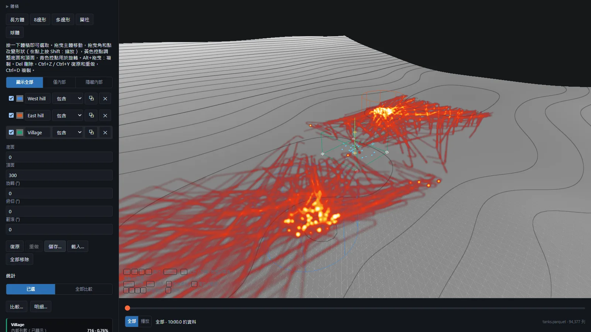
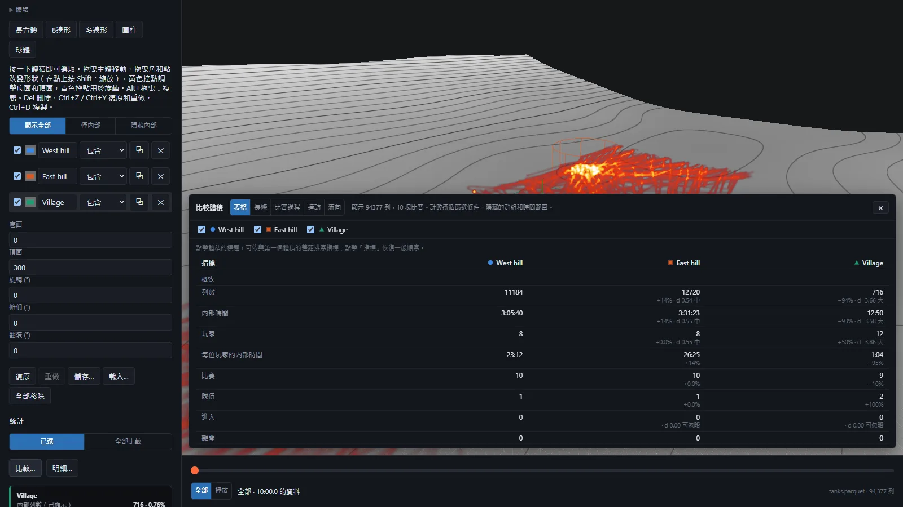
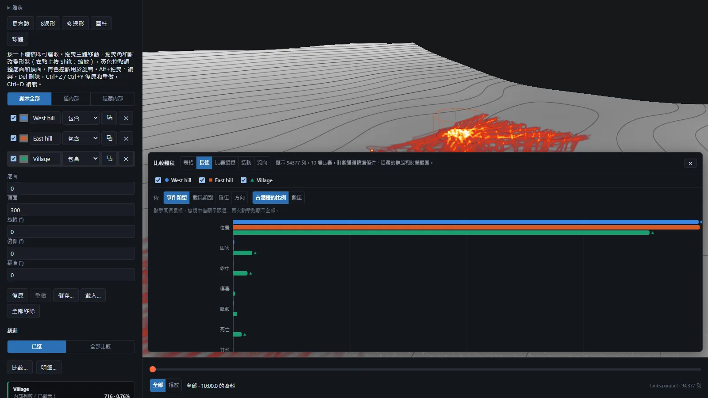

# 體積與比較

**體積**是你畫在某個地點周圍的隱形方塊（或圓柱、球體），用來詢問：這裡面發生了什麼事？可以用它來計算在某座橋上的擊殺數、比較兩座山丘，或只顯示某一區域的活動。

```
 top view                 You draw a shape ->  the viewer counts
 +------------+           what is inside:
 |   ( A )    |            rows, players, kills, time ...
 |        [B] |           Compare A with B, side by side.
 +------------+
```



體積可以測量其中發生的事情、把畫面篩選為只顯示其中的內容、匯出其中的列，並可並排比較。列、人員與比賽的說明也請參閱[詞彙表](glossary.md)。

## 繪製體積 {#draw-a-volume}

1. 在側邊欄中開啟**體積**。
2. 選擇工具，然後在 3D 檢視或 2D 地圖上繪製。地板與天花板會從其下方的資料開始。按 Esc 可取消。
3. 點擊體積即可選取它；其**統計**會出現。

| 工具 | 繪製方式 |
|---|---|
| **長方體** | 拖曳出矩形（按住 Shift：正方形）。單擊會放置預設的方塊。 |
| **n 邊形** | 從中心拖曳（按住 Shift 可保持正多邊形）。*角數*可設定 n，範圍 3 到 64（預設 8，因此按鈕顯示 **8-gon**）。 |
| **多邊形** | 依序點擊各個角；雙擊、按 Enter，或點擊第一個角即可閉合。按 Backspace 可移除最後一個角。 |
| **圓柱** | 拖曳以設定半徑。 |
| **球體** | 拖曳以設定半徑；球體會貼在地面上。 |

## 編輯 {#edit}

- 點擊體積即可選取。拖曳其本體可移動，拖曳角點可重新塑形（在角點上按住 Shift 可縮放）。
- **黃色**控制點設定地板與天花板，**青色**控制點可旋轉它。
- Alt+拖曳可複製，Del 可刪除，Ctrl+Z / Ctrl+Y 可復原與重做，Ctrl+D 可複製。**全部移除**會刪除所有體積。
- 精確數值：地板、天花板、旋轉 / 俯仰 / 翻滾（長方體）、半徑（球體、圓柱）。

每一列體積都有顯示核取方塊、顏色、名稱、**包含**或**排除**、複製與刪除。體積會依每個資料集保存在瀏覽器中；**儲存…** / **載入…** 會寫入與讀取 `volumes.json` 檔案。

## 篩選檢視 {#filter-the-view}

| 篩選 | 效果 |
|---|---|
| **全部顯示**（預設） | 體積只作測量。 |
| **僅內部** | 熱度、重播與[命中分析](hit-analysis.md)只繪製包含的體積內部、以及排除的體積外部的內容。 |
| **隱藏內部** | 與上面相反。 |

GPU 篩選總共最多接受 8 個體積，每個最多 64 個輪廓點；超過此數的體積會標上「!」。統計與匯出仍會計算它們。

## 統計 {#statistics}

**統計**區域會跟隨篩選、時間視窗與隱藏的群組。*已選取*顯示被選取的體積，*全部比較*會把每個體積並排放置。它顯示：

- **內部列數（已顯示）**與**內部列數（全部資料）**、**玩家**、**隊伍**、**比賽**、**內部時間**、**進入 / 離開**、**峰值熱度**、**平均熱度**、**體積 / 佔地**，以及**時間**直方圖；
- **勝率**，在資料說明了誰獲勝時（[結果欄位](data-formats.md#outcome-columns)）：在內部有玩家的回合中，每個玩家的回合只算一次，其所屬一方獲勝的比例 - 像 [明細](breakdown.md) 那樣，以 4 個回合向所有顯示內容上的比率收縮 - 並附有贏下和打過的回合數以及那個整體比率；
- 各欄位：類別會顯示 **Lift**（內部占比除以所有已顯示資料的占比）；數字則顯示範圍、中位數與第 5 至第 95 百分位數。

**統計為 CSV / JSON** 會儲存它們。**匯出內部資料**會把內部的列寫成 CSV 或 Parquet（預設開啟*僅列出已顯示的列*），可以是一個體積或全部體積，並有一欄說明每一列屬於哪個體積。

## 比較體積 {#compare-volumes}

當有兩個或更多可見的體積時，按**比較…**。

1. 繪製三個體積，例如西側山丘、東側山丘與村莊。
2. 在統計下按**比較…**。
3. 在**表格**中，讀取每個值與第一個體積的差異。
4. 切換到**長條**，以長條查看占比。



| 檢視 | 顯示 |
|---|---|
| **表格** | 列數、內部時間、玩家、比賽、隊伍、進入、離開、造訪、造訪長度、擊殺、死亡、每次死亡的擊殺數、每分鐘擊殺數、每位玩家的時間、數值欄位；依事件、載具類別、玩家或 AI、隊伍與朝向分組。每個值都會顯示與第一個體積的差異，以及效果量（可忽略、小、中、大）。點擊體積的標題，可依與第一個體積的距離排序。 |
| **長條** | 依事件、類別、行動者、隊伍或方向顯示的數量或占比。點擊長條即可把畫面篩選為該長條。 |
| **比賽過程** | 每個體積一張圖，依比賽分鐘顯示：存在、列數或擊殺。點擊即可跳到該時間點。 |
| **造訪** | 造訪持續時間的盒形圖與小提琴圖（對數刻度）。 |
| **流向** | 軌跡離開每個體積後的去向：轉移矩陣或流向帶。 |



## 小技巧 {#tips}

- 從一項發現開始：在[洞察](insights.md)中，**此處體積**會在該發現的地點周圍加入一個圓柱。
- **明細…**會為所選體積開啟[明細](breakdown.md)：在其中誰與什麼表現最好。
- [方向熱度](directional-heat.md)可以繪製所選體積內部的方向圖表。
- [載具頁籤](hit-analysis.md#restrict-to-an-area)把相同的體積當作其區域篩選。
