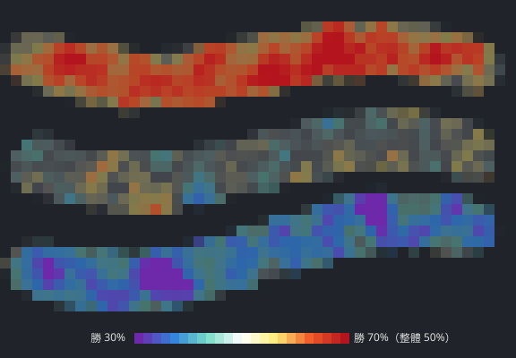

# 勝率：一個位置、一條路線或一次戰術多常獲勝

玩家站在哪裡，往哪個方向走，把道具丟到哪裡 - 以及之後他所屬的一方多常贏下這一回合。**勝率地圖**依每個位置上屬於該列所屬一方贏下之回合的列所佔的比例為它著色，並與所有顯示內容上的這個比例相比：較高處為暖色，較低處為冷色，相同處不著色。

*圖中是虛構的資料：空關卡上的三條路線，它們的列中分別有 68%、50% 和 33% 屬於贏下的回合。*

它需要說明誰獲勝的資料：[結果欄位](data-formats.md#outcome-columns)（`won`、`matchWon`、`roundEndReason`）。CS2 和 War Thunder 的轉換器會寫入這些欄位；任何檔案都可以帶有它們。

## 試試看 {#try-it}

1. 載入帶有結果欄位的比賽，按 `2`（**差異**）。
2. 在 **差異分割** 中按 **回合勝率**（或 **比賽勝率**）。它把贏下的回合放在 **+**，輸掉的放在 **−**，並把面板切換到 **+ 的佔比**。
3. 讀顏色。面板會顯示整體佔比：*整體上 1,200,000 列中有 52.0% 在 +。*
4. 用 [篩選](filters.md) 縮小範圍：一方（T 或 CT），一種事件類型（*位置* 看人們站在哪裡，*開火* 或 *發射(飛彈、火箭、炸彈)* 看他們從哪裡射擊或投擲），一種購買，一張地圖。

用 *位置* 列顯示為暖色的地方，是佔據它的人往往贏下回合的地方。用 *擊殺* 列時，是在那裡取得的擊殺帶來了贏下回合的地方。

## 設定 {#the-settings}

| 設定 | 作用 | 預設值 |
|---|---|---|
| **差異** / **+ 的佔比** | 差異本身，或兩方的列中 + 方所佔的比例 | 差異 |
| **滿色於** | 一個位置高於或低於整體佔比多少時以滿色顯示，單位為百分點 | ± 20 個百分點 |
| **為位置著色的最少列數** | 列數更少的位置不著色；從這個數的一半開始逐漸顯現 | 12 |
| **向整體佔比收縮（列）** | 每個位置都先從這麼多處於整體佔比的列開始，這樣只有 3 列、全部獲勝的位置不會顯示為 100% | 12 |

這三項都作用於完成的圖像：拖動它們從不會重新開始累積。

這個佔比可以是任何分割的，而不只是勝負：依陣營分割時，*+ 的佔比* 顯示 T 方在哪裡佔了存在的較大部分；依兩張地圖的檔案分割時，顯示哪裡一個檔案的列比另一個檔案的更重。

## 是列，不是回合 {#rows-not-rounds}

這張地圖數的是列。一個玩家在一個地方站二十秒，每次取樣都加一列，但都來自同一個回合，所以一個位置上的證據是它附近的列，而不是回合。這就是最少列數和收縮以列為單位、而且比一個回合的量更大的原因。

要看回合本身：

- 在一個點、視圖或體積上的 **[明細](breakdown.md)**：*勝率 %* 把每個玩家的回合只算一次，並以同樣的方式向該位置的整體比率收縮（4 個回合）。
- **[體積](volumes.md)** 統計：*勝率* - 體積內有玩家的回合，每個只算一次，向所有顯示內容上的比率收縮，並附有計數。

## 結果篩選 {#outcome-filters}

[篩選](filters.md) 面板把結果欄位緊接在檢視器自身的欄位之後列出：**回合結果** 和 **比賽結果**（*任意*、*勝*、*負*）以及 **回合結束方式**（全滅、炸彈爆炸、炸彈拆除、時間耗盡、投降、平手、目標、佔領區域、票數耗盡、全部載具損失），使用檢視器的語言。

## 開發者須知 {#for-developers}

熱度通道把三個總和寫入團隊熱度所用的四通道目標：熱度 `R = Σ|v|`、+ 方的熱度 `P`，以及 `S = Σ v²/w`，其中 `w` 是該通道的權重（取樣權重乘以影格增益）。合成時讀取佔比 `P/R`（核加權平均）和它所依據的列數 `n = R²/S`（Kish 有效樣本數），把佔比向整體佔比收縮，`p = (n·P/R + m·r0)/(n + m)`，並在差異色階上依跨度為 `p - r0` 著色。

`n` 會除去一個像素上各列共有的每個因子 - 影格增益、取樣權重、被限制之 sprite 的面積權重 - 因此在任何縮放和取樣密度下圖像都相同，每隔 k 列的影格也會合併成整體而顏色不跳動。整體佔比來自 CPU 的各方計數，精確到百分之零點一；不從 GPU 讀回任何東西。演算法及其檢查：[`render/rateMap.ts`](https://github.com/Holdi601/3DHeat/blob/main/src/render/rateMap.ts) 及其測試。

它的成本與團隊熱度相同：四通道目標使熱度通道的混合頻寬變為四倍，但僅在 *+ 的佔比* 開啟時。
