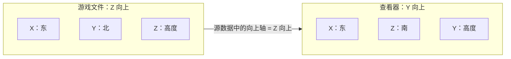

# 坐标轴、单位与时间

游戏和地图对于哪一边是向上、一个单位有多长、时间如何书写，往往意见不一。本页介绍三项设置，让你的数据以正确的方式站立、缩放和播放。

如果你的地图是竖着立起来的墙，而不是平躺的地面，请切换**源数据中的向上轴**。

如果**源数据中的向上轴**设置错误，地图会竖着立起来像墙；设置正确时，它会平躺像地面。

## 查看器绘制的世界 {#the-world-the-viewer-draws-in}

查看器的世界是 **Y 向上**的：X 和 Z 是地平面，Y 是高度。大多数游戏引擎是 **Z 向上**的：对它们来说 X 和 Y 是地面，Z 是高度。有些引擎还是镜像的（左手坐标系）。映射关系说明如何把文件的坐标轴转换为查看器的坐标轴。（严格来说查看器是右手坐标系，即 three.js 的约定。）

### 向上轴 {#up-axis}

[列映射](column-mapping.md)中的**源数据中的向上轴**：

| 设置 | 文件 (x, y, z) 变为世界 (X, Y, Z) |
|---|---|
| *Z 向上（大多数游戏引擎）*——默认 | (x, **z**, **y**)：文件的 Z 变为高度，文件的 Y 变为世界的 Z |
| *Y 向上（图形学约定）* | (x, y, z) 保持不变 |

对于 Z 向上的数据，三个数组是重新标注而不是复制（[`remapAxesInPlace`](https://github.com/Holdi601/3DHeat/blob/main/src/data/ingest.ts)），这样在大型加载中可以节省数百兆字节。猜测依据是样本：Y 列和 Z 列中，离散程度较小的那一列为向上。

### 翻转 {#flips}

**翻转 X**、**翻转 Y**、**翻转 Z** 会在重新标注之前，对*文件*中同名坐标轴取反——因此在 Z 向上时，*翻转 Y* 会对最终成为世界 Z 的那一轴取反。翻转会改变已载入的数据：[标尺](measure.md)、切片和摄像机位姿所显示的坐标都是翻转后的。

若要在**不**改变数据的前提下，把镜像的世界正确地画出来，请改用**摄像机与场景 → 反转世界坐标轴**（[摄像机](camera.md#invert-world-axis)）。对于世界为左手坐标系的游戏，这是更好的选择，因为工具显示的每个坐标都仍然是游戏自身的坐标。

### 单位缩放 {#unit-scale}

**单位缩放**会乘以每一个位置。*1 (m)* 设为 1，*0.01 (cm→m)* 设为 0.01（虚幻引擎的单位是厘米，因此用 0.01；Source 引擎的单位是英寸，因此用 0.0254；两者都不是米），该输入框接受任何数值。输入的 0 或不是数字的值会被替换为 1。

查看器以米为单位标注距离（精灵半径、剔除距离、标尺、飞行速度），这只有在缩放后的世界单位是米时才成立。如果不是，也不会出错，只是标注会显示“m”，无论单位实际是什么。

## 时间 {#time}

### 时间单位 {#time-units}

经验法则：像 17000000000 这样的数值（十位或更多位数字）是 Unix 时间戳；像 0、0.25、0.5 这样的数值是从开始计算的秒数。

| 时间单位（菜单标签） | 解释为 | 是否显示挂钟时间 |
|---|---|---|
| *秒（相对）* | 数值 × 1 s | 否 |
| *毫秒（相对）* | 数值 × 0.001 s | 否 |
| *微秒（相对）* | 数值 × 10^-6 s | 否 |
| *纳秒（相对）* | 数值 × 10^-9 s | 否 |
| *Unix 时间戳（秒）* | 自 1970-01-01 UTC 起的秒数 | 是 |
| *Unix 时间戳（毫秒）* | 自 1970-01-01 UTC 起的毫秒数 | 是 |
| *ISO-8601 日期字符串* | 如 `2026-03-14T18:02:11.250Z` 的文本，用浏览器的 `Date.parse` 解析 | 是 |

使用绝对单位（最后三项）时，数据集会保留其最早一行的挂钟时间瞬间，时间线会在播放头旁边显示当前的 UTC 时刻（`HH:MM:SSZ`）。

**Parquet 的 `TIMESTAMP` 和 `DATE` 列**会解码为真实的时间瞬间，因此其单位设置会被忽略，面板会对此加以说明。`DATE` 列表示整天：一天中的每一行都共享同一个时间瞬间，播放会按天跳跃，面板会就此发出警告。

**ISO-8601 字符串在 CSV 和 Parquet 中同样有效。** 使用 ISO 单位的文本时间列会对每个不同的字符串解析一次；如果一个都无法解析，加载会失败，并显示*映射的时间列中没有可解析的 ISO-8601 时间戳。*——而且在采样的值中一个都无法解析时，映射本身就会拒绝启动。无论设置什么单位，Parquet 的 `TIMESTAMP` 列都会被读取为时间戳；设为 ISO 单位的数值型 Parquet 列会被读取为 Unix 毫秒。使用数值单位的文本时间列会在加载前被拒绝：每个值都会被读作 NaN。

### 时间如何存储 {#how-time-is-stored}

合并文件时，时间以 64 位秒保存，因此绝对纪元保留了亚秒级的细节。所有文件都载入后，整个选择中最早的时间变为 0，每一行都从它开始存储 32 位秒数。32 位浮点数有 24 位尾数：跨度最多约一天半时，分辨率优于 1/100 秒；跨度为半年时，分辨率约为一秒。时间缺失或不是数字的行会被放在 0，即开始处。

然后各行按时间排序，这使得时间线的计算很便宜：时间窗口通过两次二分查找即可找到（见[采样与预算](sampling-and-budgets.md)）。

### 经过时间与挂钟时间 {#elapsed-time-versus-wall-clock}

像 `match_time` 或 `round_time` 这样的时间列，是从每场对局自身的开始时刻计时的。选择它会把每场对局放在同一条共享的时间轴上——便于比较每场对局第 3 分钟发生的事情——面板会指出这一点。挂钟时间列则按对局真正发生的先后顺序显示它们，在时间上重叠的地方会重叠显示。

## 观看方向 {#look-direction}

观看方向只被[模型叠加](box-replay.md)使用（每个方框发出的射线）。它以两个角度存储，即偏航和俯仰，单位为弧度。

- **偏航 / 俯仰列**按原样读取，选择*度数*时从度数转换。它们不会针对向上轴或翻转进行调整。
- **方向向量列**与位置经过相同的重新标注和翻转，然后在世界坐标轴中转换为 yaw = atan2(x, -z) 和 pitch = atan2(y, √(x² + z²))，因此在镜像源的世界中，射线也会指向方框所面对的方向。

如果在翻转、使用方向向量或调整角度之后，偏航/俯仰列指向错误的方向，请以此为修正依据。
