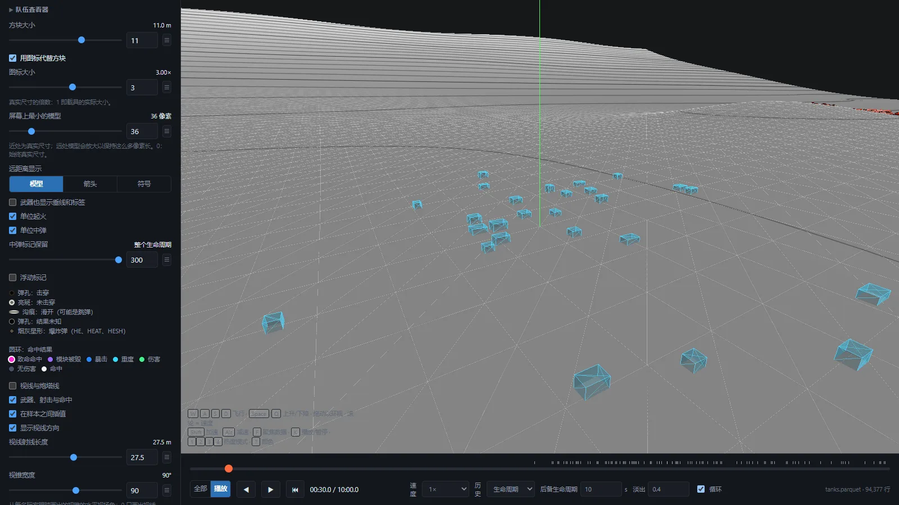

# 模型叠加（方框回放）

一部小影片：每个人对应一个图标，随时间推移而移动，身后带有拖尾。

在模式栏中，此模式称为**模型叠加**。本页以前叫“方框回放”，因为在有图标之前，每个人都是一个方框；“模型回放”和“方框回放”指的是同一件事。**模型叠加**没有数字键：请在模式栏中选择它。它为每个[人员](glossary.md)绘制一个图标（或方框），沿[时间线](timeline.md)移动，并可选择显示视线射线和拖尾。它是回放，而不是密度：*谁在何时何地*。它需要一个人员列；没有时间列时，每个样本都会同时绘制。

## 使用方法 {#how-to-use-it}

1. 载入带有人员列和时间列的数据。
2. 在模式栏中选择**模型叠加**。
3. 把时间线切换为**播放**，然后按播放（`K`）。
4. 打开**队伍查看器**，更改**拖尾长度**、图标大小或视线射线。

此模式下不绘制任何热度，自适应精灵预算处于空闲状态。

默认情况下，每个人都会以他所代表之物的图标绘制，而不是方框——关于单位获得哪种图标，见[图形](figures.md)；关于标签、跟随摄像机、两个单位之间的测量以及事件列表，见[比赛回放](match-replay.md)。

## 队伍查看器面板 {#the-team-viewer-panel}

在此模式下，它会代替热度面板显示。

| 控件 | 默认值 | 范围（拖动） | 含义 |
|---|---|---|---|
| **用图标代替方块** | 开 | | 每个人以其所代表之物的图标显示：徒步的士兵、数据中指明的坦克或飞机。数据未说明的部分仍为方框。 |
| **图标大小** | 1× | | 1× 为真实大小。 |
| **屏幕上最小的模型** | 36 px | 0 = 始终为真实大小 | 靠近时为真实大小；远处的图标会放大，以保持这么多像素的长度。 |
| **武器、射击与命中** | 开 | | 飞行中的武器（带烟迹）、曳光弹、撞击、命中和击杀。由命中推断出的曳光弹以虚线显示。 |
| **方块大小** | 实体大小，或加载时为范围 / 500 | 0.05-200 m，对数刻度（5000） | 每个方框的边长。见[实体大小](sessions-persons-groups.md#entity-size)。 |
| **在样本之间插值** | 开 | | 在同一会话中同一个人的两个样本之间，按比例把方框放在它们中间。绝不跨越会话边界。 |
| **显示视线方向** | 开 | | 从每个方框沿该人员视线方向发出的一条射线（需要[视线列](axes-units-and-time.md#look-direction)）。 |
| **视线射线长度** | 实体大小 × 4，或加载时为范围 / 200 | 0.5-500 m，对数刻度（20,000） | 视线方向开启时显示。 |
| **拖尾长度** | 8 s | 0-300 s（86,400）；0 = 关闭 | 在每个人身后绘制的历史秒数。 |
| **绘制每个原始样本** | 关 | | 窗口内每个已存储样本画一个方框，而不是每人一个插值方框。为保持交互性会进行子采样。 |

面板中的提示说明：插值和拖尾只在同一会话内连接样本；当载入的数据中有[共享名称](sessions-persons-groups.md#names-worn-by-several-things-at-once)时，还会说明有多少名称被绘制为单个样本。

## 正在播放的会话 {#the-session-being-played}

当数据带有会话列时，侧边栏顶部的**会话**选择器（[会话](sessions-persons-groups.md#the-session-picker)）决定回放哪场对局。载入时会选择最活跃的一场。只有该会话的行会变成方框和拖尾，时间线也只在该会话的跨度上运行，而不是整个数据集。**全部会话**会同时播放所有会话，同样绝不会在会话之间连接样本。

## 何时绘制什么 {#what-is-drawn-when}

来自 [`TrackCursor`](https://github.com/Holdi601/3DHeat/blob/main/src/data/tracks.ts)：

**实时方框**（播放模式，关闭原始样本）。对每个可见的人员，取播放头处或之前的最新样本：

- 如果该人员有下一个样本，并且它在同一会话中，名称也未共享，则方框会按时间比例放在两个样本之间，偏航沿较短的方向插值，俯仰线性插值（开启*插值*时）。
- 否则，方框会停留在最后一个样本处，持续时间为时间线的**后备生命周期**（默认 10 s），之后便被移除，因此已淘汰的玩家不会留存。

**全部模式**忽略播放头，把范围内的每个样本都画成一个方框。

**原始样本**在窗口内为每个已存储的样本绘制一个方框：使用*窗口*历史时为*跨度*内的全部样本，否则为播放头之前的全部样本。最多 65,536 个方框；样本更多时，每隔 *k* 个绘制一个。

**拖尾**（拖尾长度大于 0 且不绘制原始样本时）：在播放头之前的最近 *拖尾长度* 秒内，一个人的每对相邻样本之间画一条线，随年龄从 80% 不透明度渐隐为透明。拖尾在会话切换处停止，共享名称不绘制拖尾。最多 131,072 个顶点；超出时，会均匀地跳过若干行。

**谁可见：** 当其所属组在[队伍列表](teams-list.md)中被取消勾选时（该组以其第一行所属的组为准）、当组筛选将其排除时，或当[实体](entities.md)面板的选择不包括该人员时，该人员会被隐藏。[列筛选](filters.md)不适用于方框。

## 颜色 {#colours}

每个组一个色相家族，每个成员一个色阶，因此扫一眼就能看出某人属于哪一方（[`teamMemberColor`](https://github.com/Holdi601/3DHeat/blob/main/src/render/colors.ts)）。组的色相在一个固定的十色列表中循环——蓝、红、绿、琥珀、紫、青、洋红、青柠、橙、靛——组内成员的明度分布在 42-76%，饱和度分布在 90-65%。

## 注意事项 {#notes}

- 模型叠加只在有变化时重建它的图标；空闲帧会重绘上一次的图标。
- [统计叠加](performance-and-stats.md)中的*方块*一行会统计屏幕上的方框数量。
- 模型叠加与关卡绘制在同一个场景中，因此[景深](camera.md#depth-of-field)会模糊方框，但从不模糊热度。
