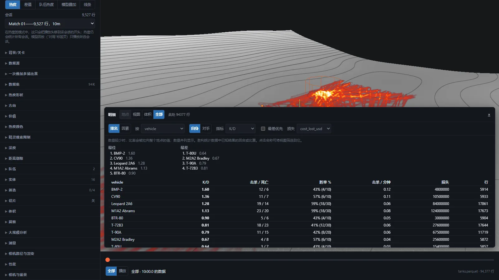
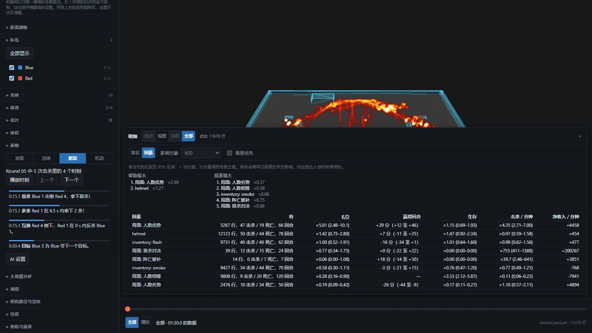

# 明细：谁在哪里表现最好

**明细**只回答一个问题：在这个地方，哪种载具、玩家或武器表现最好？用它来找出在桥头获胜的那辆坦克，或者看看戴头盔是否真的有用。

它会按任何类别，对一个地点（选定的某一点、视图、一个体积或全部显示的内容）中发生的事情进行排名，并把每个状态因素都与有、无进行对比。

## 试一试 {#try-it}

1. 载入一场含有击杀和死亡的对局，并打开**体积**。
2. 在你关心的地点周围画一个体积，并选中它。
3. 在统计下按**明细…**。
4. 在**按**下选择*载具*，并选择指标 *K/D*（每次死亡的击杀数）。
5. 阅读列表，最好的排在前面。按**最差优先**可把顺序倒过来。点击某个名称可把视图筛选为它；再点一次则取消筛选。

## 打开它 {#open-it}

| 来源 | 开始时所用的区域 |
| --- | --- |
| [体积与对比](volumes.md)（统计）中的**明细…** | 选中的体积 |
| 在点击某点后，拾取卡片上的**此处明细** | 以该点为中心的一个球体（**半径**，默认为数据大小的 3%） |
| **差值**分割面板 | 视图 |

标题栏可以切换区域：**地点**、**视图**（摄像机在上一次统计时所见的画面；移动后请按**重新统计**）、**体积**（选择一个）或**全部**。它在后台统计；状态行会显示该区域中有多少行。

## 排名 {#ranking}

选择按什么排名，以及一个指标：

| 指标 | 含义 |
| --- | --- |
| A、B | 差值图两侧的行，按热度的划分方式拆分 |
| A / B、A - B、A / (A + B) | 两个图层相互比较 |
| K/D | 击杀数对死亡数 |
| 获胜率 | 获胜的回合（或对局）数，在数据指明胜者的情况下 |
| 每分钟击杀 | 每分钟的击杀数（按移动样本的间隔计算出的在场时间） |
| 获得、损失、净收入 | `earn_*` 与 `cost_*` 列的总和；由选择器决定货币 |

击杀、死亡、在场、获胜和金钱会统计视图在该地点中显示的每一行，无论它位于分割的哪一侧，或两侧都不在。

在计数较小的情况下，比率和速率会被拉向整个地点的值，因此只打了 1 条命却有 2 次击杀的情况，不会排在列表顶部。计数会显示在它们旁边。

你可以按组、玩家和对局排名，也可以按任何类别列（载具、武器、阵营、购买类型、特工或套装），按任何数值列的范围（护甲、装备的价值），按武器列的**类别**（步枪、狙击枪、冲锋枪、手枪……），以及按列表列（如 `inventory`）中包含多少件**道具**来排名。

**自身**按该行自身的值排名。**对手的**则按对方的值排名：击杀时使用受害者的武器，死亡时使用击杀者的武器（需要一个指明它们的 `other` / `victim` 列）。

## 当时的状态 {#state-at-the-time}

一行的值就是它自身的值，除非该行没有记录任何内容（没有装备的事件行），或者它是一次死亡（其武器列可能指明了击杀者的武器）；此时使用的是同一人在本场对局中更早时所携带的最后一次装备。

## 因素：有对比无 {#factors-with-against-without}

从**排名**切换到**因素**，选择**影响对象**，然后阅读*影响最大（有利）*和*影响最大（不利）*：

每个因素对 K/D、获胜回合、生存（每次死亡的分钟数）、每分钟击杀数以及每分钟净收入的影响，附带 95% 区间：比率以 x 表示，获胜回合以分数的差值表示。排名会根据每个估计值自身的不确定性，把它拉向无效应；因此一个罕见的因素需要有明显的效应才能排在前面；显示的区间则是未经拉动的区间。

包含回合的数据还会加入近距离交战的**情况**（[近距离交战与回合](close-quarters.md)），在数据集载入后一次性算出：*致盲*（该行的 `state_flashed`，或在过去 3 秒内 15 m 以内的敌方闪光弹）、*死亡换回*、*开局对决*，以及*人数优势*、*人数相等*或*人数劣势*（该行一侧与敌方相比仍存活的玩家数）。死亡计入其受害者在死亡前所处的情况。

一次计算最多统计 256 个因素。

## 开发者信息 {#for-developers}

### 对小样本进行拉动 {#pulling-small-samples}

排名的值为 `(n + m*r0) / (d + m)`：`n` 与 `d` 为计数，`r0` 为整个地点的比率，`m` 为该先验的权重。

### 面向转换器作者：为因素列命名 {#for-converter-authors-naming-factor-columns}

转换器通过为列命名来添加因素：

| 列 | 因素 |
| --- | --- |
| `state_<name>` 数值 | 非零时开启（`state_scoped`、`state_suppressor`） |
| `state_<name>` 类别 | 每个值一个因素（`state_ammo` = AP、HE……） |
| `active_<name>` | 同样的规则，用于最近被开启或使用的东西：技能、终极技能、装备、增益（`active_ult`、`active_stim`） |
| 列表列（`inventory`、`loadout`、`perks`、`abilities`、`attachments`、`modules`、`buffs`、`debuffs`、`upgrades`，或名称以 `s` 结尾的 `state_`/`active_` 列） | `a\|b\|c` 值中的每一项一个因素 |
| 已经常见的装备标记（`helmet`、`defuser`、`armor`、`scoped`、`airborne`、`duck`、`flashed`……） | 非零时开启 |
| `ammoType`、`shellType`、`ammoName` | 最后一次开火所用的弹药 |

结果：一个 0/1 的 `won` 列（该行所在一方赢得了回合或对局）和一个 `round` 列。金钱：`earn_<currency>` 与 `cost_<kind>_<currency>`；仅按种类给出的收入（`earn_round_cs2`，即转换器精确的回合奖励）只替换该种类的成本模型收入（`round` 还包括安放和拆除），其余部分仍由模型计价。

映射会自行载入这些列，并与文件自身的列表一起加载：每一个 `state_*`、`active_*`、`won`、`round` 和列表列，但 Parquet 文件的统计信息显示其全程只保持一个值的列除外（每个载入的列每行占 4 字节）。
