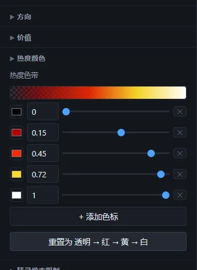

# 颜色与曝光

这些控件决定每一份热度显示什么颜色。**饱和点**表示多少热度算作白热。

## 快速修复 {#quick-fixes}

- 全都是白色：提高**饱和点**，或按**根据热度场自动曝光**。
- 什么都看不见：降低**饱和点**，或按**根据热度场自动曝光**。
- 只显示几个孤立的点：调高**最低热度**。

本页的每个控件都在热度变成颜色时生效，所以拖动任何一个都会立即重绘，**从不重新开始累积**。

## 饱和点 {#saturation-point}

**饱和点**（热度形状区）：映射到颜色带顶端的累积热度（配合*线性*响应；其他响应见下文）。对数滑块范围为 0.1 到 4000，拖动手柄可到 10,000,000，因为累积热度会随行数增长。默认值为 24；每次加载时先给出**分析估算**，然后根据画面**测量**。

设错了，热度图就会变成空白（或白色）的屏幕。而且这个值无法可靠地推算出来：遥测数据聚集得非常厉害——出生点、门口、狭窄处——峰值密度与平均密度的比值，在不同数据集之间、不同摄像机角度之间，相差一个数量级。

## 自动曝光 {#auto-exposure}

**根据热度场自动曝光**测量着色器实际生成的热度场。它忽略空像素，取被照亮像素的第 98 百分位数，并把它放在饱和点的 85% 处，使颜色带顶端留给真正的峰值。

面板随后显示 *已测量画面的 X%；第 98 百分位 R 位于颜色带顶端附近*。使用*饱和*响应时，处于饱和点 85% 的值会落在颜色带约 69% 的位置，而不是 85%。

它也会**自动**运行：

- 数据集加载后渲染 8 帧；
- [筛选](filters.md)改变后渲染 8 帧（把每个位置过滤到只剩一百个事件，会让密度变化几个数量级）；
- 在点热度和[线热度](line-heat.md)之间切换后，或改变线热度绘制哪些路线后，渲染 8 帧，因为一条线每个采样点分布的热度远少于一个精灵。

什么都没有亮起时，自动运行会保持饱和度不变；按钮则退回分析估算，并显示 *没有亮起的内容可测量——已使用分析估算*。

### 跟随视图 {#follow-the-view}

**跟随视图**（热度形状区，默认开启）会在摄像机停下来时重新测量，这样飞入的区域会使用整个颜色带，而不是按整张地图测得的刻度。小的变化会被忽略，刻度会平滑过渡而不是跳变。它在四种热度模式中运行，在图形叠加中不运行。

取消勾选可锁定刻度，以便在同一刻度下比较不同地方。手动拖动**饱和点**也会锁定刻度。

## 密度响应 {#density-response}

**密度响应**——*k*（热度 / 饱和点）如何映射到颜色带上：

| 响应 | 公式 | 用途 |
|---|---|---|
| **饱和**（默认） | t = 1 - e^(-k) | 像堆叠的半透明精灵那样渐近接近颜色带顶端。永远不会裁剪成纯白，因此在不熟悉的数据上是安全的默认值。 |
| **线性** | t = k | 唯一一种颜色相同即计数相同的映射。用于比较两个数据集或两个时间段。 |
| **对数** | t = log₂(1 + 7k) / 3 | 压缩长尾，使一个极端热点不会把其他所有区域都压到颜色带底部。提亮稀疏区域。 |

## 最低热度 {#minimum-heat}

**最低热度**（默认关闭，0-100%）：任何带有热度的像素都会被提升到颜色带中至少这个位置。调高它、调小精灵半径，就能看到*哪里曾经发生过事情*——单个数据点会变得清晰可见，而不是紧贴在透明之上。判断密度时请关闭它，因为它会按设计把颜色带底部压平。阈值（k > 0.0001）让真正空的像素保持为空。

## 颜色带编辑器 {#the-ramp-editor}

位于**热度颜色**区。其标签说明颜色带的用途：在热度与线中为*热度颜色带*，在差异中为*正值（加法队伍）*，在[队伍热度](team-heat.md)中为*不透明度颜色带（颜色来自队伍）*，此处只使用其透明度。



顶部的条显示颜色带的预览。下方每个色标占一行：

| 部分 | 含义 |
|---|---|
| 颜色方块 | 色标的颜色（浏览器的颜色选择器）。 |
| 数字 | 色标在颜色带上的位置，0 到 1（0 = 没有热度）。 |
| 滑块 | 色标的不透明度，0-100%。 |
| ✕ | 删除色标；只剩两个时禁用。 |

**+ 添加色标**会在最后两个色标的中间添加一个色标，颜色和不透明度与最后一个色标相同。**重置为 透明 → 红 → 黄 → 白**会恢复默认值。

色标可以任意顺序给出；构建颜色带时会自动排序。**透明度**决定热度如何与场景混合，这就是为什么默认颜色带的零端是完全透明的。

### 默认颜色带 {#the-default-ramps}

| 位置 | 正值（热度、线、差异 +） | 负值（差异 −） |
|---|---|---|
| 0.00 | 黑色，透明度 0 | 黑色，透明度 0 |
| 0.15 | rgb(180, 0, 0)，透明度 0.55 | rgb(0, 170, 60)，透明度 0.55 |
| 0.45 | rgb(255, 40, 0)，透明度 0.85 | rgb(0, 190, 200)，透明度 0.85 |
| 0.72 | rgb(255, 220, 40)，透明度 0.95 | rgb(40, 80, 255)，透明度 0.95 |
| 1.00 | 白色，透明度 1 | rgb(170, 60, 255)，透明度 1 |

## 摄像机移动时 {#while-the-camera-moves}

摄像机移动时，累积会每帧重新开始。开启**每帧绘制所有行**（默认）时，每个移动帧仍然是精确的；关闭时，移动帧只显示一个采样估计——更亮、带权重缩放的团块——停下来时会收敛到更平滑的真实画面。这是正常的；参见[累积](accumulation.md)。

## 开发者信息 {#for-developers}

### 合成通道 {#the-composite-pass}

热度累积完成后，每个像素的值会在一个合成通道中变成颜色（[`COMPOSITE_FS`](https://github.com/Holdi601/3DHeat/blob/main/src/render/webgl2/shaders.ts)）。步骤如下：

```
k = |heat| / saturation point
t = response(k)                         clamped to 0..1
if minimum heat > 0 and k > 0.0001:  t = minimum + (1 - minimum) × t
colour, alpha = ramp(t)                  (the negative ramp when heat < 0, Difference only)
pixel = mix(scene, colour, alpha)
```

### 分析估算 {#the-analytic-estimate}

**分析估算**（[`estimateSaturation`](https://github.com/Holdi601/3DHeat/blob/main/src/data/calibrate.ts)）假设行分布在数据的 X-Z 占地范围内：平均热度 = 行数 × (π r² / 占地面积) × 1/3 × 中心强度（1/3 是线性渐变圆盘的平均值），再乘以假定的峰值与平均值之比 25，并限定在 0.1 到 1,000,000 之间。它只需要与正确值相差一个数量级以内。

### 测量 {#metering}

[`exposure.ts`](https://github.com/Holdi601/3DHeat/blob/main/src/render/exposure.ts)：

1. 从 GPU 读回热度目标，子采样至最多 40,000 个值；
2. 丢弃空像素（热度 ≤ 0.0001）——热度场的大部分是空的，把它们平均进去会让一切曝光不足，就像相机的测光表对着黑色背景一样；
3. 被照亮像素的第 98 百分位数作为参考值；
4. 饱和点变为 参考值 / 0.85，因此参考值位于饱和点的 85% 处，颜色带顶端留给真正的峰值。

### 颜色表 {#the-colour-table}

颜色带被烘焙成一个 256 × 2 的 RGBA 表（正值颜色带在第一行，负值在第二行）（[`buildColorLut`](https://github.com/Holdi601/3DHeat/blob/main/src/render/colors.ts)）。颜色在线性光中插值，以 sRGB 存储；不透明度线性插值。
