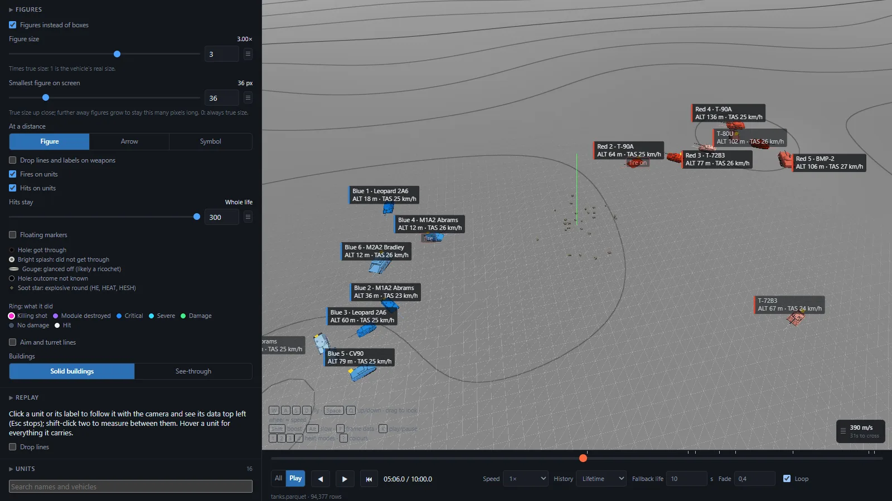

# 演示数据：五分钟试用查看器


还没有你自己的数据？仓库会生成一些。其中的一切都是虚构的：一个山谷、一个院子，以及三种虚构游戏风格的对局，玩家名叫 *Blue 1* 或 *Red 3*。本站的所有图片都是用它拍摄的。

## 生成数据 {#make-it}

```bash
node tools/demo-data.mjs
```

它会写入 `tools/.shots/demo/`：

| 文件 | 内容 |
|---|---|
| `demo-valley.glb` | 一个 12 km 的山谷，有两座山丘和一个村庄，作为 3D 关卡 |
| `demo-yard.glb` | 一个 160 m 的有围墙的院子，有建筑物，作为 3D 关卡 |
| `tanks.parquet` | 10 场坦克对局，每场 8 对 8：移动、射击、命中（附带命中车体的位置）、火焰、击杀、残骸、炮塔瞄准、胜者 |
| `tanks/match-NN.parquet` | 同样的对局，每场一个文件，用于[同时查看多场比赛](many-matches.md) |
| `air.parquet` | 一场 4 对 4 的空战，有导弹、干扰弹、击杀和未命中 |
| `shooter.parquet` | 12 回合，每回合 5 对 5 步战：射击、击杀、安放炸弹、赚取和花费的资金、头盔和道具 |
| `mass/` | 一个包含小型 `.3dheat` 对局的文件夹，用于[批量分析](mass-analysis.md) |
| 一组赛车圈次 | 同一辆车在虚构赛道上的两圈，用于[赛车分析](race-analysis.md) |

每个表格都在其页脚中注明了自己的列，因此无需任何映射即可加载。

## 试用 {#try-it}

1. 启动查看器（Windows 上运行 `start.bat`，或在任何系统上先运行一次 `npm install` 再运行 `npm run dev`），然后打开 `http://127.0.0.1:5273/`。
2. **背景 / 关卡 → 3D 模型…**，选择 `demo-valley.glb`。
3. **数据源 → 多个文件…**，选择 `tanks.parquet`。
4. 按 `F` 将视野对准数据。你会看到十场对局的[热度](heat.md)。
5. 试试模式栏：**差值**（Blue 对 Red）、**队伍热度**、**线条**。
6. 打开**洞察**（位于热力图侧边栏中）：它会找出被射击、命中和摧毁次数远多于其他地方的位置——即两座山丘周围。
7. 打开**对局**标签页；在**回放中的对局**下选择 *Match 01*，然后在时间线上按**播放**：即[回放](match-replay.md)。



对于步战数据，加载 `demo-yard.glb` 和 `shooter.parquet`；对于空战，加载 `air.parquet`（在热力图侧边栏的**队伍查看器**面板中，将**图标大小**设为 4 时，图形更容易看清，这是一个滑块）。

## 截图 {#the-screenshots}

本站的图片由脚本基于这些数据生成，可以使用查看器支持的任何语言：

```bash
node tools/demo-data.mjs
HEAT3D_FIGURE_PACK=none npx vite --port 5321 --strictPort --host 127.0.0.1   # PowerShell: $env:HEAT3D_FIGURE_PACK="none"; npx vite ...
node tools/docs-shots.mjs --lang en
```

截图服务器在没有本地图形包的情况下运行，因此只显示公共图形目录。图片保存到 `docs/assets/img/<lang>/`。参见[维护文档](maintaining.md)。
