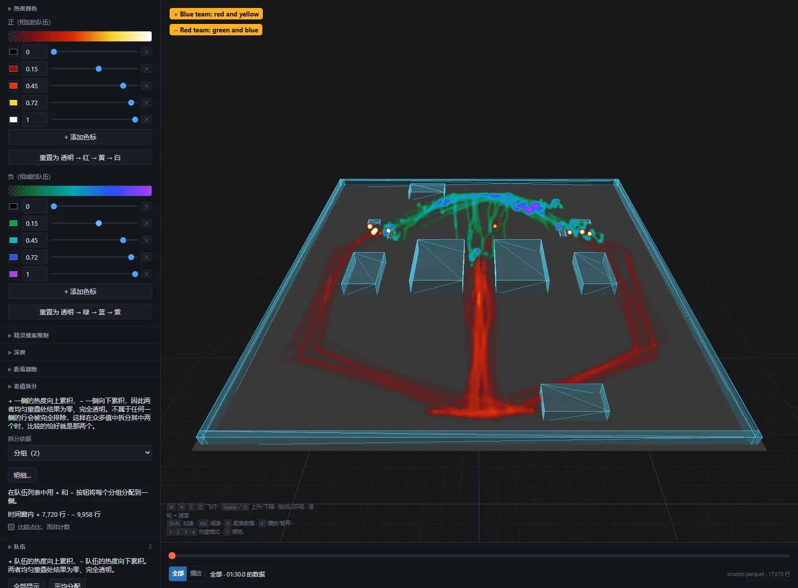

# 差值

哪一方的队伍 A 更多时为红色，哪一方的队伍 B 更多时为绿蓝色，两者相等时则无色。

**差值**（按键 2）是带符号的热度。一个群体的行会增加热度；另一个群体的行则减去热度。两者均匀重叠之处结果为零，完全透明；哪一方占优，就以该方的颜色显示——默认情况下，**+** 一方为暖色（透明 → 红 → 黄 → 白），**−** 一方为冷色（透明 → 绿 → 蓝 → 紫）。

## 使用方法 {#how-to-use-it}

1. 按 `2`（或在模式栏中选择 **差值**）。
2. 在侧边栏中打开 **差值拆分**。
3. 选择 **拆分依据**：通常选 *分组*。
4. 把一个分组（或一个值）放到 **+** 上，另一个放到 **−** 上。
5. 阅读颜色：暖色表示 + 一方，冷色表示 − 一方。如果某一方没有任何行，面板会发出警告（参见[你可能看到的消息](#messages-you-may-see)）。

*哪两个*群体才是整个问题，因此拆分可以基于任何保留的列，而不仅仅是分组。落在 **任何一方都不属于** 的行会被 **排除**，而不是计为零：正因为如此，在众多值中只针对其中两个进行拆分时，比较的才恰好是这两个值；它还可以与[筛选](filters.md)组合——先筛选到一张地图，再按版本拆分。

此模式需要两方：一个至少有两个分组的分组列，或基于为筛选而保留的列进行的拆分。对于分组少于两个的数据，载入时会以一个列的拆分开始——先是多文件载入的 *Source file* 列，否则是第一个有两个值的类别列，再否则是第一个有跨度的数值列——因此 *比较两次载入* 即使在没有任何分组的数据上也能使用。只有两者都没有时，此模式才不可用；一个在某一方没有任何内容的列拆分，同样不可用。

## 差值拆分面板 {#the-difference-split-panel}

在差值模式中显示，位于热度面板下方。

**拆分依据** 提供：

| 选项 | 显示为 | 拆分规则 |
|---|---|---|
| 分组 | *分组（N）*（有分组列时） | 每个分组放在 +、− 或两者都不属于，在[队伍列表](teams-list.md)中设置 |
| 某个类别列 | *列（N 个值）* | 值放在 +、− 或两者都不属于 |
| 某个数值列 | *列（数值）* | 每一方各有一个数值范围 |
| 来源文件 | *Source file - 比较两次载入*（载入了多个文件时） | 文件放在 +、− 或两者都不属于 |

只提供在加载时于 *保留用于筛选* 下保留的列。

### 比较占比，而非计数 {#compare-shares-not-counts}

**比较占比，而非计数**（默认关闭）会按每一方自身行数的倒数对其加权，因此行数多五倍的一方不会仅凭数量获胜。颜色随后显示每一方相对于另一方在比例上更常见的地方。当两方的数据量差别很大时使用它，例如两个时长不同的会话。

### 你可能看到的消息 {#messages-you-may-see}

当画面并非真正的差值时，面板会发出警告：

| 消息 | 含义 |
|---|---|
| *N + / M −*（或 *N + / M − / K 未使用*） | 每一方（以及两者都不属于的）有多少个值。 |
| 窗口中没有行属于 **+** 一方 | 只绘制 **−** 一方。移动时间线窗口或更改拆分。 |
| 窗口中没有行属于 **−** 一方 | 只绘制 **+** 一方。 |
| 没有值属于任何一方 | 差值不绘制任何内容。至少把一个值放到 **+** 或 **−** 上。 |
| *列* 无法以这种方式拆分 | 所选的列不适合该拆分。请重新选择列。 |
| 拆分列在 N 个（共 M 个）数据块中无法放入 GPU 内存 | 这些行不会被绘制。在 性能 → 资源预算 中提高 GPU 预算，或载入更少的行。 |

### 按分组 {#by-group}

面板只是指向[队伍列表](teams-list.md)，那里每个分组都有 **+** 和 **−** 按钮。每次加载时，分组的前一半（向上取整）放到 +，其余放到 −；队伍列表中的 **平均分配** 会再次执行同样的操作。两者都不属于的分组，或用其复选框隐藏的分组，不产生任何贡献。

### 按类别值 {#by-category-values}

| 部分 | 含义 |
|---|---|
| `a + / b − / c 未使用` | 每一方以及两者都不属于的值各有多少。 |
| **清除** | 把每个值都放到两者都不属于的位置。 |
| 值列表 | 每个值都有 **+** 和 **−** 按钮（再次点击已激活的按钮即可把它从该方移除）。空值显示为 *（缺失）*。 |
| 上限提示 | 只列出前 200 个值：*显示 N 个值中的前 200 个。这么宽的列最好先用筛选缩小，若其值有序，则按范围拆分。* |

选择该列时，它的第一个值放到 +，第二个放到 −。当两方都没有任何值时，拆分会回退到分组，而不是显示一个空白画面。*来源文件* 的工作方式相同，每个文件一个值——这就是比较两次导出、两次测试运行或两个版本的方法。

### 按范围 {#by-range}

| 部分 | 含义 |
|---|---|
| 提示 | 该列的最小值和最大值。 |
| **正范围（+）**、**从** / **到** | 值落在此范围内的行（两端均包含）相加。 |
| **负范围（−）**、**从** / **到** | 落在此范围内的行相减。 |
| **在中点拆分** | 将 + 设为 [最小值, 中间值]，将 − 设为 [中间值, 最大值]——选择该列时也会执行此操作。 |

同时位于两个范围内的值计为 +。两个范围不必覆盖整个列；两者都不在的值会被排除。*前两分钟对最后两分钟* 就是对类似时间的列进行的范围拆分。

## 颜色 {#colours}

**热度颜色** 一节在此模式下显示两个色带编辑器：**正（相加的队伍）** 和 **负（相减的队伍）**，各自带有独立的重置按钮（*重置为 透明 → 红 → 黄 → 白*，*重置为 透明 → 绿 → 蓝 → 紫*）。合成结果会通过[饱和点与响应](colour-and-exposure.md)取净热度的绝对值，并在净值低于零处选用负色带。参见[颜色与曝光](colour-and-exposure.md#the-ramp-editor)。

当差值的大小很重要时，使用 *线性* 密度响应：它是唯一一种相同颜色意味着相同计数的响应。

## 开发者信息 {#for-developers}

每一行在顶点着色器中都会获得 +1、-1 或 0 的符号（[`POINT_HEAT_VS`](https://github.com/Holdi601/3DHeat/blob/main/src/render/webgl2/shaders.ts)）；符号为 0 时，该行会在任何片元绘制之前被剔除。

- 按分组时，符号来自一个 4,096 项的分组表，以该行的分组编号为索引（分组编号位于该行位置纹素的第四个通道中）。
- 按类别时，符号来自第二个 4,096 项的表，按每个类别值填充，该行的值从该列的筛选纹理中读取；超出表末尾的值在两个后端上都会被剔除。
- 按范围时，将该行的值与两个范围进行比较。

改变拆分会重新开始累积。

**隐藏的分组在任何拆分下都保持隐藏。** 在按列拆分时，分组表不再携带符号；它对显示的分组保存 1，对隐藏的分组保存 0（[`frameSignTables`](https://github.com/Holdi601/3DHeat/blob/main/src/render/filterTables.ts)），两个表同时到达着色器——在 WebGL2 上是同一个符号纹理的两行，在 WebGPU 上是同一个存储缓冲区的两半。只有当某行的分组被显示 *并且* 其列值属于某一方时，该行才会被绘制。因此，在[队伍列表](teams-list.md)中未勾选的分组，或被对局标签的阵营聚焦排除的分组，无论差值如何拆分，都不产生任何贡献。
