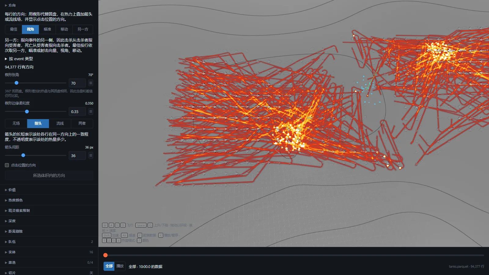

# 方向热度

普通的热度只说明事情**发生在哪里**。方向热度还说明**朝哪个方向**：人们朝哪里看、瞄准、移动，或者交战的另一方位于何处。

普通的精灵是一个完整的圆盘（360 度）。把**楔形张角**设为 70 度，同一个精灵就会变成一个狭窄的楔形，指向该行所面对的方向，并且添加的热度总量不变。

## 使用方法 {#how-to-use-it}

1. 载入带有方向信息的数据（见[什么让一行有了方向](#what-gives-a-row-a-direction)）。
2. 在模式栏中选择**热度**、**差值**或**队伍热度**。
3. 在侧边栏中打开**方向**区。
4. 选择一个**来源**（使用哪个方向），然后开启绘制：
   - 把**楔形张角**降到 360° 以下，使每一行被绘制为指向其方向的楔形，而不是圆盘；
   - 选择一个**场**，在热度上方绘制箭头或流线；
   - 勾选**点击位置的方向**，然后点击热度，即可获得该点的极坐标图。

状态行会显示所选来源中有多少行带有方向。

## 设置 {#settings}

| 设置 | 默认值 | 作用 |
|---|---|---|
| 来源：**最佳**、**视图**、**瞄准**、**移动**、**另一方** | 最佳 | 每一行获得哪个方向。*最佳*对每一行依次取：另一方；若无则取瞄准；若无则取视图；若无则取移动。 |
| **按事件类型** | 同上 | 为每种事件类型指定不同的来源，例如击杀使用*另一方*，位置使用*视图*。当数据中的某个事件列最多只有 40 个值时显示。 |
| **楔形张角** | 360° | 360° 是普通的圆盘（即关闭）。越小则楔形越窄。楔形添加的热度与其圆盘相同，因此总量和差值仍可比较。 |
| **楔形边缘柔和度** | 0.35 | 0 是边缘锐利的楔形，1 是柔和的扇形。 |
| **场**：无场、箭头、流线、两者 | 无场 | 箭头：箭头的长度表示那里的行在方向上达成一致的程度，其不透明度表示那里有多少热度。箭头只在有热度的地方显示。 |
| **箭头间距** | 28 px | 屏幕上箭头之间的距离。 |
| **流线动画** | 开 | 开启时流线会流动。 |
| **点击位置的方向** | 关 | 点击热度即可看到该处的方向（见下文）。 |
| **所选体积内的方向** | | 对所选[体积](volumes.md)内的所有内容显示同样的图表。 |

## 某点的极坐标图 {#the-polar-chart-at-a-spot}

开启**点击位置的方向**后，点击热度。靠近该点的行（在 1.5 个精灵半径之内）会被汇集为一个玫瑰图，共 24 个扇区，每个 15°：

- **橙色**花瓣：输出方向（行指向的方向）；
- **蓝色**花瓣：输入方向（它们来自的方向）；
- 花瓣的**面积**随其计数增长；一个箭头显示主要方向；
- 图表下方的文字给出主方位、行之间的一致程度（R，0 到 1）、以度数表示的离散范围，以及行数。

在图表中 0° 朝上，即世界的 −Z（对于 Tacview 录像即北方）。该点也会在三维视图中以一个箭头和一个圆环标出。

## 什么让一行有了方向 {#what-gives-a-row-a-direction}

| 来源 | 数据中需要的内容 |
|---|---|
| 视图 | 一个偏航列（映射为观看方向）：`yaw`、`heading`、`azimuth`、`view_yaw`、`rot_z` |
| 瞄准 | 成对的数值，例如 `aim_x`/`aim_y`、`shot_x`/`shot_y`、`fire_x`/`fire_y`、`hit_dir_x`/`hit_dir_y`（可选 `…_z`） |
| 移动 | 无需额外内容：同一人员上一个样本的步进（最多早 10 s，同一会话） |
| 另一方 | 一个指明事件另一方的列（`other`、`victim`、`target`、`killer`、`attacker`、`shooter`、`other_player` ……），其值为人员名称；击杀从击杀者指向受害者，死亡则从受害者指向击杀者 |

## 提示 {#tips}

- 楔形需要在屏幕上有一定的尺寸；小于几个像素时，它们会再次被绘制为圆盘。
- 在击杀行上使用*另一方*，可以看到交战是**从哪里**赢得的；在位置行上使用*视图*，可以看到**人们在看哪里**。
- 使用**差值**时，两方的楔形会指向各自的方向，因此相互争夺的射击线会更加突出。
