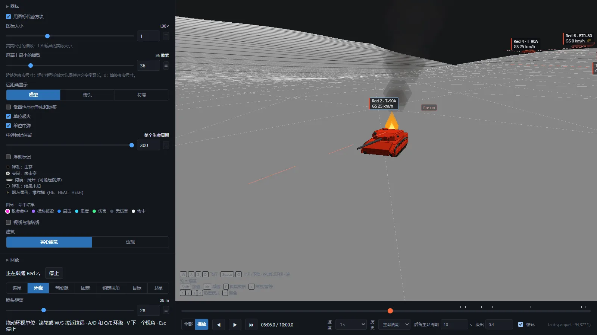

# 图形

**图形**是某个单位真实样子的小型三维模型：坦克、喷气机、舰船、士兵。[回放](match-replay.md) 会把每个单位画成其真实大小的图形，而不是一个普通方块。

大约有 2,000 种有名称的车辆、飞机、舰船、武器和士兵，全部由查看器自身建造。

## 目录中有什么 {#what-is-in-the-catalogue}

| 类别 | 示例 |
|---|---|
| 人员 | 站立、蹲伏、俯卧的士兵；狙击手、反坦克兵、医护兵、乘员 |
| 地面 | 坦克、步兵战车、防空武器、火炮、卡车和汽车、火车和有轨电车 |
| 空中 | 战斗机、攻击机、轰炸机、运输机、直升机，从双翼机到现代喷气机 |
| 海上 | 按级别划分的战舰、航空母舰、潜艇、艇、商船 |
| 武器 | 导弹、火箭、炸弹、鱼雷、照明弹和干扰箔条 |
| 标记 | 烟雾、闪光和燃烧手榴弹、已布置的炸弹、旗帜、出生点、航路点 |
| 近距离战斗 | 身穿防弹插板背心、手持突击步枪、SMG、霰弹枪、DMR、LMG、手枪或盾牌的士兵；无人机、摄像头、铁丝网、盾牌、墙体加固、路障、破墙炸药、陷阱、窗户、手榴弹、拆弹器 |

## 图形如何制作 {#how-the-figures-are-made}

- **根据公布的尺寸建造。** 大多数图形由查看器自己的图形建造器根据公开数据制作：长度、宽度、高度、负重轮、炮塔和火炮、机翼和尾翼。然后根据公开照片、图纸和公布的尺寸调整其形状。没有使用任何游戏的模型。
- **免费模型。** 少数图形在更真实的情况下使用免费三维模型（CC0 或 CC BY），有时会与建造的车身组合。CC BY 作品的作者在 [图形致谢](figure-credits.md) 中署名；CC0 作品无需署名，因此不在该页列出。
- 每个图形都有完整版、粗略版和远距离版（细节层次，LOD），因此可以同时绘制数千个。

## 每个单位获得哪个图形 {#which-figure-a-unit-gets}

查看器会查看数据自身的列：

1. **名称**——名为 *Name*、*Vehicle*、*Unit*、*Unit type*、*Model*、*Aircraft*、*Plane*、*Tank*、*Ship*、*Craft*、*Loadout*、*Kit* 或 *Figure* 的列——会与目录进行匹配：完全匹配，通过约 4,000 个别名（多款游戏的单位 id），按最长的已知开头匹配（`F-16C_50` 即 F-16C），或按以它开头的最短图形名称匹配。
2. 图形与单位**类型**不符的名称不会被使用（名为 *Typhoon* 的卡车不是战斗机）。
3. **类型**——名为 *Type*、*Class*、*Kind*、*Category*、*Icon*、*Role* 或 *Domain* 的列——提供一个类别图形：Tacview 标签（`Air+FixedWing`、`Ground+Heavy+Armor+Vehicle+Tank`、`Sea+Watercraft+Warship`、`Weapon+Missile`）、地图图标，或普通词语（tank、helicopter、infantry）。
4. 两者都没有的数据，就是人员的数据：每个人都是士兵。

因此，获得正确图形最简单的方法是使用一个带有真实名称的 `vehicle` 列，或一个带有 Tacview 标签的 `type` 列。

**我的单位显示为方块或士兵。** 添加一个带有真实名称的 `vehicle` 列，或一个带有 Tacview 标签的 `type` 列。将鼠标悬停在单位上，可看到匹配到了哪个名称。如果数据有这样的列，但对某个单位没有任何说明，它就保持为方块；两者都没有的数据则画成士兵。

## 近距离战斗图形（Rainbow Six Siege） {#close-quarters-figures-rainbow-six-siege}

按 Rainbow Six Siege 回放读取器的格式写成的表格（列 `operator`、`pawn`、`primaryClass`、`side`）会得到专属图形：

- **玩家**显示为其干员：78 名干员每人都有专属图形，身高约 1.8 米，穿着自己的衣服——夹克、裤子和装备按其常见的公开形象使用两到三种颜色（黑色、橄榄色、棕褐色、城市灰、白色、海军蓝，配红色、橙色或青绿色装备）——并有自己的形状；需要从上方看清的部分比真实大三分之一：头戴物（头盔、面罩或重型头盔、帽子、毛线帽、贝雷帽、宽檐奔尼帽或毛皮帽、兜帽、围巾、头发）、面部（护目镜、防毒面具、眼镜、面具、胡子、三镜片护目镜）、轻型、中型或重型体格（重型体格较宽，带大型护肩板和护颈）、长外套或西装、吉利服、背上背的东西（锤子、炸药、无人机、罐子、燃料箱、发射筒、十字弩、面板、干扰器、盾牌）或手臂上的东西（发射器、金属手臂）、自己的盾牌（高盾、防暴盾、带灯的盾），以及肩上的强调色。他们手持主武器的类别。查看器不认识的干员显示为穿防弹插板背心、使用队伍颜色的普通士兵。
- **阵营**与衣服分开显示：每名干员脚下地面上有一个圆环，**进攻方为琥珀色，防守方为浅青色**，圆环内是队伍颜色，臂章和头带也使用同一颜色。`stance` 列（stand、crouch、prone）决定其姿势；没有该列时，他们站立。
- **在回放距离上可以区分：**从上方和四分之三视角以 48 像素高度绘制时，同一阵营的任意两名干员都有明显的颜色差异或不同的形状（由查看器的测试检查）。
- **标签**显示玩家名称和其当时所用的干员，并用符号表示干员的角色：✸ 硬破墙手、⚒ 软破墙手、➤ 突入、✦ 击杀手、✚ 支援、⬟ 盾牌、◉ 情报、◇ 灵活、↺ 侧翼警戒、⚓ 据守、✕ 布陷阱者、⇄ 游走、↯ 反道具、▣ 反破墙。
- **无人机**是可投掷的两轮无人机，宽约 30 厘米，每架都是独立的轨迹，以其主人命名（"Ash · drone 2"）。
- **放置的道具**从放下之时起到回合结束都留在原处，每个都显示为表示其用途的图形：摄像头、铁丝网、可部署盾牌、破墙炸药、硬破墙炸药、小型粘性炸药、地面陷阱、带绊线激光的阔剑地雷、单向窗、装甲板、手榴弹、毒气罐、干扰器、传感器、激光门、补给箱。用途相同的道具共用一个图形。数据未说明种类的道具显示为带灯的小装置。
- **拆弹器**在其安放处停留 45 秒。

文件加载时，每架无人机和每个道具都会成为独立的轨迹，因此玩家自己的图形会留在其身体上。干员是根据其公开描述和图像（所穿的衣服、作为其能力的装置）制作的简化形状，道具则按其用途确定形状。这些全部是查看器自己的设计，采用物体的真实尺寸（阔剑地雷宽约 22 厘米，门大小的面板为 1 米 × 2.1 米），不是游戏中的模型。

## 设置 {#settings}

回放侧边栏中的 **图标** 部分设置大小、屏幕上的最小尺寸、远处单位变成什么（图形、箭头、符号），以及绘制在它们身上的效果。见 [对局回放](match-replay.md#figures)。烟雾、火焰和其他定时效果：见[图形叠加中的图形](figure-replay.md)。

## 可选的本地图形包 {#an-optional-local-figure-pack}

你可以在自己的电脑上保存一个可选的、属于你自己的图形包。其中的图形会替代目录中同名的图形。它从不属于代码库或已发布的版本；没有它，什么都不会改变。
