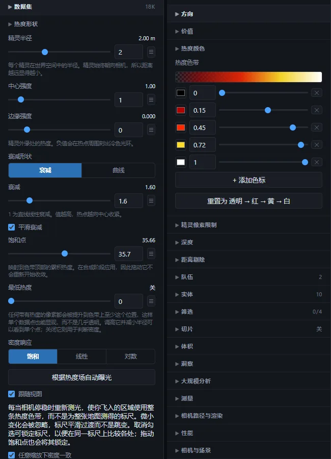

# 热度

热度会为大量事情发生的地方上色：事情发生得少的地方是红色，发生得多的地方是白热色。它回答的问题是“这里发生了什么，发生了多少”。

**热度**（按键 1）是默认模式。每个可见的[行](glossary.md)都会贡献一个面向摄像机的圆形[精灵](glossary.md)；重叠的精灵在浮点缓冲区中相加；总和通过颜色渐变映射——默认是透明 → 红 → 黄 → 白——然后绘制在场景之上。

图片显示的是一个带建筑物的关卡中步战回合的热度：热点位于房间内和楼梯上，而不只是地面上。

## 使用方法 {#how-to-use-it}

1. 加载数据并按 `1`（或在模式栏中选择**热度**）。
2. 如果一切都是白色或空白，请在**热度形状**部分按**根据热度场自动曝光**。
3. 调整**精灵半径**，直到相邻的点合并成带状：较小的显示单个光点，较大的显示区域。
4. 打开**热度颜色**来更改颜色，或打开**深度**，让山丘和墙壁遮住其后的热度。

同样的面板也塑造[差值](difference.md)、[队伍热度](team-heat.md)和[线条热度](line-heat.md)；它们的区别在于相加的内容（带符号、有颜色，或沿线条），而不在于处理方式。

## 面板及其默认值 {#the-panels-and-their-defaults}

下面的每个控件都对应一个着色器参数，因此更改它只需要重绘，没有其他开销。滑块旁边有一个可输入数值的框和一个拖动手柄（右侧的小握把：上下拖动，拖得越远越快，按住 Shift 可微调）；如果滑块轨道在真实上限之前就结束了，手柄可以推过它，最多到这里给出的*拖动上限*。标为*加载时*的值会为每个新数据集重新计算。

### 热度形状（展开）{#heat-shape-open}

| 控件 | 默认值 | 范围（拖动上限） | 详情 |
|---|---|---|---|
| **精灵半径** | 6 m；加载时为范围 / 120 | 0.05-2000 m，对数（50,000） | [精灵形状](sprite-shape.md#sprite-radius) |
| **中心强度** | 1 | 0-10（1000） | [精灵形状](sprite-shape.md#centre-and-edge-intensity) |
| **边缘强度** | 0 | -2-10（1000） | [精灵形状](sprite-shape.md#centre-and-edge-intensity) |
| **衰减形状** | *衰减* | *衰减* / *曲线* | [精灵形状](sprite-shape.md#ramp-shape-falloff-or-curve) |
| **衰减**（仅限衰减） | 1.6 | 0.1-8（64） | [精灵形状](sprite-shape.md#falloff) |
| **平滑衰减**（仅限衰减） | 开 | | [精灵形状](sprite-shape.md#falloff) |
| 曲线编辑器（仅限曲线） | *平滑*预设 | | [精灵形状](sprite-shape.md#the-curve-editor) |
| **饱和点** | 24；加载时为估算值，之后测量 | 0.1-4000，对数（10,000,000） | [颜色与曝光](colour-and-exposure.md#saturation-point) |
| **最低热度** | 关（0） | 0-100% | [颜色与曝光](colour-and-exposure.md#minimum-heat) |
| **密度响应** | *饱和* | *饱和* / *线性* / *对数* | [颜色与曝光](colour-and-exposure.md#density-response) |
| **根据热度场自动曝光** | | 按钮 | [颜色与曝光](colour-and-exposure.md#auto-exposure) |
| **跟随视图** | 开 | | 每次摄像机静止时重新测量曝光，因此飞入的区域会使用整个颜色渐变。小的变化会被忽略，刻度会平滑过渡。取消勾选，或拖动**饱和点**，即可锁定刻度，在同一刻度下比较不同地点。[颜色与曝光](colour-and-exposure.md#follow-the-view) |
| **任意缩放下密度一致** | 开 | | 无论你离得多近，一种颜色在每单位地面面积上都代表相同数量的行。被像素钳制放大（远处）或缩小（近处）的精灵，会保留其真实大小所应添加的热度，因此从远处曝光的画面不会在你飞近时变暗。关闭时，被钳制的精灵以其钳制后的大小添加全部权重。[精灵形状](sprite-shape.md#pixel-clamps) |
| **压平到地平面** | 关 | | [精灵形状](sprite-shape.md#flatten-onto-ground-plane) |

### 热度颜色（收起）{#heat-colours-closed}

| 控件 | 默认值 | 详情 |
|---|---|---|
| 分组色块和**颜色分离度**（仅限队伍热度） | 1.4 | [队伍热度](team-heat.md) |
| **热度色带**编辑器（差值中为*正（相加的队伍）*，队伍热度中为*不透明度色带*） | 透明 → 红 → 黄 → 白 | [颜色与曝光](colour-and-exposure.md#the-ramp-editor) |
| **重置为 透明 → 红 → 黄 → 白** | | |
| **负（相减的队伍）**色带（仅限差值） | 透明 → 绿 → 蓝 → 紫 | [差值](difference.md#colours) |

### 精灵像素钳制（收起）{#sprite-pixel-clamps-closed}

| 控件 | 默认值 | 范围（拖动上限） | 详情 |
|---|---|---|---|
| **最小像素半径** | 1 px | 0-16（512） | [精灵形状](sprite-shape.md#pixel-clamps) |
| **最大像素半径** | 96 px | 2-1024，对数（8192） | [精灵形状](sprite-shape.md#pixel-clamps) |

### 深度（展开）{#depth-open}

| 控件 | 默认值 | 详情 |
|---|---|---|
| **隐藏地形后方** | 开 | [深度与剔除](depth-and-culling.md#hide-behind-terrain) |
| **被几何体遮挡的部分** | 0.8（*暗 80%*） | [深度与剔除](depth-and-culling.md#hidden-behind-geometry) |

### 距离剔除（收起）{#distance-culling-closed}

| 控件 | 默认值 | 范围（拖动上限） | 详情 |
|---|---|---|---|
| **近** | 关（0） | 0.5-5000 m，对数，轨道底部 = 关（200,000） | [深度与剔除](depth-and-culling.md#distance-culling) |
| **远** | 关（0） | 1-200,000 m，对数，底部 = 关（10,000,000） | [深度与剔除](depth-and-culling.md#distance-culling) |
| **按平面裁切** | 开 | | [深度与剔除](depth-and-culling.md#distance-culling) |
| **同时裁切关卡** | 开 | | [深度与剔除](depth-and-culling.md#distance-culling) |

按键：`[` 和 `]` 将远端边界向内和向外推，`\` 切换其开关（[深度与剔除](depth-and-culling.md#keyboard)）。

### 方向和值 {#direction-and-value}

热度形状下方还有两个部分。**方向**将每一行绘制为一个扇形并添加箭头：参见[方向热度](directional-heat.md)。**值**按每一行的代价或收益对热度加权：参见[数值加权](value-weighting.md)。

## 保存的内容 {#what-is-saved}

上面的热度设置不会在会话之间保存：重新加载页面会恢复默认值。浏览器中保存了两项内容：上一次的播放速度（`heat3d.speed`，参见[时间线](timeline.md)），以及[模型叠加](box-replay.md)中远处图形的设置（符号样式、大小、命中标记等）。语言、[反转世界坐标轴](camera.md#invert-world-axis)、赛车标签页记住的车辆名称以及[关卡库](level-library.md)也会保存。完整列表见[已保存的设置](ref-settings-storage.md)。
