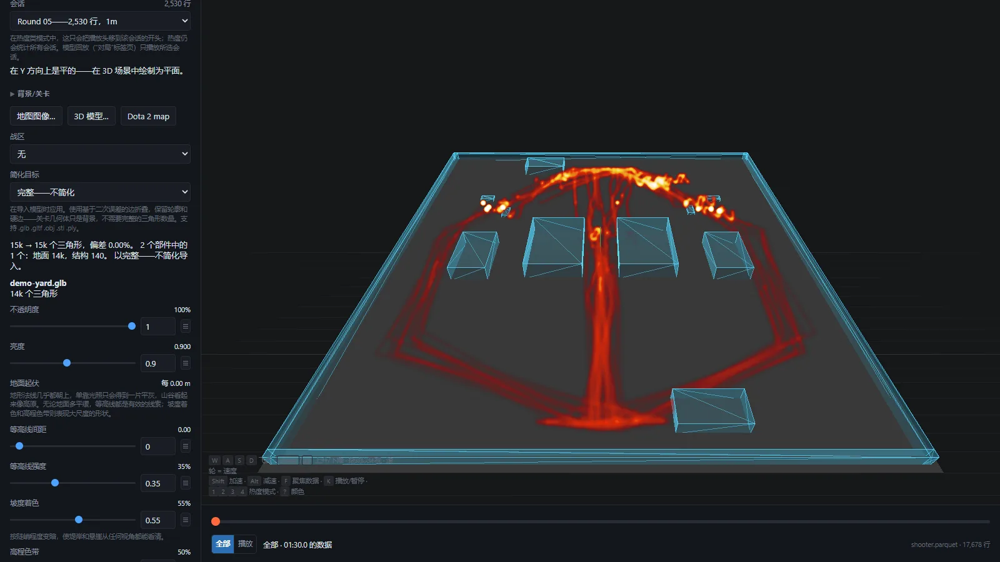

# 热度

热度会把许多事情发生过的地方涂上颜色：事情偶尔发生的地方显示为红色，发生得很频繁的地方则显示为白热。它回答的问题是“这种事在哪里发生，发生了多少”。

**热度**（按键 1）是默认模式。每个可见的[行](glossary.md)都会贡献一个始终面向摄像机的圆形[精灵](glossary.md)；重叠的精灵会在一个浮点缓冲区中相加；总和再通过一条颜色带进行映射——默认是透明 → 红 → 黄 → 白——然后叠加绘制在场景之上。

图片显示的是一个射击游戏回合在有建筑的关卡上的热度：热点位于房间内和楼梯上，而不仅仅是地面上。

## 使用方法 {#how-to-use-it}

1. 载入数据并按 `1`（或在模式栏中选择**热度**）。
2. 如果一切都是白色或空白，在**热度形状**区中按**根据热度场自动曝光**。
3. 调整**精灵半径**，直到相邻的点合并成带状：较小时显示单个的点，较大时显示区域。
4. 打开**热度颜色**来更改颜色，或打开**深度**，让山丘和墙壁遮住它们后面的热度。

同样的面板也会塑造[差值](difference.md)、[队伍热度](team-heat.md)和[线条热度](line-heat.md)；它们的区别在于添加的内容（有符号、有颜色，或沿线进行），而不在于方式。

## 各面板及其默认值 {#the-panels-and-their-defaults}

每个控件都在它自己的页面上有说明；“详情”列链接到该页面。滑块旁边有一个可输入数值的框，以及一个拖动手柄（右侧的小把手：上下拖动，拖得越远变化越快，按住 Shift 可精细调节）；当滑轨在真实上限之前就已结束时，手柄可以推过它，最远到这里给出的*拖动上限*。标注为*载入时*的值会针对每个新数据集重新计算。

### 热度形状（展开） {#heat-shape-open}

| 控件 | 默认值 | 范围（拖动上限） | 详情 |
|---|---|---|---|
| **精灵半径** | 6 m；载入时为范围 / 120 | 0.05-2000 m，对数刻度（50,000） | [精灵形状](sprite-shape.md#sprite-radius) |
| **中心强度** | 1 | 0-10（1000） | [精灵形状](sprite-shape.md#centre-and-edge-intensity) |
| **边缘强度** | 0 | -2-10（1000） | [精灵形状](sprite-shape.md#centre-and-edge-intensity) |
| **衰减形状** | *衰减* | *衰减* / *曲线* | [精灵形状](sprite-shape.md#ramp-shape-falloff-or-curve) |
| **衰减**（仅衰减时） | 1.6 | 0.1-8（64） | [精灵形状](sprite-shape.md#falloff) |
| **平滑衰减**（仅衰减时） | 开 | | [精灵形状](sprite-shape.md#falloff) |
| 曲线编辑器（仅曲线时） | *平滑*预设 | | [精灵形状](sprite-shape.md#the-curve-editor) |
| **饱和点** | 24；载入时为估算值，之后为测量值 | 0.1-4000，对数刻度（10,000,000） | [颜色与曝光](colour-and-exposure.md#saturation-point) |
| **最低热度** | 关（0） | 0-100% | [颜色与曝光](colour-and-exposure.md#minimum-heat) |
| **密度响应** | *饱和* | *饱和* / *线性* / *对数* | [颜色与曝光](colour-and-exposure.md#density-response) |
| **根据热度场自动曝光** | | 按钮 | [颜色与曝光](colour-and-exposure.md#auto-exposure) |
| **跟随视图** | 开 | | 每当摄像机停下时都会重新测量曝光，因此你飞入的区域会使用整个颜色带。小的变化会被忽略，刻度平滑过渡。取消勾选，或拖动**饱和点**，即可锁定刻度，在同一刻度下比较不同地方。[颜色与曝光](colour-and-exposure.md#follow-the-view) |
| **任意缩放下密度一致** | 开 | | 无论你离得多近，一种颜色都表示每单位地面面积的相同行数。被像素限制放大（远处）或缩小（近处）的精灵，会保留其真实大小应添加的热度，因此从远处曝光的画面不会在你飞近时变淡。关闭时，被限制的精灵会以其限制后的大小添加全部权重。[精灵形状](sprite-shape.md#pixel-clamps) |
| **压平到地平面** | 关 | | [精灵形状](sprite-shape.md#flatten-onto-ground-plane) |

### 热度颜色（折叠） {#heat-colours-closed}

| 控件 | 默认值 | 详情 |
|---|---|---|
| 各组色块与**颜色分离度**（仅队伍热度） | 1.4 | [队伍热度](team-heat.md) |
| **热度色带**编辑器（差值中为*正值（加法队伍）*，队伍热度中为*不透明度颜色带*） | 透明 → 红 → 黄 → 白 | [颜色与曝光](colour-and-exposure.md#the-ramp-editor) |
| **重置为 透明 → 红 → 黄 → 白** | | |
| **负（相减的队伍）**色带（仅差值） | 透明 → 绿 → 蓝 → 紫 | [差值](difference.md#colours) |

### 精灵像素限制（折叠） {#sprite-pixel-clamps-closed}

| 控件 | 默认值 | 范围（拖动上限） | 详情 |
|---|---|---|---|
| **最小像素半径** | 1 px | 0-16（512） | [精灵形状](sprite-shape.md#pixel-clamps) |
| **最大像素半径** | 96 px | 2-1024，对数刻度（8192） | [精灵形状](sprite-shape.md#pixel-clamps) |

### 深度（展开） {#depth-open}

| 控件 | 默认值 | 详情 |
|---|---|---|
| **隐藏地形后方** | 开 | [深度与剔除](depth-and-culling.md#hide-behind-terrain) |
| **被几何体遮挡的部分** | 0.8（*调暗 80%*） | [深度与剔除](depth-and-culling.md#hidden-behind-geometry) |

### 距离剔除（折叠） {#distance-culling-closed}

| 控件 | 默认值 | 范围（拖动上限） | 详情 |
|---|---|---|---|
| **近** | 关（0） | 0.5-5000 m，对数刻度；滑轨底部为关（200,000） | [深度与剔除](depth-and-culling.md#distance-culling) |
| **远** | 关（0） | 1-200,000 m，对数刻度；底部为关（10,000,000） | [深度与剔除](depth-and-culling.md#distance-culling) |
| **按平面裁切** | 开 | | [深度与剔除](depth-and-culling.md#distance-culling) |
| **同时裁切关卡** | 开 | | [深度与剔除](depth-and-culling.md#distance-culling) |

按键：`[` 和 `]` 把远界向内和向外推，`\` 切换它（[深度与剔除](depth-and-culling.md#keyboard)）。

### 方向与值 {#direction-and-value}

热度形状下方还有两个区域。**方向**会把每一行画成一个楔形并添加箭头：见[方向热度](directional-heat.md)。**值**会按每一行的花费或所得来加权热度：见[数值加权](value-weighting.md)。

## 保存的内容 {#what-is-saved}

上面的热度设置不会在两次会话之间保存：重新加载页面会恢复默认值。浏览器中保存了两样东西：上次的播放速度（`heat3d.speed`，见[时间线](timeline.md)），以及[模型叠加](box-replay.md)中远处图标的设置（符号样式、大小、命中标记等）。语言、[反转的世界坐标轴](camera.md#invert-world-axis)、赛车标签页中记住的赛车名称，以及[关卡库](level-library.md)也会被保存。完整列表见[已保存的设置](ref-settings-storage.md)。
