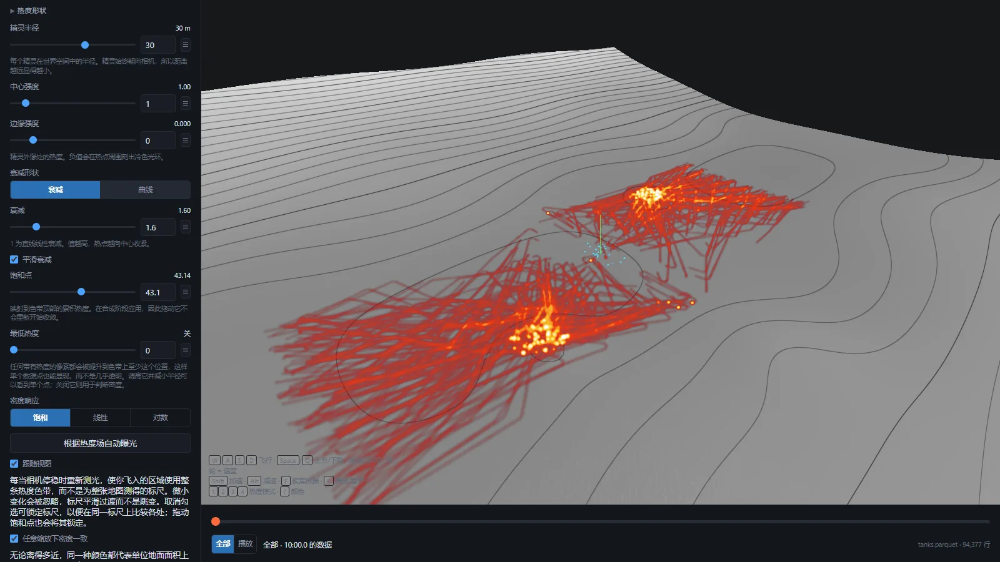
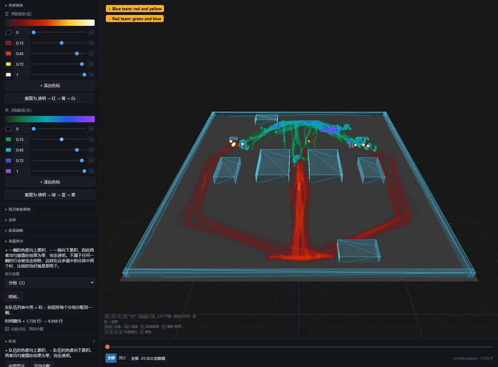
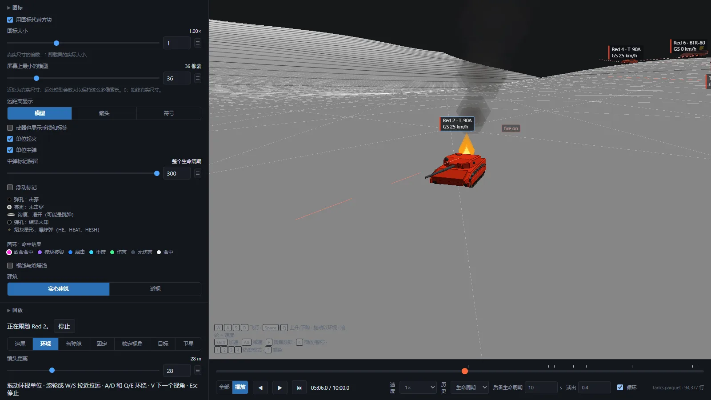
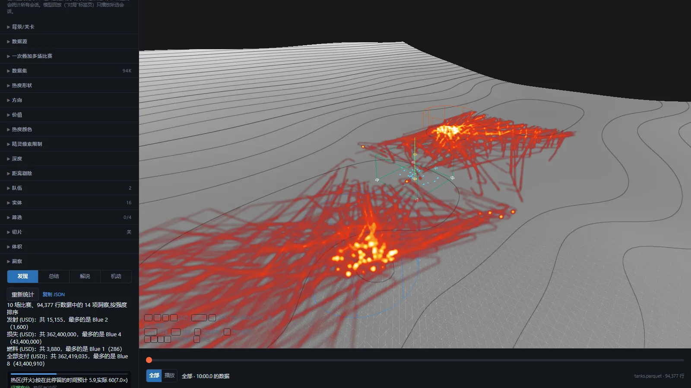
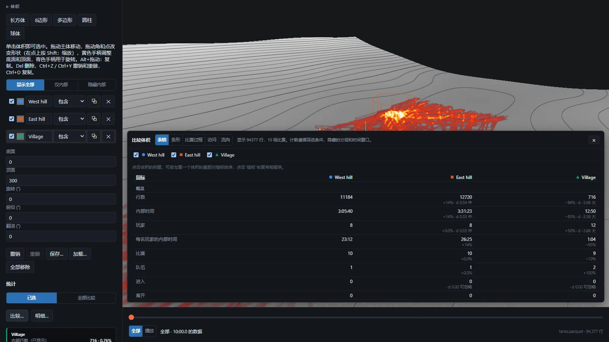
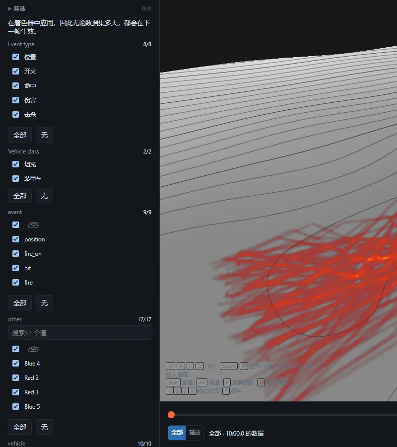
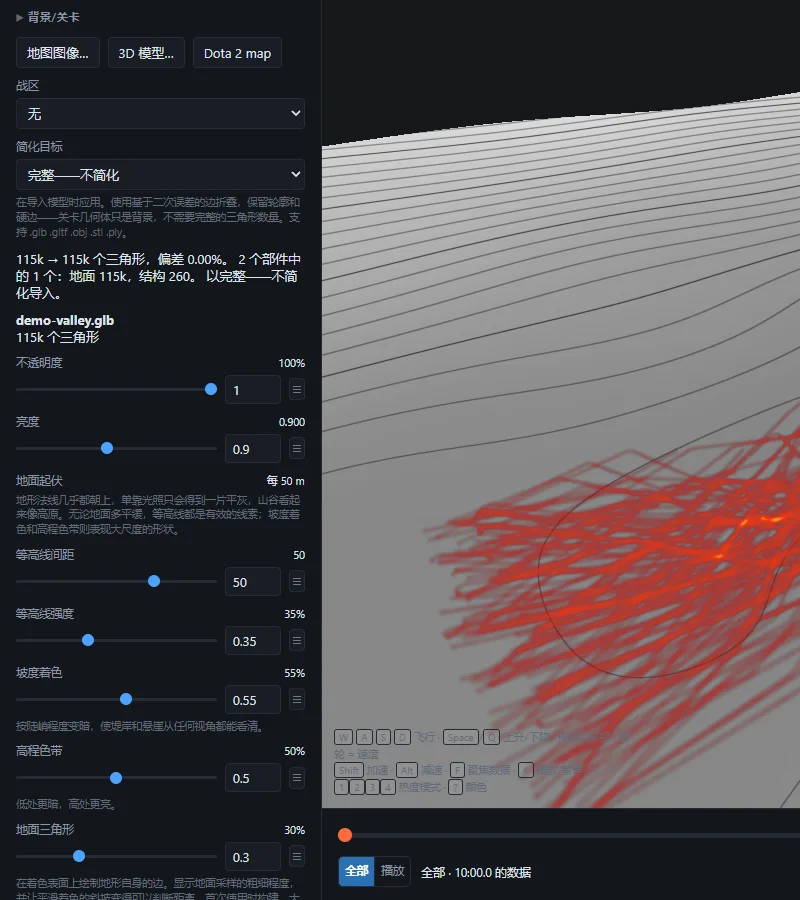

# 3DHeat

3DHeat 显示游戏中事情发生在哪里：玩家去了哪里、在哪里交战、在哪里倒下。结果是一些发光的颜色，你可以在其中飞行穿梭；也可以是一个个小小的 3D 图形，重现整场比赛。

加载位置数据，包括 CSV、Parquet、Tacview 录像、转换后的回放、单个文件、一个文件夹或成千上万场比赛，然后把它们看成**可以飞行穿梭的热力图**、**重现比赛的图形**、沿玩家路线绘制的线条，或者两组人群之间的对比。它会自己找出突出的地方，完全在你的浏览器中运行：没有任何内容会上传到别处。3DHeat 及其所有工具都是免费的开源软件，采用 [MIT 许可证](https://github.com/Holdi601/3DHeat/blob/main/LICENSE)发布。



**第一次使用？** 先生成[演示数据](demo-data.md)，然后按它的七个步骤操作。本站的每一张图都是用它拍的。

## 它能做什么 {#what-it-does}

| | |
|---|---|
|  | **[热度模式](heat-modes.md)**：热度、[差值](difference.md)（一方更多的地方为红色，另一方更多的地方为绿蓝色）、[队伍热度](team-heat.md)、[线条热度](line-heat.md)；[方向热度](directional-heat.md)，包括扇形、箭头场和极坐标图；按[数值加权](value-weighting.md)的热度：武器、载具和燃料各自的代价。 |
|  | **[比赛回放](match-replay.md)**：每个单位都以它所属类型的[图形](figures.md)呈现，远距离时显示北约或俄式符号，还有导弹和曳光弹、命中标记、残骸、火焰、炮塔、目标，以及 Tacview 风格的摄像机和战术显示；[同时查看多场比赛](many-matches.md)。 |
|  | **[洞察](insights.md)**：强势位置、致命地形、出生点陷阱、瓶颈和突出的玩家，附带证据并排序；书面复盘，可选由你选择的 AI 生成；单场比赛的解说模式；[知识视角](knowledge.md)。 |
|  | **[体积](volumes.md)**：绘制方块、棱柱、圆柱和球体，按它们筛选，统计其中发生的事情，导出，并把多个地点并排比较；[细分](breakdown.md)显示某个地点中谁、什么表现最好。 |
|  | **[筛选](filters.md)**：按事件类型、玩家或 AI、载具类别、数值、任意列筛选，在任何数据规模下都由显卡完成。 |
|  | **[关卡](levels.md)**：地图图像、用[数据工具](#related-repositories)制作的 3D 关卡、简化处理、用于飞行数据的真实地形[世界背景](world-backdrop.md)。 |

此外还有：用于赛车游戏多圈数据的[赛车分析](race-analysis.md)标签页；用于 Counter-Strike 2 摘要的[对局](match-analysis.md)标签页；用于关卡上计划的[战术面板](tactics-board.md)；按载具统计的[命中分析](hit-analysis.md)；数千场比赛的[批量分析](mass-analysis.md)；[摄像机路径与视频](camera-path-and-video.md)；[40 种语言](languages.md)；[公制或英制单位](settings.md)。

## 标签页 {#the-tabs}

标签页位于侧边栏顶部，在名称、单位和语言菜单之下。

| 标签页 | 用途 |
|---|---|
| **热力图** | 任何位置表：热度模式、模型叠加、筛选、体积、洞察、关卡、测量和视频。 |
| **赛车分析** | 同一赛道的两圈或更多圈：时间在哪里损失、为什么损失、该怎么改。 |
| **对局** | 比赛的图形回放，以及 Counter-Strike 2 的对局摘要。 |
| **战术** | 关卡上的计划：图形、路线、投掷的辅助道具、区域和备注，按步骤播放。 |
| **载具** | 每个单位在哪里被命中、被谁命中、用什么命中。 |

## 安装与运行 {#install-and-run}

3DHeat 可以免费使用、修改和分享（MIT 许可证），[相关仓库](#related-repositories)中列出的每个工具同样如此。

### Windows，简便方式 {#windows-the-easy-way}

仓库根目录有三个批处理文件。

| 文件 | 作用 |
|---|---|
| `start.bat` | 启动查看器。即使 Node.js 不在 `PATH` 中，它也能找到（会查找 `%ProgramFiles%\nodejs`、`%ProgramFiles(x86)%\nodejs` 和 `%LOCALAPPDATA%\Programs\nodejs`）。如果缺少 Node.js，它会提议用 `winget install -e --id OpenJS.NodeJS.LTS` 安装 LTS 版本。首次运行时，它会先询问是否下载依赖（约 300 MB，放在本文件夹内的 `node_modules\` 中，不会改动系统）。如果端口 5273 已被占用，它会拒绝启动，并建议改用 `restart.bat`。如果该文件夹是 git 检出且没有本地修改，并且有更新版本，它会询问是否更新（Y/N；60 秒内没有回答则保留当前版本；参见[更新](updates.md)）。然后它在 `http://127.0.0.1:5273/` 运行开发服务器并打开浏览器。**这个窗口就是服务器**：保持打开即可；关闭它或按 Ctrl+C 即可停止。 |
| `restart.bat` | 运行 `stop.bat quiet`，然后运行 `start.bat`。只有在修改了 `vite.config.ts`、添加了依赖，或服务器卡住时才需要使用；源代码修改会热重载。 |
| `stop.bat` | 停止占用端口 5273 的进程。它通过 `netstat` 找到进程号再结束，从不按映像名称结束，因此机器上的其他 Node.js 进程不受影响。它会等待约两秒，直到套接字释放。带参数 `quiet` 时，结束时不会暂停。 |

### 手动操作（任何系统）{#by-hand-any-os}

```bash
git clone --recursive https://github.com/Holdi601/3DHeat.git
cd 3DHeat
npm install
npm run dev      # http://127.0.0.1:5273
```

`exporters/` 文件夹以 git 子模块的形式存放各个独立的数据工具，每个都是自己的仓库；普通克隆之后，请运行 `git submodule update --init`。查看器本身运行时不需要它们。`exporters/ext/` 存放可选的转换器（战争雷霆、坦克世界、战舰世界、Squad 回放；DCS 和 IL-2 地图），与主程序分开存放，因此其中一个出现问题不会影响其他部分。

所有这些都不附带任何游戏数据：关卡、地图和录像都在你自己的机器上，使用这些工具、基于你拥有的游戏制作。

### npm 脚本 {#npm-scripts}

| 脚本 | 运行内容 |
|---|---|
| `npm run dev` | 端口 5273 上的 Vite 开发服务器，绑定到 `127.0.0.1`。 |
| `npm run build` | 类型检查（`tsc --noEmit`）并在 `dist/` 中生成生产版本。 |
| `npm run preview` | 提供生产版本的服务。 |
| `npm run typecheck` | 仅进行类型检查。 |
| `npm test` / `npm run test:watch` | 单元和集成测试（vitest）。 |
| `npm run smoke` | 在无界面的 Chromium 中驱动真实应用，检查画布上是否有带数据颜色的像素；截图保存到 `tools/.smoke/`。需要开发服务器已在运行。 |
| `npm run smoke:f16` | 同一套测试，但带上 `?heat=f16`，强制使用半精度浮点累积路径（参见[半精度浮点累积](half-float-accumulation.md)）。 |
| `npm run bench` | 导入基准测试，结果写入 `tools/.smoke/ingest-bench.json`。 |
| `npm run test:heavy` | 需要大型真实数据文件的测试；如果文件不存在，它们会自动跳过。 |
| `npm run inspect -- <file.parquet>` | 打印 Parquet 文件的结构和部分行（`tools/inspect-parquet.mjs`）。 |

### 开发服务器的附加功能 {#what-the-dev-server-adds}

查看器是一个静态网页，但开发服务器（参见 `vite.config.ts`）额外提供两个本地路由，静态部署的 `dist/` 没有这两个路由：

- `/__host/memory` 报告机器已安装和可用的内存，并在可以读取时报告显卡的显存（来自 `nvidia-smi`，或在 Windows 上来自显示适配器的注册表项）。这使[内存预算](memory-and-budgets.md)能够使用真实数字，而不是浏览器受限的估计值。
- `/__heat3d/update` 检查检出的代码是否落后，并可以快进更新（[更新](updates.md)）。

服务器只绑定到 `127.0.0.1`，因此这两个路由都无法从网络访问。请用 `http://127.0.0.1:5273` 打开：`localhost` 可能解析到 IPv6 回环地址 `::1`，那里没有任何服务在监听。它不发送跨源隔离头（COOP/COEP）：查看器中没有任何内容使用 `SharedArrayBuffer`，工作线程通过转移来交换数据，无需它。

## 浏览器与 GPU 要求 {#browser-and-gpu-requirements}

- **支持 WebGPU 或 WebGL2 的浏览器。** 首先尝试 WebGPU（Chrome 和 Edge 支持）；没有它时使用 WebGL2 后端。WebGL2 必须提供 `EXT_color_buffer_float`（渲染到浮点纹理），否则查看器会显示“无法初始化渲染器”。参见[两种后端](backends.md)。查看器在 Chromium 中开发和测试；其他浏览器未经验证。
- **已开启硬件加速。** 当浏览器用 CPU 绘图时（SwiftShader、llvmpipe、Microsoft Basic Render Driver 等），侧边栏顶部会出现红色横幅，说明情况以及修复方法。参见[软件渲染检测](software-rendering.md)。
- **独立显卡有帮助，但不是必需的。** 两种后端都会请求高性能适配器。能在 GPU 上保存多少数据是一个可以查看和更改的预算（[内存与预算](memory-and-budgets.md)）。
- **可选功能**使用其他浏览器 API：视频渲染需要带 VP9 或 VP8 的 WebCodecs `VideoEncoder`（[摄像机路径与视频](camera-path-and-video.md)）；关卡的网格简化需要 WebAssembly；拖放文件夹使用 File 和 Directory Entries API；关卡库使用 IndexedDB；手柄使用 Gamepad API。

## 文档地图 {#documentation-map}

**开始**：[演示数据](demo-data.md) · [导入数据](getting-data-in.md)（[加载文件](loading-files.md)、[列映射](column-mapping.md)、[坐标轴、单位与时间](axes-units-and-time.md)、[会话、人员与分组](sessions-persons-groups.md)、[Tacview](tacview-acmi.md)、[转换器](converters.md)、[.3dheat](container.md)、[内存与预算](memory-and-budgets.md)）

**查看**：[热度模式](heat-modes.md)（[热度](heat.md)、[精灵形状](sprite-shape.md)、[颜色与曝光](colour-and-exposure.md)、[深度与剔除](depth-and-culling.md)、[差值](difference.md)、[队伍热度](team-heat.md)、[线条热度](line-heat.md)、[模型叠加](box-replay.md)、[方向热度](directional-heat.md)、[数值加权](value-weighting.md)）· [时间线](timeline.md) · [关卡](levels.md)（[地图图像](map-images.md)、[3D 关卡](model-levels.md)、[外观](level-appearance.md)、[关卡库](level-library.md)、[世界背景](world-backdrop.md)、[其来源](world-backdrop-sources.md)）· [摄像机](camera.md)（[手柄](gamepad.md)、[按键](keyboard-reference.md)）· [摄像机路径与视频](camera-path-and-video.md)

**分析**：[筛选与工具](filters-and-tools.md)（[筛选](filters.md)、[队伍](teams-list.md)、[实体](entities.md)、[切片](slice.md)、[测量](measure.md)、[体积](volumes.md)、[细分](breakdown.md)）· [洞察](insights.md)（[知识视角](knowledge.md)）· [批量分析](mass-analysis.md)

**回放**：[比赛回放](match-replay.md) · [同时查看多场比赛](many-matches.md) · [图形](figures.md)（[模型叠加中的图形](figure-replay.md)、[致谢](figure-credits.md)）· [Tacview 对齐](tacview-parity.md) · [命中分析](hit-analysis.md)

**其他标签页**：[赛车分析](race-analysis.md)（[方法](race-analytics.md)、[其他游戏](other-games.md)）· [对局分析](match-analysis.md) · [战术面板](tactics-board.md)（[速度](tactics-speeds.md)）

**查看器**：[术语表](glossary.md) · [设置、单位与按键](settings.md) · [语言](languages.md) · [更新](updates.md) · [渲染内部机制](rendering-internals.md)（[后端](backends.md)、[累积](accumulation.md)、[采样与预算](sampling-and-budgets.md)、[半精度浮点](half-float-accumulation.md)、[GPU 内存](gpu-memory.md)、[软件渲染](software-rendering.md)、[性能与统计](performance-and-stats.md)）· [数据格式](data-formats.md) · [参考](reference.md) · [维护文档](maintaining.md)

## 相关仓库 {#related-repositories}

查看器读取数据；这些工具负责生成数据。每个工具都是独立的公开仓库（MIT 许可），附带自己的文档。它们都不附带游戏数据：关卡、地图和录像都在你自己的机器上，基于你拥有的游戏制作。

| 仓库 | 作用 | 用途 |
|---|---|---|
| [3DHeat-GameFiles](https://github.com/Holdi601/3DHeat-GameFiles) | 从游戏发行的归档中读取赛道和关卡（Forza Horizon、BeamNG、Assetto Corsa Rally；Unreal、Unity、Frostbite 和 Source 2 读取器），输出为 glTF | 放在你的热度或回放下方的 3D 关卡 |
| [3DHeat-GameCapture](https://github.com/Holdi601/3DHeat-GameCapture) | 从赛车游戏公开的接口记录圈速遥测，并从游戏视频重建关卡 | 赛车分析的圈次数据；无法读取文件时的关卡 |
| [3DHeat-UnrealExporter](https://github.com/Holdi601/3DHeat-UnrealExporter) | Unreal 编辑器插件，将关卡导出为一个 glTF 文件 | 你自己的 Unreal 项目中的关卡 |
| [3DHeat-CS2](https://github.com/Holdi601/3DHeat-CS2) | 将 Counter-Strike 2 的 demo 转换为热力图表和对局摘要，并将 CS2 地图转换为几何体 | CS2 热度、回放和对局标签页 |
| [3DHeat-Watcher](https://github.com/Holdi601/3DHeat-Watcher) | 在后台根据游戏公开的内容记录你的游戏：遥测、游戏状态集成、日志、回放 | 无需手动操作即可获得你自己的统计数据 |
| [3DHeat-Ext-WarThunder](https://github.com/Holdi601/3DHeat-Ext-WarThunder) | 将战争雷霆回放（`.wrpl`）转换为表格：空中和地面轨迹、射击、命中、击杀、炮塔、目标 | 战争雷霆回放、命中标记和洞察 |
| [3DHeat-Ext-WoT](https://github.com/Holdi601/3DHeat-Ext-WoT) | 将坦克世界回放转换为表格：每辆载具的位置、死亡和击杀 | 坦克世界热度和回放 |
| [3DHeat-Ext-WoWs](https://github.com/Holdi601/3DHeat-Ext-WoWs) | 将战舰世界回放转换为表格：每艘舰船的位置和击沉 | 战舰世界热度和回放 |
| [3DHeat-Ext-Squad](https://github.com/Holdi601/3DHeat-Ext-Squad) | 将 Squad 服务器 demo 转换为表格：每位玩家的位置、队伍和小队 | Squad 热度和回放 |
| [3DHeat-Ext-DCS](https://github.com/Holdi601/3DHeat-Ext-DCS) | 将你本机安装的 DCS World 地形转换为关卡：地面、道路、城镇、机场、田野、水域 | DCS 和 Tacview 录像在其真实地形上的显示 |
| [3DHeat-Ext-IL2](https://github.com/Holdi601/3DHeat-Ext-IL2) | 将 IL-2 Great Battles 地图转换为关卡 | 在其地图上显示的 IL-2 录像 |

## 源代码结构（简述）{#source-layout-briefly}

| 文件夹 | 内容 |
|---|---|
| [`src/data/`](https://github.com/Holdi601/3DHeat/tree/main/src/data) | 文件选择、CSV 和 Parquet 导入、自动映射、验证、内存模型、数据集构建器、模型解析、分类、简化、关卡库 |
| [`src/render/`](https://github.com/Holdi601/3DHeat/tree/main/src/render) | 帧循环（`engine.ts`）、采样、两种后端、摄像机、手柄、测量、摄像机路径、视频录制 |
| [`src/state/`](https://github.com/Holdi601/3DHeat/tree/main/src/state) | 应用状态（`store.ts`）及其所有默认值、领域类型（`types.ts`）、精灵曲线 |
| [`src/ui/`](https://github.com/Holdi601/3DHeat/tree/main/src/ui) | 侧边栏面板、时间线、覆盖层 |
| [`src/race/`](https://github.com/Holdi601/3DHeat/tree/main/src/race)、[`src/match/`](https://github.com/Holdi601/3DHeat/tree/main/src/match) | 赛车分析和对局标签页 |
| [`src/i18n/`](https://github.com/Holdi601/3DHeat/tree/main/src/i18n) | 翻译 |
| [`src/insights/`](https://github.com/Holdi601/3DHeat/tree/main/src/insights) | 洞察：检测器、复盘、解说、AI 提供方、知识视角 |
| [`src/mass/`](https://github.com/Holdi601/3DHeat/tree/main/src/mass) | 对多场比赛的批量分析 |
| [`src/volumes/`](https://github.com/Holdi601/3DHeat/tree/main/src/volumes) | 体积、其统计、导出和比较 |
| [`src/breakdown/`](https://github.com/Holdi601/3DHeat/tree/main/src/breakdown) | 细分和因素 |
| [`src/overlay/`](https://github.com/Holdi601/3DHeat/tree/main/src/overlay) | 多场比赛叠加 |
| [`src/figures/`](https://github.com/Holdi601/3DHeat/tree/main/src/figures) | 图形目录及其构建器 |
| [`src/vehicle/`](https://github.com/Holdi601/3DHeat/tree/main/src/vehicle) | 命中分析（载具标签页） |
| [`src/tactics/`](https://github.com/Holdi601/3DHeat/tree/main/src/tactics) | 战术面板 |
| [`src/world/`](https://github.com/Holdi601/3DHeat/tree/main/src/world) | 世界背景 |
| [`src/units/`](https://github.com/Holdi601/3DHeat/tree/main/src/units) | 计量单位 |
