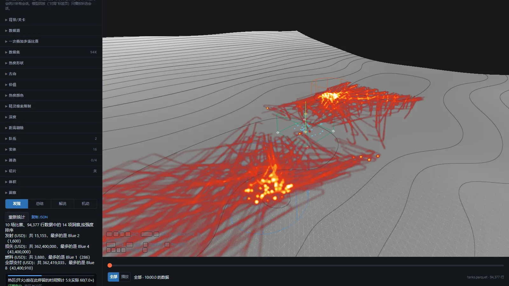

# 洞察

**洞察**会在已加载的数据中寻找突出的内容——强势位置、致命地形、出生点陷阱、咽喉点，以及远超同侪的玩家——并按最强者优先的顺序，附带证据告诉你。用它能在一分钟内了解一场比赛是在哪里赢或输的。之后它可以撰写一份总结；在单场回放中，它还可以充当解说，跳到关键时刻。

所有计数都在你的浏览器中完成。除非你开启外部 AI（参见[外部 AI](#external-ai)），否则没有任何内容会离开你的电脑。

**洞察**部分位于热力图和对局标签页的侧边栏中。它有三个标签页：**发现**、**总结**和**解说**。

## 发现 {#findings}

1. 加载数据并打开**洞察**。按**查找洞察**（“统计中… n%”显示进度）。
2. 阅读列表。每个发现都有一个强度条、一句话描述、证据的可靠程度（*证据充分*、*证据良好*或*有一定证据*）、发现它的检测器，以及在有关系时的载具类别。
3. **点击某个发现**：查看器会应用其筛选，把摄像机飞到该地点并跳转到相应时间，并打开详情：带 95% 区间的效应、p 值和 q 值、统计的证据，以及**此处体积**，它会在该地点周围绘制一个[体积](volumes.md)。
4. **恢复筛选**会把你的筛选恢复。**复制 JSON**会复制整份报告。

统计会在整个时间范围内使用当前的筛选、隐藏的分组和所选的对局。之后当你更改筛选时，会有提示说明；按**重新统计**即可。

列表顶部的各行（例如金钱总额）会在发现之前概括整个数据。

### 检测器 {#the-detectors}

| 检测器 | 它发现什么 | 数据中需要 |
|---|---|---|
| **强势位置** | 击杀与死亡之比远优于地图其他部分的地点，以及在停留期间很少有人死亡的*安全地面* | 击杀和死亡事件 |
| **热区与冷区** | 某类事件（射击、命中、占领 ……）发生得远比停留时间所预测的更多或更少的地点 | 一个事件列 |
| **开阔地与掩体** | 在开阔地的死亡，对比附近的关卡几何体，以及对比快速移动时的缓慢移动 | 死亡；几何部分需要 3D 关卡 |
| **出生点** | 强势出生点、出生点陷阱、安全出生点、首次接触的时间 | 时间和人员 |
| **按地点看职业** | 某一载具类别，或玩家与 AI 对比，在某一区域表现明显更好或更差 | 击杀，加上载具类别或玩家 / AI 列 |
| **玩家** | 在同一类别中击杀或死亡远多于或远少于他人的玩家 | 人员和击杀 |
| **咽喉与侧翼** | 咽喉点（穿越次数远多于周围地面）和侧翼路线（很少使用，但能导向击杀） | 人员 |
| **值** | *高成本地面*和*高收益地面* | [数值列](value-weighting.md) |
| **是什么决定了回合** | 区分赢下与输掉回合的因素，以及增加或损失获胜概率最多的玩家（见[谁赢了](#who-won-what-decided-the-rounds)） | 回合、击杀和死亡，以及[结果列](data-formats.md#outcome-columns)（`won`） |

无法在数据上运行的检测器会列在底部，并说明原因。

### 发现如何排序 {#how-findings-are-ranked}

每个地点或分组都会与地图其余部分进行检验（精确二项检验或速率检验）。错误发现率保持在 5%（Benjamini-Hochberg）。偶然性可能看起来像规律；这种做法可以减少误报：在显示的发现中，预计大约只有二十分之一是偶然的。来自很少事件的效应在排序前会被拉向“无效应”。最多列出 60 个发现，并且每个检测器都会在靠前的位置至少有几个地点。

### 谁赢了：是什么决定了回合 {#who-won-what-decided-the-rounds}

如果数据写明了每个回合由谁赢下（`won` [结果列](data-formats.md#outcome-columns)：CS2、Rainbow Six Siege、War Thunder ……），结果就是洞察的核心。对每一方，它按回合中发生的事把回合分开，并比较胜率：

| 因素 | 该方有此情况的回合 | ……以及没有的回合 |
|---|---|---|
| 首次对枪 | 拿下了第一个击杀 | 先阵亡 |
| 购买 | 购买比另一方好 | 更差 |
| 首死被换 | 首个阵亡在 5 秒内被换回 | 没有被换 |
| 安放 | 安放了炸弹 | 没有安放 |
| 道具 | 投掷物比平常的回合多 | 更少 |
| 早接触 | 第一次对枪早于本场比赛的中位时间 | 更晚 |
| 守住某地 | 有玩家在该地点站了 5 秒或更久 | 没有人 |
| 早到某地 | 有玩家在前 25 秒内到达那里（路线） | 没有人 |

每次比较都是两个胜率之差，附带 95% 区间（Newcombe）、Fisher 精确 p 值，以及跨所有尝试过的因素的 q 值（Benjamini-Hochberg）。回合少于 8 个的一侧会标为*回合少*。低于 5% 错误发现率的成为发现；最强的排在其他检测器的发现之上（结果类发现的权重是同等效应和证据的其他发现的 1.35 倍）。

一个虚构的例子，共 40 回合：

> **T** 守住 **Mid** 的 19 个回合中赢下 79%，没有守住的 21 个回合中赢下 24%（55 个百分点，95%：26 至 74）——q 0.004。

它还会跟踪回合的**获胜概率**——每一方在每个时刻的胜算，依据存活人数、安放情况和时钟：回合有 30 个或更多时据此拟合，否则使用固定的先验模型（文字会说明是哪一种）。由此得出**转折点**（最能改变胜算的击杀和安放）以及每名玩家**增加的获胜概率**：他们的击杀和安放计为正，他们的阵亡计为负，以整场比赛中相当于多少个回合来表示，附带每回合平均值及其区间，并与零比较检验。地点也有同样的收支：哪一方在那里发生的对枪中得益最多。

数据需要双方的回合、击杀和死亡，以及 `won` 列；守住地点需要有名称的地点（`place`），购买需要 `buy` 列。

## 总结 {#debrief}

**总结**标签页会将发现写成一段简短的文字：开篇、最清晰的一个发现、一条战术建议、一条平衡性建议，然后——如果数据写明了谁赢——是什么决定了回合，其余按检测器分组的发现，以及有多少发现依据较弱的证据。

是什么决定了回合分为四段：比分以及获胜概率的来源；最强的因素及其数字、区间和 q（如果没有一个通过错误发现率，文字会写*目前都还不确定*，但仍会说出最强的那个）；最大的三个转折点；以及增加和损失获胜概率最多的玩家，加上得益最多的地点。一个虚构的例子：

> 在结果已知的 40 回合中，T 赢下 23，CT 赢下 17（T：58%，95%：42% 至 72%）。获胜概率来自拟合了这些回合的模型。
>
> 区分赢下与输掉回合的因素：T 守住 Mid 的 19 个回合中赢下 79%，没有守住的 21 个回合中赢下 24%（55 个百分点，95%：26 至 74）（q 0.004），……
>
> 转折点：第 17 回合 48 秒，CT 在 B 点的一次击杀使其胜算从 31% 变为 58%，并赢下了该回合，…… 每个段落都有编号按钮，用于显示其对应的发现。**复制文本**会复制它。

内置叙述者可离线工作，使用你的语言。其上方的**视角**选择器（参见[知识视角](knowledge.md)）决定段落引用哪些文献。

### 外部 AI {#external-ai}

**AI 设置**允许你选择一个 AI 模型来撰写总结：

| 设置 | 含义 |
|---|---|
| **提供方** | Anthropic (Claude)、OpenAI (ChatGPT)、OpenRouter、Ollama（本地）、LM Studio（本地）、llama.cpp 服务器（本地），或任何兼容 OpenAI 的端点 |
| **基础 URL**、**模型** | 由提供方填写；**列出模型**会向服务器请求列表 |
| **API 密钥** | 仅发送到基础 URL。从不记录，也从不保存在视图、导出或 `.3dheat` 文件中。大多数本地服务器不需要它。 |
| **在此浏览器中记住密钥** | 默认关闭：页面关闭后密钥会被遗忘 |
| **使用外部 AI** | 默认关闭 |
| **发送玩家名称** | 默认关闭：玩家以 P1、P2 …… 的形式发送 |

然后输入一个可选问题，并按**用 AI 撰写**。发送的只有发现及其数字——从不发送你数据的行。答案会逐字显示；被引用的发现会变成按钮。如果数据写明了谁赢，会要求模型先写是什么决定了回合，给每个数字附上区间和 q，并在某个因素只依据很少的回合、或获胜概率来自先验模型时说明这一点。

## 解说 {#caster}

对于**一场比赛**（如果加载了多场，请选择一场），**解说**会找出值得观看的时刻：第一滴血、多杀、换杀、残局、目标易手、逆转、突出的玩家、远距离击杀，以及**转折点**——最能改变某一方赢下该回合机会的击杀（依据每一方剩余的存活玩家，在没有重生的回合中）。

如果数据写明了每个回合由谁赢下，每个时刻都会说出来：*"Anna 击倒 Ben：T 赢下该回合的机会从 38% 变为 62%——并且他们赢下了这个回合。"* 解说挑选保留哪些时刻时，最终获胜一方的时刻分量更重；逆转按赢下的回合计算。

- 点击某个时刻：视图切换到回放，跳到其之前不久的位置，飞到那里并跟随该玩家。
- **播放时刻**会将每个时刻播放到结束然后前进；**上一个** / **下一个**逐个切换。
- 开启外部 AI 后，**AI 解说**会根据时刻列表（类型、时间、名称或化名、队伍、类别、距离）撰写解说。

它需要人员以及击杀/死亡（或占领）事件；一个 `other`/`victim` 列可以使换杀和远距离击杀成为可能。

## 知识视角 {#knowledge-lens}

可以通过一个已确立知识的**视角**来解读发现：军事学说、空战与海战、城市作战、游戏设计和电竞（或*自动*，由数据中的单位决定）。打开一个发现后，会显示最接近的**学说与文献**条目和一个**历史类比**，并附带参考文献；**视角指标**则基于该文献在数据上计算度量（兰彻斯特拟合、交换比、兵力比、火力范围、关键地形、换杀、主动权）。总结和 AI 提示词都会包含这些内容。关于它的全部内容：[知识视角](knowledge.md)。

视角指标还会将玩家的行为作为一个群体和一个团队来度量——一致性与聚集、路线聚拢、通道与踪迹、拥挤度、领导者与跟随者、掉队者、损失下的崩溃点、失去生命后的风险、连杀、购买一致性，以及对来袭火力的反应——每项都与其自己的零模型进行比较：参见[集体行为](collective-behaviour.md)。

## 让洞察生效的数据 {#data-that-makes-insights-work}

- 带有**时间**、**人员**和**队伍**列的位置数据；
- 带有击杀和死亡（`kill`、`death`）以及其他事件（`hit`、`fire`、`capture` ……）的**事件**列；
- 用于换杀和方向的**对方**列（`other`、`victim`）；
- 用于类别的**载具**或**类型**列；用于玩家与 AI 对比的 `ai` 列；
- 有多场比赛时，一个**会话** / **比赛** / **回合**列。

[演示数据](demo-data.md)包含以上所有内容。
