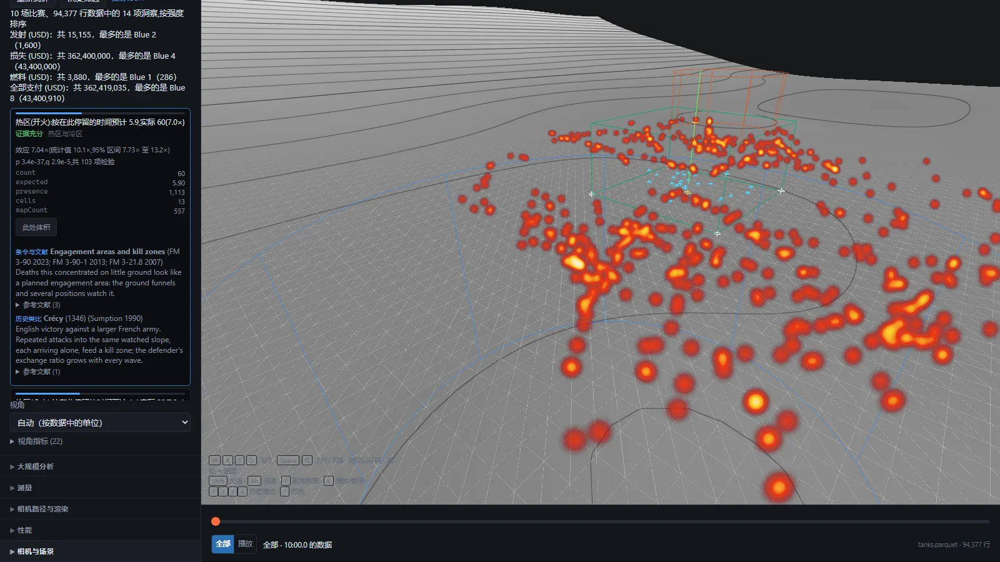

# 知识视角

当[洞察](insights.md)发现某些东西时，本部分会用军事史、游戏设计和体育分析中的思想来解释它，并指出其出处的书籍或论文。用它来了解一种模式*为什么*重要，而不仅仅是它存在。

## 试一试 {#try-it}

1. 载入数据并打开 **洞察**，然后按 **查找洞察**。
2. 点击一个发现，将其打开。
3. 阅读 **条令与文献** 和 **历史类比**；完整的参考文献折叠在其下方。
4. 更改 **视角**（例如改为 *军事条令*），以另一套文献来解读同一个发现。

## 工作原理 {#how-it-works}

洞察面板以专业分析人员的方式评判其发现：借助军事条令和作战研究、历史上的交战，以及游戏设计、关卡设计和分析方面的文献。它离线进行，使用查看器中经过整理的知识库；当由外部模型撰写总结时，同样的材料也会交给该模型。

## 面板显示的内容 {#what-the-panel-shows}

- **视角** 选择用来解读这些发现的文献：*自动*（根据数据中的单位种类选择：飞机、舰船、地面车辆、步兵）、*军事条令*、*空战*、*海军*、*城市战*、*游戏设计与平衡*、*电子竞技*。所选视角之外的条目会被省略。
- 每个打开的发现会显示与其最接近的 **条令与文献** 条目及其最接近的 **历史类比**，完整的参考文献折叠在其下方。
- **视角指标** 列出在同一批行上计算出的作战分析度量（见下文），每项都附有其含义及相关文献。
- **总结** 会为主要发现和视角指标添加若干行："条令与文献：……"和"历史类比：……"，每项都带有作者-年份的引用，参考文献折叠在其下。
- **用 AI 撰写** 会把最相关的条目（摘要、教训、它们所关联的发现、完整参考文献）随报告一同发送，并要求模型通过编号引用它们——`{concept.lanchester-square}`——且不使用其他来源。

界面标签已翻译；知识内容本身为英文。

## 视角指标 {#lens-metrics}

在洞察 worker 中计算，与检测器在同一遍行扫描中完成（`src/insights/lensMetrics.ts`）。当数据无法支撑某项指标时，该项会被省略。

| 指标 | 衡量内容 | 需要 |
|---|---|---|
| 兰彻斯特拟合 | 每一方每 20 秒的损失，对双方存活的兵力进行回归（泊松分布，准似然误差）；敌方与己方兵力的指数，与平方律（瞄准射击）和线性律（区域射击）进行检验 | 时间、队伍、击杀和死亡 |
| 交换比 | 按一方和按地点统计的每次死亡的击杀数；占用 5% 作战时间的最致命地面上死亡的占比，与仅凭机会在同样死亡数下所得占比的比较；死亡随时间的基尼系数；死亡率的莫兰 I | 击杀和死亡 |
| 局部兵力比 | 每次击杀的交战距离内存活的己方和敌方单位（距离由数据设定：到最近敌人的中位距离的两倍）；局部占优一方所获击杀的占比，以及它超出仅凭人数所预测的部分 | 时间、队伍、人员 |
| 火力范围 | 最繁忙的击杀地点在 2.5D 遮挡面上（墙高以内的关卡几何体，或所走过的地面）的视域，与平均地点相比，以及视域与击杀占比的秩相关 | 位置；载入关卡可使其更精确；不适用于空中 |
| 能量状态 | 空中击杀者和空中受害者的比能（高度加上速度所能换取的高度），以 Mann-Whitney 统计量进行比较 | 飞机类别、时间、高度 |
| 关键地形 | 每个地点在一场对局中成为三个最繁忙击杀地点之一的频率 | 多场对局 |
| 相互支援（交换） | 在交战距离和 5 秒之内，被队友击杀所回应的死亡 | 时间、队伍 |
| 先手打击 | 交战——按对局、按 20 秒的平静期、以及按三倍交战距离分组的击杀——由先得分的一方获胜 | 时间、队伍 |
| 齐射模型 | 将 Hughes 齐射方程拟合到接触中舰船的 20 秒时段：每艘进攻舰船使多少舰船失去战斗力，每艘防守舰船挽救多少；仅对舰船进行的兰彻斯特拟合 | 舰船类别、时间、队伍 |
| 作战效能 | 每一方每单位作战小时的击杀数，以及两个最大值之比（Dupuy 意义上的作战效能值）及其 95% 区间，以及每一方在局部兵力相当时所占的击杀份额 | 时间、队伍 |
| 交战距离 | 击杀时、发射时以及每次生命中的首次射击时（从发现到交战）与最近敌人的距离，按单位种类划分 | 时间、队伍；数据中有的发射记录 |
| 击杀链 | 从杀手最后一次发射到击杀所经过的秒数，以及从其该场战斗的首次射击到击杀所经过的秒数 | 时间；发射或开火事件 |
| 集中或分散 | 在每个 20 秒时段内，两个最大一方的散布，以及较为集中的一方所得击杀的占比 | 时间、队伍 |
| 出动架次 | 每一方：出动架次（起飞，或飞机生成）、降落、损失的飞机，以及飞机所得的击杀；损失率和每架次击杀数 | 飞机类别；起飞或生成 |

包含回合的数据会增加近距离交战和电子竞技的度量——回合胜率、行动价值、开局对决、交换、推进者对守点者、瞄准、交叉火力、道具、人数优势、残局、布置、下包后、致命漏斗以及玩家影响力：参见[近距离交战与回合](close-quarters.md)。

轨迹与队伍会增加群体科学、集体运动、行为经济学和军事心理学中的集体行为度量——对齐与回旋、路线聚集、通道与轨迹、拥挤、领导者与跟随者、掉队者、崩溃点、损失后的风险、连胜、购买协议与压制——每项都与其自身的空白模型进行比较：参见[集体行为](collective-behaviour.md)。

武器、诱饵和建筑不计为单位。当武器行注明其发射单位（类似 Tacview 衍生数据中的 `Shooter` 或 `Launcher` 列）时，该次发射会记在该单位名下，依据其名称或对象编号匹配。

## 发现如何与文献相遇 {#how-findings-meet-the-literature}

条目与发现通过一个 **模式分类法**（`src/insights/knowledge/patterns.ts`）相遇：集中、局部优势、瞄准与区域射击、咽喉要道、杀伤区、火力范围、反斜坡、侧翼、相互支援、能量优势、出生点压力、平衡，等等。每种检测器和每项视角指标都会说明其数字显示了哪些模式（`src/insights/lens.ts`）；每个知识条目都会说明它涉及哪些模式，并附上权重。条目与发现的相关性，是加权的重叠程度，并按该条目的领域（陆地、空中、海上、城市）与数据的契合程度，以及发现自身的强度进行缩放。所显示的理由是一句话概括发现的数字，随后是该条目的教训。

## 目录 {#catalogue}

每个模式、概念、方法、历史案例、设计原则和研究，以及参考书目：参见[知识目录](knowledge-catalogue.md)。

## 开发者信息 {#for-developers}

### 添加条目 {#adding-entries}

1. 按类型选择文件：`src/insights/knowledge/` 中的 `concepts.ts` 和 `concepts-more.ts`、`methods.ts`、`cases.ts`、`cases-land.ts`、`cases-air-sea.ts`、`cases-esports.ts`、`design.ts`（设计原则）或 `studies.ts`。
2. 为它分配一个新的编号 `<类型>.<slug>`（绝不重复使用），以及它的视角、领域，以及它涉及的模式和 0..1 的权重。只有当某个发现能够体现某个模式时，才将其添加到 `patterns.ts`，并在 `lens.ts` 中从某个发现或指标映射到它。
3. 用 **你自己的话** 撰写摘要和教训。引语仅限于公有领域的作品（参考文献中为 `pd: true`），并且要简短。
4. 引用：把任何新作品添加到 `refs.ts`，附上作者、年份、标题和出版者（期刊需附卷号和页码）；若有公开记录，则附上 URL 或 DOI。
5. 运行 `npx vitest run src/insights/lens.test.ts`（编号唯一、模式已知、参考文献可解析、公有领域引语、带有日期和结果的案例），并运行 `node tools/knowledge-doc.mjs` 以更新[目录](knowledge-catalogue.md)。
