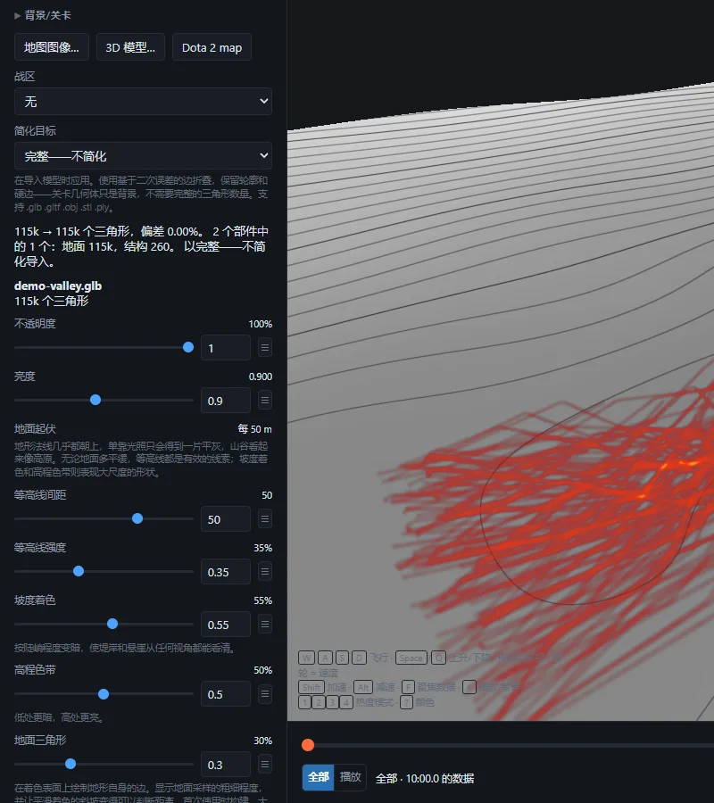

# 关卡与背景几何体

关卡是游戏发生的三维场所——一张地图、一座小镇、一条赛道。把它放在你的数据后面，你就能看到热度*在哪里*。**背景/关卡**面板（“关卡”的含义见[术语表](glossary.md)）提供三类背景信息：

- **地图图像**，通过两个锚点进行地理配准——参见[地图图像](map-images.md)；
- **3D 关卡**——`.glb`、`.gltf`、`.obj`、`.stl` 或 `.ply`——在导入时被拆分为地面、结构和水体，并进行简化——参见[3D 关卡](model-levels.md)和[关卡外观](level-appearance.md)。
- **真实世界背景**——适用于记录了其在地球上位置的录像（Tacview ACMI 文件），从开放数据下载真实地形、道路、水域、机场和建筑物——参见[世界背景](world-backdrop.md)。

未加载任何内容时，场景是一片带有网格和彩色坐标轴的暗色背景（[摄像机与场景](camera.md)中的**网格**和**坐标轴**），面板会显示：*未加载任何内容 - 场景只显示网格和坐标轴。添加地图图像或关卡网格，即可为热度提供背景。*

三个标签页共享同一个关卡：在赛车分析标签页中加载的赛道，就是热力图所显示的同一个关卡。

## 把关卡放在数据后面 {#put-a-level-behind-your-data}

1. 先加载你的数据（[导入数据](getting-data-in.md)），使关卡适配它。
2. 在侧边栏中打开**背景/关卡**。
3. 按**地图图像…**选择图片，或按**3D 模型…**选择 3D 关卡文件。对于真实世界的录像，请改用**真实世界背景**或**战区**。
4. 等待进度行完成。大型模型会先进行简化（见下文的**简化目标**）。
5. 在视图中按 **F** 对准所有内容。调整**不透明度**和**亮度**，直到热度从关卡中凸显出来。
6. 如果你以后还会使用该关卡，按**保存到库**（[关卡库](level-library.md)）。

## 关卡对热度的作用 {#what-a-level-does-for-the-heat}

- 它会**遮挡**：位于其后的数据点会按表面变暗，位于地形后面的数据点会被隐藏（[深度与剔除](depth-and-culling.md)）。没有关卡时，就没有遮挡。
- 它会被[切片](slice.md)**裁切**；开启*同时裁切关卡*后，它也会被[距离剔除](depth-and-culling.md#distance-culling)与热度一同裁切。
- 除了网格和方框之外，它是[景深](camera.md#depth-of-field)唯一会模糊的内容。
- 当三维关卡比数据更大时，它会**扩大摄像机的远裁剪面**：近裁剪面和远裁剪面是根据数据集校准的，而一张跨越数公里的导出地图否则会完全位于远裁剪面之后，导致视图空白。当关卡的水平范围更大时，远裁剪面会变为其水平范围的 3 倍，近裁剪面随之移动（至少为远裁剪面 / 100,000），以保持遮挡所依赖的深度精度，飞行速度也会提高到至少为范围 / 12。它只会被扩大，从不会被缩小。

## 面板，从上到下 {#the-panel-top-to-bottom}

| 部分 | 详情 |
|---|---|
| **地图图像…**、**3D 模型…** | 加载其中一个；它会替换当前关卡。 |
| **真实世界背景**、**清除地图瓦片** | 仅适用于带有地理参考的数据集：在其下方构建真实场景作为关卡，或删除已下载的瓦片。[世界背景](world-backdrop.md) |
| **简化目标** | 下一次模型导入的三角形预算：*完整 - 不简化*（默认）、*高 - 8M*、*中 - 3M*、*低 - 800k*、*轮廓 - 100k*。[3D 关卡](model-levels.md#simplification) |
| 进度和**取消** | 在解码或导入期间显示。 |
| 导入说明 | 导入前后的三角形数、地面 / 结构 / 水体的拆分、所用的细节层次。 |
| 名称和尺寸 | 图像为 `宽×高 px · x × z m/px`，模型为 `N 个三角形（原为 M）`。 |
| **不透明度**、**亮度** | 两种类型都适用。 |
| 图像控件 | **去饱和**、**南北翻转**、**定位**（两个锚点）、**适配数据范围**、**高度**。[地图图像](map-images.md) |
| 模型控件 | 地面起伏、水体、地面三角形、线框、纹理、采集颜色、结构、部件分类。[关卡外观](level-appearance.md) |
| **保存到库**、**移除** | [关卡库](level-library.md)；移除会卸载关卡。 |
| **库** | 保存在此浏览器中的关卡。[关卡库](level-library.md) |

## 本节包含的页面 {#pages-in-this-section}

- [地图图像](map-images.md)
- [3D 关卡](model-levels.md)——格式、部件、分类、简化、纹理
- [关卡外观](level-appearance.md)——3D 关卡的每个控件
- [关卡库](level-library.md)
- [世界背景](world-backdrop.md)——录像下方的真实世界，来自开放数据

如何从游戏和引擎中获取关卡，属于单独的导出工具的范畴（参见仓库的 [README](https://github.com/Holdi601/3DHeat/blob/main/README.md)）；它们所写入的约定在[3D 关卡](model-levels.md#the-exporter-contract)中有概述。
