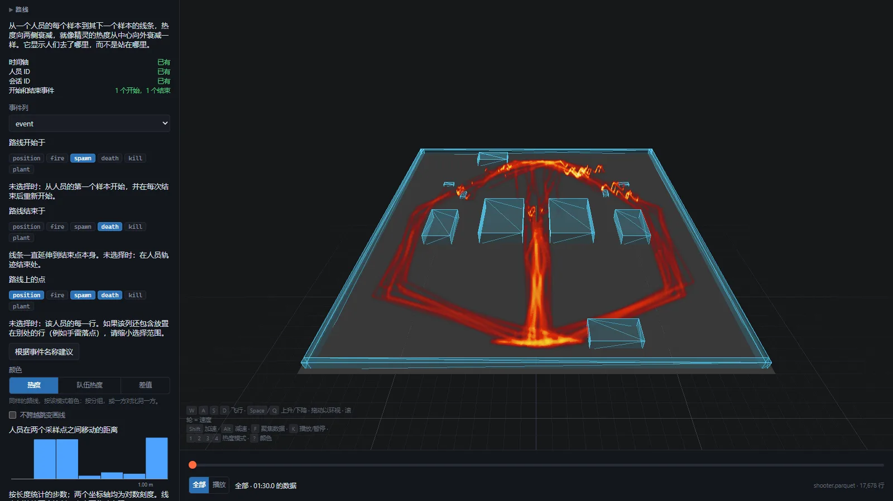

# 线条热度

热度显示人们站在哪里。线条显示他们走过的路径。

**线条**（按键 4）是线条热度：从每个[人员](glossary.md)的一个样本到其下一个样本画一条线，并用与[精灵](glossary.md)相同的衰减方式铺开热度——沿线条两侧而非绕一个点。它显示的是人们 *去过* 哪里，而不是他们 *站过* 哪里：沿走廊只经过一次的路线，与长时间驻守的房间一样明显；快速玩家稀疏的样本会连成一条连续的路线，而不是一串虚线。它需要人员列和时间列。

## 使用方法 {#how-to-use-it}

1. 按 `4`（或在模式栏中选择 **线条**）。
2. 打开 **路线**，检查绿色的清单：必须有时间轴和人员 ID。
3. 按 **根据事件名称建议**，以填写路线从哪里开始和在哪里结束。
4. 阅读统计行："N 条路线，其中 M 条到达了终点"。
5. 如果线条跨越了地图上的跳跃，请调整 **最长步长**（见 [跳变限制](#the-jump-limit)）。

线条只有在起点与终点之间才有意义，因此 **路线** 面板会说明什么界定路线。从[路线的规则](#the-rules-of-a-route)开始的所有内容都是细节，可以跳过。

## 路线面板 {#the-routes-panel}

在线条模式下显示在热度面板上方。

### 数据中有什么 {#what-the-data-has}

一份清单：存在时为绿色，不存在时为琥珀色：

| 项目 | 状态 |
|---|---|
| **时间轴** | *存在* / *缺失——必需* |
| **人员 ID** | *存在* / *缺失——必需* |
| **会话 ID** | *存在* / *无——所有行属于同一会话* |
| **开始和结束事件** | *N 个开始，M 个结束* / *未选择——整条轨迹* （只有存在事件列且至少各选择一个开始和一个结束时才为绿色） |

### 控件 {#controls}

| 控件 | 含义 |
|---|---|
| **事件列** | 其值为事件（出生、死亡、位置……）的类别列。*无——整条轨迹*：每个人在每个会话中的轨迹是一条路线，在轨迹有间隙处断开。只提供为加载时保留用于筛选的列。 |
| **路线开始于** | 开始一条路线的事件值（出生、重生、部署）。未选择时：路线从一个人的第一个样本开始，每次结束后再次开始。 |
| **路线结束于** | 结束一条路线的事件值（死亡、撤离、传送）。线条一直画到结束行本身。未选择时：路线在该人的轨迹结束处结束。 |
| **路线上的点** | 其行位于路线沿途的事件值。未选择时：该人的每一行。当该列还包含放置在别处的行（例如手榴弹落点）时，应缩小范围。 |
| **根据事件名称建议** | 根据各值的名称（见下文）填入三个列表。 |
| **颜色** | *热度*、*队伍热度* 或 *差值*。同样的路线，以该模式的颜色绘制：每个分组一种色调，或一方对另一方，分组列表、拆分和色带的工作方式与那些模式中相同。默认为 *热度*。队伍热度和差值需要分组列。 |
| **不跨越跳变画线** / **最长步长** | 一个人的下一个样本比这更远时，视为重生、传送或掉落，而不是他们去过的地方，因此不会在两者之间连线。当数据显示出明显的间隙时（见下文），在加载时自动填写；数据没有间隙时则关闭。无论是否有事件列都有效。 |
| 统计行 | `N 条路线，其中 M 条到达终点，K 段`，每秒更新几次。 |

每个列表是一行切换标签，每个值一个，最常见的排在最前；将鼠标悬停在标签上会显示其行数。最多提供 120 个值（*另有 N 个值未显示*）。

选择另一个事件列时，若建议所选的正是同一列，则应用该建议；否则从空列表开始。

### 建议 {#the-suggestion}

每次加载时，以及在 **根据事件名称建议** 时（[`suggestLineSettings`](https://github.com/Holdi601/3DHeat/blob/main/src/data/lines.ts)）：

- **事件列：** 第一个保留的、名为 `event`、`eventname` 或 `eventtype` 的类别列；否则为 `kind`、`type` 或 `action`；否则为任何包含 *event*、*kind*、*action* 或 *type* 的列。
- **开始：** 包含 *spawn、deploy、join、enter、start、begin、respawn、revive、land/landed/landing、drop* 的值——除非它们同时匹配某个结束词。
- **结束：** 包含 *death、died、dead、kill/killed、eliminat…、extract、evac、teleport、leave、left、disconnect、quit、exit、end、finish、downed* 的值——但不包括 `kill` 和 `kills` 这两个值（击杀是杀手所做的事，并不是其路线的结束）。
- **点：** 恰好为 *position、location、player location、move、movement、tick、sample* 或 *pos* 的值；若找到任何一个，则开始和结束也会加入点。若一个都找不到，点保持为空（即每一行）。

### 跳变限制 {#the-jump-limit}

人们跳跃的地方，步长的长度分为两组，两组之间几乎没有任何东西：一个人在两个样本之间走过的距离，以及地图的宽度。加载时（[`suggestMaxJump`](https://github.com/Holdi601/3DHeat/blob/main/src/data/lines.ts)），步长按其平方长度每翻一倍进行计数，最多计 1600 万个，限制值位于第一个高于中位数、且宽度至少为长度翻一倍的区间的中间；该区间内每个分段占步长的比例低于 0.02%，并且其之外有步长。若没有这样的区间，则不做任何截断，因为无法将跳跃与快车区分开来；此时手动开启限制会从数据对角线的十分之一开始。

限制上方的图表显示步长的真实长度，并有一条限制线：位于其右侧的条不予绘制。两个坐标轴都是对数的，因为跳跃可能只占步长的百分之一，而长度却是其一千倍。将鼠标悬停在条上可查看其范围和占比；点击图表可将限制设在那里。其下方显示超过限制的步长所占的比例。

## 路线的规则 {#the-rules-of-a-route}

行按时间顺序、以人为单位逐一遍历（[`buildLines`](https://github.com/Holdi601/3DHeat/blob/main/src/data/lines.ts)）：

1. 属于[共享名称](sessions-persons-groups.md#names-worn-by-several-things-at-once)的行被完全跳过。
2. 选择了点时，既不是开始、结束也不是点的行会被跳过。
3. 行按人、按会话逐一跟随，因此时间顺序上交错的会话，每个都有一条路线。当上一行没有后继时（其[生命周期](sessions-persons-groups.md#person)为"无"），路线即告关闭——路线永远不会跨越会话边界，也不会跨越加载时判定为没有下一个样本的间隙。一行属于哪条路线会被计算一次并保存下来，每行 4 字节，因此更改最长步长时不会重复这部分计算。
4. **开始** 行会关闭任何未结束的路线，并在该处开启一条新路线。
5. 选择了开始时，路线之外的行会被忽略。没有开始时，路线之外的任何非结束行都会开启一条路线。
6. 路线中的任何其他行，都会添加一个从路线的上一行到该行的 **线段**。
7. 扩展了某条路线的 **结束** 行，会在其线段之后关闭该路线；该路线计为 *到达终点*。
8. 长于 **最长步长** 的步长会在原处关闭路线，并在远端开启一条新路线，除非该行本身是结束。跨越它不画线，统计行会计入这一次。

每条线段都保存在其 *结束* 行上，因此线段保持时间顺序，并且[时间线](timeline.md)窗口、采样器、[筛选](filters.md)、分组可见性和差值符号都会像对待点一样对待它们。因此，筛选作用于线段结束所在的那一行。

## 播放 {#playback}

在 **全部** 模式下，每条路线都整条绘制。在 **播放** 模式下，每个人是一个在其样本之间移动的点，并在身后绘制其路线：

- 在播放头之后开始的线段不绘制；
- 该人正处于其中的线段，绘制到其插值位置，并在头部带有端帽；
- 热度沿 **尾迹** 衰减：使用 *累积* 历史时，尾迹不受限制，到目前为止的整条路线都保留；使用 *窗口* 时，它会在 *跨度*（默认 30 秒）内衰减至零。使用 *生命周期* 时，尾迹同样为 *跨度*；在线条模式中，时间线会为该历史显示 *跨度* 框（代替线条热度不使用的 *后备寿命* 和 *衰减*）。

播放时，每一帧都是整体绘制，而不是累积，因为线头每一帧都在移动，移动平均会把每个线头拖成一道条纹。

## 开发者信息 {#for-developers}

### 内存 {#memory}

进入线条模式（或路线设置改变）时，路线在主线程中构建；离开该模式时释放：内存中每行 5 字节，GPU 上每行 8 字节（每条线段的起点位置，在数据包围盒内每个轴量化为 16 位，以及其标志）。

### 线条如何绘制 {#how-a-line-is-drawn}

两个后端都用 **18 个顶点** 从线段的结束行绘制每条线段（[`lineHeatVs`](https://github.com/Holdi601/3DHeat/blob/main/src/render/webgl2/shaders.ts) 及其 WGSL 对应版本）：

- 每一端的半宽是该端距离处的[精灵半径](sprite-shape.md#sprite-radius)，并应用像素限制。窄于 2.5 像素的线条按 2.5 像素宽绘制，其热度相应缩小，因此细线既不会消失，也不会变亮。
- 热度沿线条 **横向** 衰减，使用与精灵相同的色带——衰减或曲线、中心与边缘强度。
- 圆头端帽 **仅** 在路线开始或结束处绘制，因此相邻线段之间的接点不会串成一串珠子。
- 几何体在屏幕空间中构建，并在那里线性插值，因此无论线条如何延伸到深度中，衰减都保持以线条为中心。跨越近平面的线段会在该处被裁剪，而不是被丢弃。

点热度和线条热度每行铺下的热量差别很大，因此在两者之间切换时会重新计量饱和度（[颜色与曝光](colour-and-exposure.md#auto-exposure)）。
