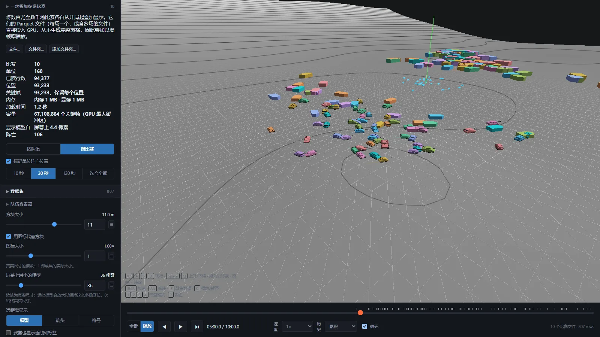

# 一次叠加多场比赛

**一次叠加多场比赛** 会把许多场对局叠在一起播放，因此你可以看到每场对局的玩家通常都去了哪里。用它在一张图中比较数百或数千场对局。

每场对局都从它自己的开始处开始，其单位以图形的形式移动。文件直接进入显卡，不会构建完整的表格，因此即使普通加载会耗尽内存，它也能流畅播放。

## 如何使用 {#how-to-use-it}

1. 在热力图侧边栏中打开 **一次叠加多场比赛**。
2. 按 **多个文件…**（选择许多文件）、**文件夹…**（一个文件夹及其子文件夹）或 **添加文件夹…**（添加到已加载的内容中）。
3. 查看器会切换到图形叠加，并从开始处开始。按 **播放**。

每个文件是一场对局（或包含几场）。支持 Parquet 文件和 [`.3dheat`](container.md) 容器。文件需要位置、时间和单位列；名称、类型和阵营列会被保留。其他文件，以及转换器的附属文件（飞行、消息、事件、聊天、目标），都会被跳过。普通表格见[导入数据](getting-data-in.md)。

## 设置 {#settings}

| 设置 | 作用 |
|---|---|
| **按队伍** / **按比赛** | 按阵营着色，或每场对局一种颜色。 |
| **标记单位阵亡位置** | 在每个单位阵亡的地方做一个标记，保留 10 秒、30 秒、120 秒，或直到目前为止的全部。 |

面板显示读取了多少场对局、单位、行和位置，所用的内存以及加载时间。*可容纳* 是显卡还能再接受多少个位置。*图形起始于* 是屏幕上的尺寸阈值：低于它的单位会画成一个小箭头，而不是其图形。

图形的外观使用与[对局回放](match-replay.md#figures)相同的控件：**图标大小**、**屏幕上最小的模型** 和 **远距离显示**。

## 提示 {#tips}

- 当所有内容都放不进内存时，位置会被稀疏化（只保留每隔几米的一个位置），面板会说明这一点。
- 热度模式也适用于叠加层的数据。
- 若要对数千场对局做统计而不绘制它们，见[批量分析](mass-analysis.md)。
