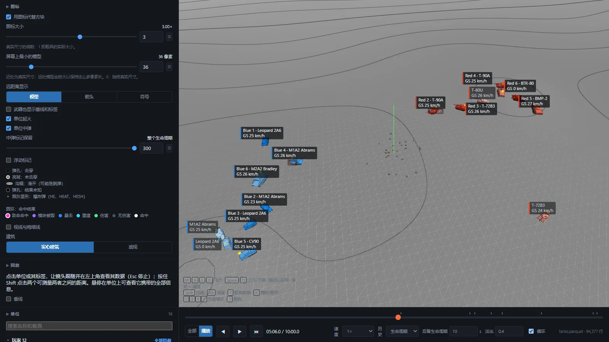
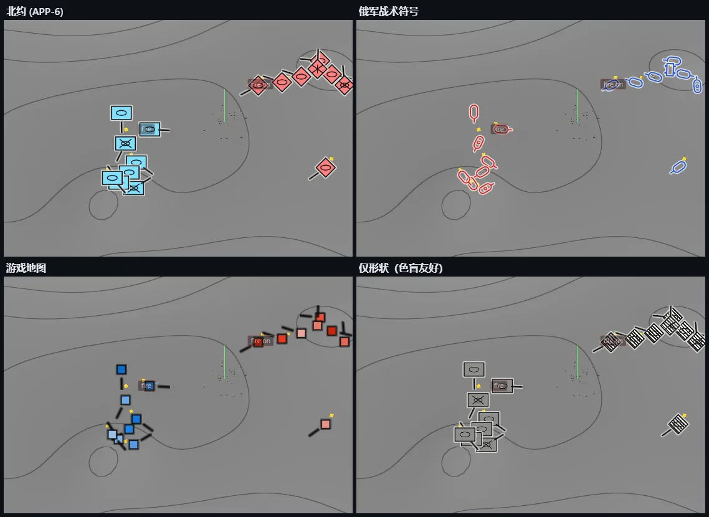

# 比赛回放

回放是一段对局的影片，每个玩家都以他所驾驶的东西的样子出现。用它来重看一场战斗、跟随某个单位，并看清谁击中了谁。

开火、命中、起火和残骸会画在关卡里的单位和目标上。摄像机、标签和战术显示可以帮你读懂战斗。你熟悉 Tacview 吗？[Tacview 对齐](tacview-parity.md)会说明它的每个工具在这里的位置。

## 开始回放 {#start-a-replay}

1. 用 **Source → Files…** 载入录像，或把它拖到 Source 面板上（任何带有 **人员** 和 **时间** 列的表格、Tacview 文件、转换后的回放、[`.3dheat`](container.md) 对局文件）。见[导入数据](getting-data-in.md)。
2. 打开 **Match** 标签页并选择 **模型回放**，或在热度标签页的模式栏中选择 **模型叠加**。
3. 在 **回放中的对局** 下选择一场对局、全部对局，或多场对局。
4. 在时间线上按 **播放**（或 `K`）。拖动时间线可以跳转。

对于名称或类型已知的每个单位，图标会代替方块（见[图形](figures.md)）。没有名称或类型列的数据会画成士兵。

## 图标 {#figures}

| 设置（**图标**区） | 默认值 | 作用 |
|---|---|---|
| **用图标代替方块** | 开 | 关闭后画普通方块。 |
| **图标大小**（真实大小的倍数） | 1 | 1 为真实大小；0.25 到 20 倍（对数刻度）。远看时调大更容易看清。 |
| **屏幕上最小的模型** | 36 px | 远处的图标会放大，直到达到这个大小，范围 0 到 200 px；0 表示保持真实大小。 |
| **远距离显示**：图标、箭头、符号 | 图标 | 远处单位会变成什么。 |
| **符号体系** | NATO（APP-6） | NATO（APP-6）、俄罗斯战术符号、**游戏地图**图标，或**仅形状（色盲友好）**。 |
| **符号大小**、**我方**、**敌对 / 中立**、**航向标记** | 28 px（12 到 64）、自动、敌对、开 | 符号的外观，以及哪一方是友方。 |
| **垂线** | 开 | 从每个单位向下连到地面的线，让高度在 3D 中更容易看清。 |
| **武器也显示垂线和标签** | 关 | 导弹和炸弹的地面连线与标签。 |
| **单位起火** | 开 | 单位着火到被扑灭之间的火焰。 |
| **单位中弹** | 开 | 标出射击击中的位置（见下文）。**中弹标记保留**：1 到 300 秒，或**整个生命周期**。**浮动标记**：画在表面以上的标记。 |
| **视线与炮塔线** | 关 | 虚线：玩家看向的方向；实线：火炮指向的方向。 |
| **建筑** | 实体 | 实体或透明的建筑，前提是关卡会绘制它们。 |

### 远距离的符号 {#symbols-at-a-distance}

当一个单位会小于**屏幕上最小的模型**时，它可以变成一个始终清晰可读的符号。形状显示种类（例如装甲车用带履带标记的圆角方框）；颜色显示所属一方。打开**符号体系**菜单可以更改样式。

### 命中标记、残骸与火焰 {#hit-marks-wrecks-and-fires}

- **命中标记**位于炮弹击中的表面上，大小与图标的比例一致。它们的样子说明发生了什么：孔洞（穿透）、明亮的溅点（未穿透）、划痕（跳飞）、烟痕星形（爆炸弹）。彩色圆环说明造成的结果：致命一击、模块被毁、致命伤、严重、受损、无伤害、命中。把鼠标悬停在标记上可以看到这发弹的名称。
- 被摧毁的单位从死亡到重生或被移除之前，会以**焦黑**的残骸形式画出；它的符号会被划掉。
- **火焰**从单位着火到被扑灭之前在它身上燃烧。
- **炮塔**会转向数据显示的火炮指向（如果没有这项数据，则转向玩家的视线）。

### 武器、诱饵与曳光弹 {#weapons-decoys-and-tracers}

开启**武器、射击与命中**（队伍视角区）后，导弹、火箭、炸弹和鱼雷会以各自的图标飞行，并带有烟迹；子弹和炮弹是曳光弹；撞击和爆炸会闪烁。以**虚线**画出的曳光弹是根据一次命中推算出来的，因为数据里没有这发射击。照明弹和干扰箴会画成诱饵；除非勾选了*诱饵与炮弹*，它们不会出现在单位列表中。

## 摄像机 {#cameras}

点击一个单位或它的标签即可**跟随**它；**回放**区提供**追尾**、**环绕**、**驾驶舱**（带平视显示，`H`）、**固定**、**锁定视角**、**目标**和**卫星**。按 `V` 可依次切换，**镜头距离**设定距离。按 Esc 停止。

- **双单位视角**：选择一个**目标**（或 Ctrl/Alt 点击一个单位），从被跟随的单位视角看向它；**互换**可以交换两者。
- **指标**：按住 Shift 点击两个单位，即可得到它们之间的方位、距离和高度差。
- **2D 地图**（`M`）：角落或全屏视图，带有轨迹和名称。
- **书签**（`B`）：保存当前时刻和摄像机；录像自带的击杀、死亡和标记也会列在这里。
- **事件**：按时间顺序列出每个事件；点击即可跳到那里。`Page Up` / `Page Down` 在事件之间跳转；**遇事件暂停**会在每个事件处停下。

## 战术显示 {#tactical-display}

**战术显示**区为“无”、“选中的”、“全部”或某一类（飞机、地面、舰船、武器）画出：速度矢量和前方路径、机头与升力线、雷达锥、锁定、数据链、交战区域与线路、视线、玩家的注视方向（视锥）、炮塔瞄准，以及录制的摄像机。

### 显示风格 {#display-style}

`T`（或**以战术显示查看**开关）会把外观切换为雷达屏风格：辉光、轮廓、等高线、测量网格、扫描线、距离环、高度阶梯、显示击杀和事件的面板，以及一个会自行把摄像机移动到事件处的**导演**。

## 目标 {#objectives}

如果一场对局附带了目标，**目标**区会在关卡上画出它们：占领区（带有归属方和占领进度）、出生点、机场、区域和轰炸目标，每一层都可以单独开关，并带有标签。它们可以透过地面看到。载入多种游戏模式时，**模式**会按模式筛选对局。目标来自录像旁边的转换器对局文件，或来自 [`.3dheat`](container.md) 容器内部。

## 标签与统计 {#labels-and-statistics}

- **标签**：按种类设定的规则（**选中**、**飞机**、**地面**、**舰船**、**武器**、**AI**）：显示与否、显示哪些值，以及标签重叠时由谁占用空间的**优先级**。**标签互不重叠**会在标签会遮住另一个单位时，把它移到单位旁边；如果没有空间，则不显示它。**标签大小**为 60% 到 250%。**恢复为名称、载具、高度和速度**会重置这些规则。
  - 地面单位默认显示名称、载具和速度。
  - 飞机默认显示名称、载具、高度和速度。
  - 舰船默认显示名称、载具、速度和航向。
  - 把鼠标悬停在单位上，可以看到它的所有值。
- **统计**：按队伍和单位列出击杀、死亡、射击、命中、命中率、起飞、降落、在空中的时间、最高速度、高度和过载、距离。可导出为 CSV。
- **图表**：单位的值随时间的变化、两个单位的对比，或一个值与另一个值的关系。

## 同时查看多场对局 {#many-matches-at-once}

要把数百或数千场对局叠在一起，见[同时查看多场比赛](many-matches.md)。图标的细节（烟、火和其他定时效果）：[模型叠加中的图形](figure-replay.md)。Tacview 功能列表：[Tacview 对齐](tacview-parity.md)，它是本页的子页面。
