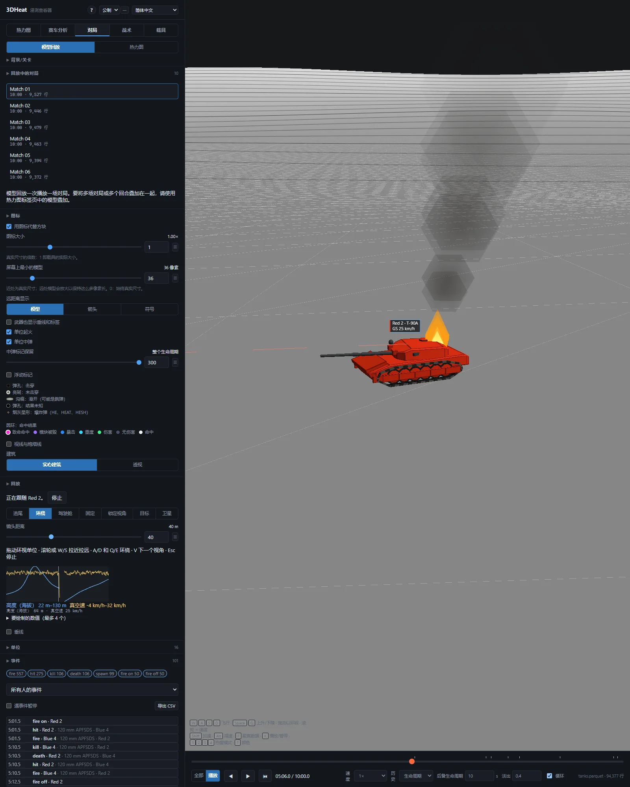
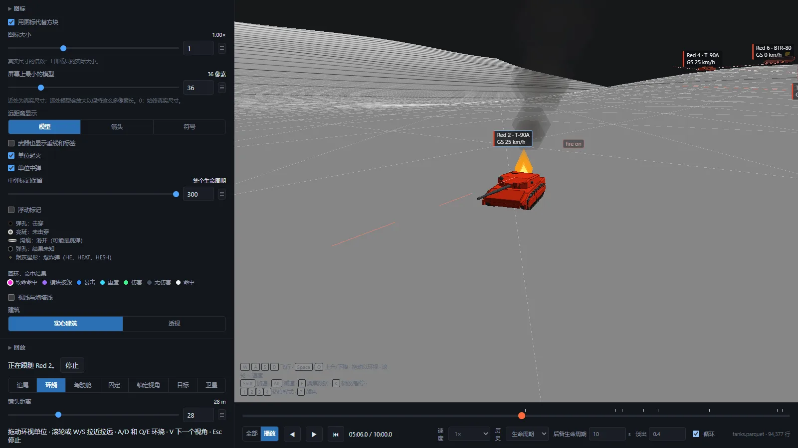
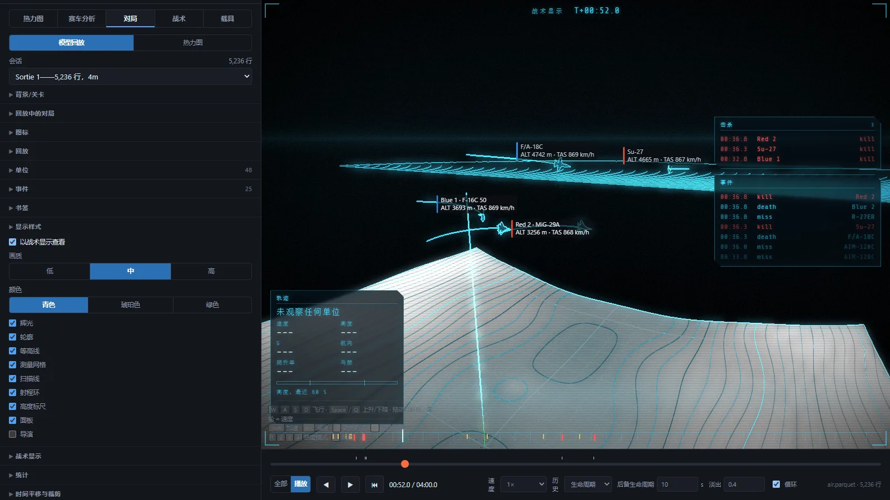
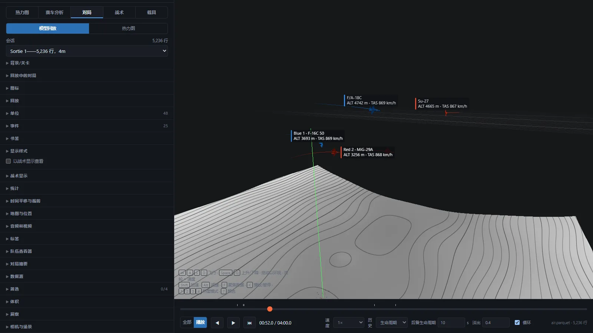

# 比赛回放

回放就是比赛的影片，每个玩家都以其所驾驶的东西呈现。用它来重看一场交战，跟随某个单位，并看清谁击中了谁。

射击、命中、起火和残骸会绘制在关卡的单位和目标上。摄像机、标签和战术显示帮助你读懂交战。你了解 Tacview 吗？[Tacview 对齐](tacview-parity.md)说明了它的每项工具在这里对应什么。

## 开始回放 {#start-a-replay}

1. 使用**数据源 → 多个文件…**加载录像，或将其拖放到数据源面板上（任何带有**人员**和**时间**列的表格、Tacview 文件、转换后的回放、[`.3dheat`](container.md) 对局）。参见[导入数据](getting-data-in.md)。
2. 打开**对局**标签页并选择**模型回放**，或在热力图标签页的模式栏中选择**模型叠加**。
3. 在**回放中的对局**下选择一场比赛、全部比赛，或其中几场。
4. 在时间线上按**播放**（或按 `K`）。拖动时间线可跳转。

对于名称或类型已知的每个单位，图形会取代方框（参见[图形](figures.md)）。没有名称或类型列的数据会被绘制为士兵。

## 图标 {#figures}

| 设置（**图标**部分） | 默认值 | 作用 |
|---|---|---|
| **用图标代替方块** | 开 | 关闭则绘制普通方块。 |
| **图标大小**（真实大小的倍数） | 1 | 1 为真实大小；0.25 到 20 倍（对数刻度）。较大的在远处更容易看清。 |
| **屏幕上最小的模型** | 36 px | 远处的图标会放大到至少这个大小，范围 0 到 200 px；0 则保持真实大小。 |
| **远距离显示**：图形、箭头、符号 | 图形 | 远处单位会变成什么。 |
| **符号体系** | NATO (APP-6) | NATO (APP-6)、俄罗斯战术符号、**游戏地图**图标，或**仅形状（色盲友好）**。 |
| **符号大小**、**我方**、**敌对 / 中立**、**航向标记** | 28 px（12 到 64）、自动、敌对、开 | 符号的外观，以及哪一方为友军。 |
| **垂线** | 开 | 从每个单位直线向下到地面的一条线，使三维中的高度一目了然。 |
| **武器也显示垂线和标签** | 关 | 导弹和炸弹的地面连线与标签。 |
| **单位起火** | 开 | 从单位起火到被扑灭之间的火焰。 |
| **单位中弹** | 开 | 标记射击击中的位置（见下文）。**中弹标记保留**：1 到 300 秒，或**整个生命周期**。**浮动标记**：绘制在表面之上的标记。 |
| **视线与炮塔线** | 关 | 虚线：玩家看向的方向；实线：火炮指向的方向。 |
| **建筑** | 实体 | 实体或透明的建筑，当关卡会绘制它们时。 |

### 远距离的符号 {#symbols-at-a-distance}

当一个单位会小于**屏幕上最小的模型**时，它可以变成一个保持可读的符号。形状表示类别（例如，装甲车用带履带标记的圆角方框）；颜色表示阵营。打开**符号体系**菜单可更改样式。

### 命中标记、残骸和火焰 {#hit-marks-wrecks-and-fires}

- **命中标记**位于射击击中的表面上，比例与图形一致。它们的外观说明发生了什么：一个洞（穿透）、一团明亮的溅射（未穿透）、一道划痕（弹开）、一颗烟灰星（爆炸弹）。彩色圆环表示其效果：致命一击、模块被毁、致命、严重、伤害、无伤害、命中。将鼠标悬停在标记上可查看这一回合的名称。
- 被摧毁的单位从死亡到重生或被移除为止，都会以**烧焦**的残骸形式绘制；其符号被划掉。
- **火焰**从单位起火到被扑灭为止在其身上燃烧。
- **炮塔**会转向数据所示火炮指向的方向（若没有该数据，则转向玩家看的方向）。

### 武器、诱饵和曳光弹 {#weapons-decoys-and-tracers}

开启**武器、射击与命中**（队伍查看器部分）后：导弹、火箭、炸弹和鱼雷会以各自的图形飞行，并带有烟迹；子弹和炮弹为曳光弹；撞击和爆炸会闪光。以**虚线**绘制的曳光弹是根据命中推算出来的，因为数据中没有对应的射击。照明弹和箔条会被绘制为诱饵；除非勾选了*诱饵与炮弹*，否则它们会从单位列表中隐藏。

## 摄像机 {#cameras}

点击某个单位或其标签即可**跟随**它；**回放**部分提供**追尾**、**环绕**、**驾驶舱**（带平视显示，按 `H`）、**固定**、**锁定视角**、**目标**和**卫星**。按 `V` 循环切换，**镜头距离**设置远近。按 Esc 停止。

- **双单位视图**：选择一个**目标**（或 Ctrl/Alt 点击一个单位），从被跟随的单位处看向它；**互换**则可以交换两者。
- **指标**：按住 Shift 点击两个单位，即可得到它们之间的方位、距离和高度差。
- **2D 地图**（`M`）：角落视图或全屏视图，带有轨迹和名称。
- **书签**（`B`）：保存当前时刻和摄像机；录像自身的击杀、死亡和标记也会列出。
- **事件**：按时间顺序列出每个事件；点击即可跳转。`Page Up` / `Page Down` 在事件之间跳转；**遇事件暂停**会在每个事件处停止。

## 战术显示 {#tactical-display}

**战术显示**部分可以为所有单位、所选单位、全部单位，或某一类（飞机、地面、舰船、武器）绘制：速度矢量和前方路径、机头和升力线、雷达锥、锁定、数据链、交战区域和线条、视线、玩家看向的方向（视锥）、炮塔瞄准，以及录制的摄像机。

### 显示风格 {#display-style}

`T`（或**以战术显示查看**开关）会将外观切换为雷达屏幕风格：辉光、轮廓、等高线、测量网格、扫描线、距离环、高度阶梯、显示击杀和事件的面板，以及一个会自行将摄像机移动到事件处的**导演**。

## 目标 {#objectives}

当一场比赛附带其目标时，**目标**部分会在关卡上绘制它们：占领区（带有所有者和占领进度）、出生点、机场、区域和轰炸目标，每一层都可以切换，并带有标签。它们可以透过地面看到。加载了多种游戏模式时，**模式**会按模式筛选对局。目标来自录像旁边的转换器对局文件，或来自 [`.3dheat`](container.md) 容器中。

## 标签和统计 {#labels-and-statistics}

- **标签**：每类（**选中**、**飞机**、**地面**、**舰船**、**武器**、**AI**）的规则：是否显示、显示哪些值，以及标签重叠时**优先级**决定谁获得空间。**标签互不重叠**会在标签会遮住另一个单位时将其移到该单位旁边，若没有空间则将其省去。**标签大小**为 60% 到 250%。**恢复为名称、载具、高度和速度**会重置规则。
  - 地面单位默认显示名称、载具和速度。
  - 飞机默认显示名称、载具、高度和速度。
  - 舰船默认显示名称、载具、速度和航向。
  - 将鼠标悬停在单位上可查看它拥有的每个值。
- **统计**：按队伍和单位：击杀、死亡、射击、命中、命中率、起飞、着陆、在空中的时间、最高速度、高度和过载、距离。可导出 CSV。
- **图表**：单位的值随时间的变化、两个单位的比较，或一个值与另一个值的对比。

## 一次叠加多场比赛 {#many-matches-at-once}

要将数百或数千场比赛叠加在一起，参见[一次叠加多场比赛](many-matches.md)。图形的细节（烟雾、火焰和其他定时效果）：[模型叠加中的图形](figure-replay.md)。Tacview 功能列表：[Tacview 对齐](tacview-parity.md)，它是本页的子页面。
