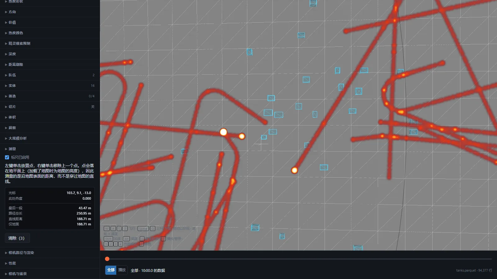

# 测量

**指标** 会把鼠标变成一把标尺，并告诉你光标下的位置有多繁忙。用它来查明两个地方相距多远，或某个位置有多少流量。

## 试一试 {#try-it}

1. 在侧边栏中打开 **指标**，并勾选 **标尺已启用**。
2. 在地图上左键点击三个地点。每次点击都会放下一个点。
3. 查看 **路径总长**（整条路径的长度）和 **最后一段**（最后一段的长度）。
4. 右键点击可删除最后一个点，或按 **清除 (3)** 删除全部。

| 操作 | 效果 |
|---|---|
| 左键点击 | 在光标与地平面相交的位置放下一个点。按下和松开之间移动超过 4 像素的点击是相机拖动，而不是放点。 |
| 右键点击 | 删除最后一个点。 |
| 移动 | 光标位置及其下方的热度实时更新。 |

标尺开启时，相机仍然可以操作：拖动仍然可以环视，按键仍然可以飞行。标尺开启期间它会接管每一次点击，所以[点击拾取](camera.md#click-to-pick)要等它关闭后才能使用。

**地平面**是加载地图图像时[地图图像](map-images.md)的高程；否则是数据集的最低 Y（没有地图图像时为 0）。点会落在它上面，所以标尺测量的是横跨地图的距离，而不是穿过地图的直线。使用三维关卡时，地平面仍然是数据集的最低 Y，而不是关卡的表面——若要得到真实表面上的一个点，请关闭标尺并点击它（[点击拾取](camera.md#click-to-pick)），这样会直接从关卡自身的三角形读取坐标。

## 读数 {#readouts}

| 行 | 含义 |
|---|---|
| **光标** | 地平面上光标所指点的世界 X、Y、Z。 |
| **此处热度** | 光标像素处的热度有多少。数值越大，说明该位置的流量越多。它是颜色色带在饱和点相除之前所用的数值，因此你可以将它与[饱和点](colour-and-exposure.md#saturation-point)进行比较。 |
| **最后一段** | 从最后一个点到光标（或最后两个点之间）的距离。 |
| **路径总长** | 经过每个点和光标的折线长度。 |
| **直线距离** | 从第一个点到光标（或最后一个点）的三维距离。 |
| **仅地面** | 同样的距离，但只计算 X 和 Z。 |
| **清除 (N)** | 删除所有点。 |

距离显示规则：小于 1 个单位时以厘米显示，小于 1,000 时以米显示，大于 1,000 时以公里显示——这假定一个世界单位为一米（[坐标轴、单位和时间](axes-units-and-time.md#unit-scale)）。坐标是世界坐标，即使某个轴为了显示而[反转](camera.md#invert-world-axis)，也是如此。

点以及点之间的线会作为叠加层绘制在视图中，其大小根据网格间距确定。标尺的点不会保存在视图中；加载其他数据时它们仍然保留。

## 开发者须知 {#for-developers}

**此处热度** 最多每 120 毫秒从 GPU 读取一次，因为单像素回读会使流水线停顿。它使用与 `engine.readHeatProbe()` 相同的路径：除以该帧写入时所用的增益，因此在半浮点累积路径（`?heat=f16`）上，它的单位与 32 位目标上的单位相同（[半浮点累积](half-float-accumulation.md)）。
