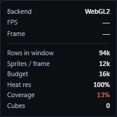

# 性能面板和统计浮层

视图右上角的框显示查看器工作得有多努力：每秒多少帧、绘制了多少个点，以及它是否仍在细化画面。**性能** 面板让你用画质换取速度。

## 统计浮层 {#the-stats-overlay}

在热力图和对局标签页中，视图右上角的框（[`StatsOverlay.tsx`](https://github.com/Holdi601/3DHeat/blob/main/src/ui/StatsOverlay.tsx)）。它在每个动画帧读取引擎的实时读数。

| 行 | 含义 |
|---|---|
| **后端** | *WebGPU* 或 *WebGL2*。如果没有使用 WebGPU，悬停可看到原因。见[两种后端](backends.md)。 |
| **FPS** | 每秒帧数，至少在 0.4 秒内取平均。 |
| **帧耗时** | 以毫秒计的帧时间，经过平滑（90% 旧值，10% 新值）。这是帧与帧之间的时间，不是 GPU 时间——没有测量每个渲染通道的 GPU 时间。 |
| **窗口内行数** | 候选行：当前时间窗口中的行，在着色器中按行过滤之前。 |
| **精灵数/帧** | 上一帧的计划提交的精灵数（在不绘制任何内容的空闲帧上保持计划数值）。 |
| **预算** | 本帧计划时使用的精灵预算——即自适应控制器的值，在绘制每一行时提高到所有候选行。 |
| **热度分辨率** | 热度缓冲区相对于画布的分辨率：*热度分辨率* 设置乘以自适应第二阶段的比例。 |
| **覆盖率** | 渐进累积已使用了多少行：收敛时以百分比显示（琥珀色），完成时显示 *精确*。有噪点的帧绝不会被误认为是最终画面。 |
| **方块** | [盒子回放](box-replay.md)中绘制的盒子。 |
| **未驻留** | 仅在行无法放入 GPU 预算时显示：有多少行。见 [GPU 内存驻留](gpu-memory.md)。 |

## 速度显示 {#the-speed-display}

位于视图右下角，仅在透视模式下出现：飞行速度，以及以该速度穿过数据所需的时间。拖动它可以改变速度。见[相机](camera.md#fly-speed)。

## 如果查看器很慢 {#if-the-viewer-is-slow}

先看统计浮层，然后：

1. **窗口内行数远大于精灵数/帧，覆盖率低于 100%**——这一帧无法绘制全部内容；静止时它会在几帧内收敛。缩小窗口、过滤或剔除以减少候选数，或者接受采样。
2. **精灵数/帧等于窗口内行数，帧仍然很慢**——代价与屏幕上的每个精灵相关：降低*最大像素半径*（[精灵形状](sprite-shape.md#pixel-clamps)）或*热度分辨率*。
3. **行很少但仍然很慢**——很可能是关卡：结构数量大、开启了边缘、地面三角形、景深。见[关卡外观](level-appearance.md)。
4. **一切都很慢，并且出现红色横幅**——软件渲染（[软件渲染检测](software-rendering.md)）。

## 性能面板 {#the-performance-panel}

| 控件 | 默认值 | 效果 |
|---|---|---|
| 提示 | | 每帧喷溅可见行的分层随机子集，并按补偿缩放权重，因此在任何预算下期望热度都是精确的；保持视图不动时，帧会持续合并，直到每一行都有贡献。 |
| **每帧绘制所有行** | 开 | 每个开始新估算的帧都会绘制每一个候选行（最多约 2.68 亿行）；下面的预算变为下限。[采样和预算](sampling-and-budgets.md#draw-every-row-each-frame) |
| **自适应预算** | 开 | 先调整每帧精灵数，再调整热度分辨率，以保持目标帧率——并在削减无济于事时停止削减。[采样和预算](sampling-and-budgets.md#the-adaptive-budget) |
| **目标 FPS** | 60 | 20–240（使用手柄时可到 1000）。低于 15 的值按 15 处理。 |
| **初始精灵数/帧** / **精灵数/帧** | 4.00M | 65,536–268,435,456，对数刻度。自适应开启时名为 *初始*，因为控制器会改变它。 |
| **热度分辨率** | 100% | 25–100%。片段代价随平方缩放：50% 使混合工作量减为四分之一，而且热度场足够平滑，几乎看不出差别。 |
| **渐进细化** | 开 | 视图保持不动时跨帧累积。关闭则每帧显示单帧估算。[累积](accumulation.md) |
| **资源预算** | 自动检测 | 内存、GPU 和解析线程预算。[内存和预算](memory-and-budgets.md#resource-budgets) |

这些设置都不会被保存；重新加载会恢复默认值。
