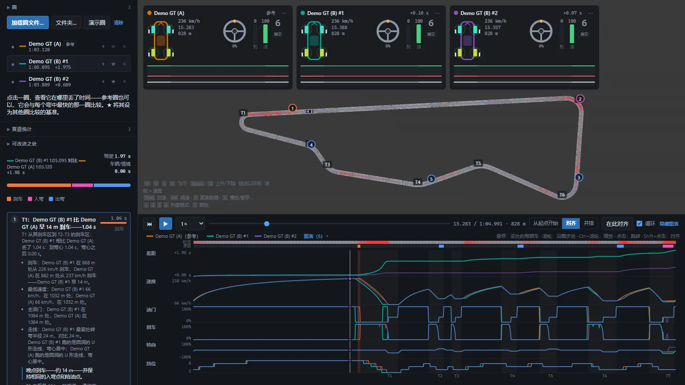

# 赛车分析

你把同一条赛道开了两次。**赛车分析** 标签会在 3D 中同时播放两次驾驶，显示一圈在哪里更慢，并告诉你原因。还没有圈？按 **演示圈**。

该标签比较同一条赛道的两圈或更多圈。它与热度标签共用画布、摄像机和已载入的赛道模型（**背景 / 关卡**）；其余部分则是它自己的：自己的侧边栏，以及视图下方自己的栏。*圈*、*参考*和*弯心*等词语收录在[术语表](glossary.md)中。

本页是该标签的地图。每个部分都有自己的页面：

| 页面 | 涵盖内容 |
|---|---|
| [加载圈次](race-loading-laps.md) | 每种文件格式、文件夹和赛道、车辆名称、演示圈、圈列表、参考和聚焦 |
| [回放与 3D 场景](race-replay-and-scene.md) | 播放控制栏、三种回放模式、对齐车辆、追逐摄像机、线条、地图、车辆、标签、镜像世界 |
| [图表与 HUD](race-charts-and-hud.md) | 距离图表、曲线选择器、悬停与缩放、车辆卡片、通道表 |
| [车辆操控事件](race-control-events.md) | 抱死、轮胎打滑、过度转向、打转、转向不足、撞击、碰撞、ABS/TC、手刹、空中——每一项如何检测，以及每个阈值 |
| [逐弯分析](race-corner-analysis.md) | 按距离对齐、弯道和分段、弯道的时间账目、每种原因及其尝试顺序、走线形状与建议 |
| [车辆档案与对比](race-car-profiles.md) | 每辆车能做什么，根据其圈数测得；*车辆对比*；车辆在每个弯道中决定了什么 |
| [赛道统计](race-course-statistics.md) | 同一条赛道的许多圈：每个弯道和每种类型的失误、失误地图、热力图导出、性能限制 |
| [赛车分析：方法](race-analytics.md) | 规则背后的研究，附来源 |
| [其他赛车游戏](other-games.md) | 查看器如何处理来自每款游戏的圈：在游戏未提供数据的地方推算打滑和漂移、镜像世界、额外的通道 |

## 界面 {#the-screen}

**侧边栏**，自上而下（各部分可以折叠）：

1. **圈** ——载入、列出、显示/隐藏、参考、聚焦、追逐。
   参见[加载圈次](race-loading-laps.md)。
2. **赛道统计** ——仅在载入三圈或更多之后出现。
   参见[赛道统计](race-course-statistics.md)。
3. **可改进之处** ——聚焦圈的发现，逐弯列出。
   参见[逐弯分析](race-corner-analysis.md)。
4. **逐弯分析**（有多个等级时为 *逐弯分析 - 等级 X*）——通过每个弯道最快的圈及其走线。两圈或更多圈时显示。
5. **车辆操控** ——聚焦圈的抱死、侧滑、推头和撞击。
   参见[车辆操控事件](race-control-events.md)。
6. **车辆对比**（只有一辆车时为 **车辆**）——参见[车辆档案与对比](race-car-profiles.md)。
7. **视图** ——赛道上绘制哪种地图，以及绘制什么。
   参见[回放与 3D 场景](race-replay-and-scene.md)。
8. 共用的 **关卡** 和 **相机与场景** 面板（赛道模型、坐标轴翻转、摄像机）——与热度标签一同记录在[摄像机](camera.md)中。

**视图** 显示赛道、驾驶线、地图、车辆、固定在赛道上的标签，以及左上角最多六张车辆卡片（参见[图表与 HUD](race-charts-and-hud.md)）。没有载入圈时，它会显示："没有载入圈——将两个或更多圈文件拖到这里，或从侧边栏载入演示圈。"

**视图下方的栏** 包含回放播放控制，以及（除非隐藏）距离图表。

## 快速开始 {#quick-start}

1. 打开 **赛车分析** 标签（位于侧边栏顶部 **热力图** 的旁边）。
2. 载入圈。按 **演示圈** 可以看到该标签如何处理三个虚构的圈。对于你自己的圈，请先录制它们（[文件格式与录制工具](race-loading-laps.md#file-formats)），然后按 **加载圈文件…** 或 **文件夹…**，或把文件或文件夹拖到视图上。
3. 最快的完整圈成为参考；其他圈中最慢的那一圈被聚焦。点击列表中的任何一圈即可聚焦它；★ 会把一圈设为参考。
4. 阅读 **可改进之处**。点击一个发现：车辆会在它之前 40 米处对齐，摄像机对其取景，回放播放经过它的过程，并打开测量结果。
5. 将鼠标悬停在图表上，可把每辆车移动到该米位置；按 Shift+点击则在该处对齐它们。

## 键盘 {#keyboard}

打开赛车标签时：

| 按键 | 作用 |
|---|---|
| **K** | 播放/暂停回放 |
| **Home** | 回到回放的起点 |
| 数字键 | 无作用（在热度标签中它们切换模式） |

输入到文本框或下拉菜单中的按键会被忽略。摄像机按键的作用与热度标签中相同（**W A S D**、**Space** 上升、**Q** 下降、**Shift** 加速、**Alt** 减速、鼠标转动视角；全部见[摄像机](camera.md)）；**F** 对已载入的圈取景（与加载圈次时相同）。

## 许多圈 {#many-laps}

- 所有已载入的圈都会被分析和统计；几十圈只需一两秒。
- 超过 **8** 圈（`SHOW_ALL_UP_TO`）后，新加入的圈只有在它是参考圈、聚焦圈，或聚焦圈所在等级的最佳圈时才会被绘制。*全部显示* / *只显示正在查看的* 可以切换。
- 可见车辆超过 **10** 辆（`PLAIN_PAST`）后，未被查看的圈（不是焦点、被追逐车辆或参考圈）会以每 6 米一个点（而非每 1.5 米）的稀疏线条绘制，并且车辆以普通方式绘制。
- 图表最多绘制 **8** 圈；HUD 最多显示 **6** 张卡片。
- 赛道统计从 **3** 圈起出现。

详情：[赛道统计](race-course-statistics.md#performance-with-many-laps)。

## 默认视图设置 {#default-view-settings}

| 设置 | 默认值 |
|---|---|
| 地图 | 时间地图 |
| 驾驶线、车辆、轮胎与悬挂、标签、取自圈的赛道 | 开启 |
| 卡片上的所有数值 | 关闭 |
| 车辆大小 | 1× |
| 图表 | 显示 |
| 回放模式 | 从线条开始 |
| 回放速度 | 1× |
| 循环 | 开启 |

这些设置都不会被保存；重新加载会从默认值开始。浏览器会记住的内容：语言，以及从圈文件中学到的车辆名称（参见[加载圈次](race-loading-laps.md#car-names)）。

## 开发者信息 {#for-developers}

### 加载圈时会发生什么 {#what-happens-when-laps-are-loaded}

每当圈的集合、参考或语言改变时，整个分析都会重新进行（[`src/race/analysis.ts`](https://github.com/Holdi601/3DHeat/blob/main/src/race/analysis.ts) 中的 `analyse`）：

1. 在游戏未提供的地方，为每一圈添加推导出的通道：漂移角、由轮速推算的车轮打滑、是否在空中、松散路面、横摆率（[`derive.ts`](https://github.com/Holdi601/3DHeat/blob/main/src/race/derive.ts)）。
2. 选出参考，并把每一圈投影到其路径上，每 2 米重采样一次（[`align.ts`](https://github.com/Holdi601/3DHeat/blob/main/src/race/align.ts)）。
3. 根据圈推断游戏世界是否为镜像（[`handedness.ts`](https://github.com/Holdi601/3DHeat/blob/main/src/race/handedness.ts)）。
4. 在参考上找出弯道，并从一个刹车区到下一个刹车区组合成分段（[`segments.ts`](https://github.com/Holdi601/3DHeat/blob/main/src/race/segments.ts)）。
5. 对每辆车：它的包络（每个速度下的抓地力、刹车、牵引力）、它的档案、它的轮胎曲线（[`envelope.ts`](https://github.com/Holdi601/3DHeat/blob/main/src/race/envelope.ts)、[`profile.ts`](https://github.com/Holdi601/3DHeat/blob/main/src/race/profile.ts)、[`control.ts`](https://github.com/Holdi601/3DHeat/blob/main/src/race/control.ts)）。
6. 对每一圈和每个分段：它做了什么（刹车点、最慢点、全油门等……）以及它所走的线（[`line.ts`](https://github.com/Holdi601/3DHeat/blob/main/src/race/line.ts)）。
7. 对每一圈：它的车辆操控事件，各自与它在该处所对比的圈并列。
8. 对每一圈和每个分段：相对于其比较圈的时间账目，以及用文字表述的发现。
9. 每一圈的时间地图和原因地图。

文本以当前语言生成；切换语言会重新运行分析（并重新命名演示圈）。分析中的失败会在 **圈** 按钮下方以错误形式显示，圈则保持载入状态。

### 源文件 {#source-files}

| 文件 | 作用 |
|---|---|
| `src/race/adapters.ts`、`ibt.ts` | 读取圈文件 |
| `src/race/lap.ts`、`carNames.ts`、`synthetic.ts` | 圈的类型、命名、演示圈 |
| `src/race/derive.ts`、`handedness.ts` | 推导的通道、镜像世界 |
| `src/race/align.ts`、`segments.ts`、`line.ts` | 距离轴、弯道、线条 |
| `src/race/analysis.ts` | 对比的弯道、原因、发现 |
| `src/race/envelope.ts`、`profile.ts` | 车辆能做什么 |
| `src/race/control.ts`、`impacts.ts` | 车辆操控、撞击和碰撞 |
| `src/race/stats.ts` | 许多圈 |
| `src/race/replay.ts`、`scene.ts`、`glyph.ts`、`geometry.ts` | 回放与绘制 |
| `src/race/schema.ts`、`graphs.ts` | 通道表、图表的行 |
| `src/ui/race/*` | 侧边栏、图表、HUD、标签 |
| `src/state/raceStore.ts` | 标签的状态与回放时钟 |
