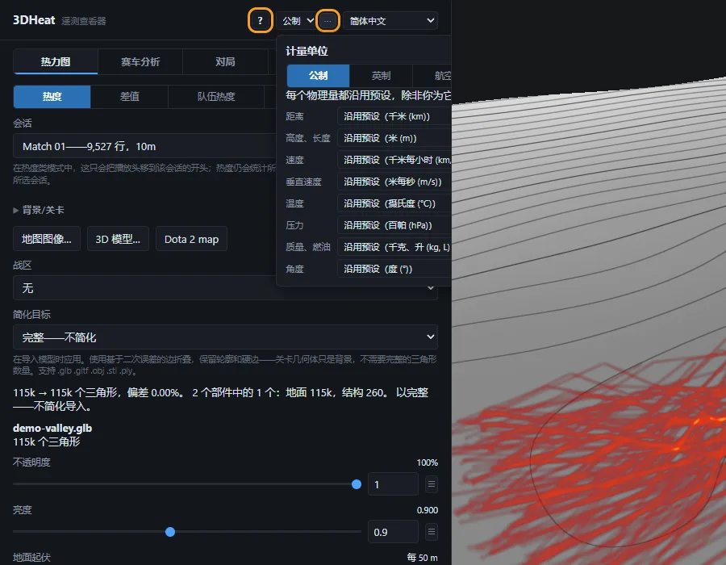
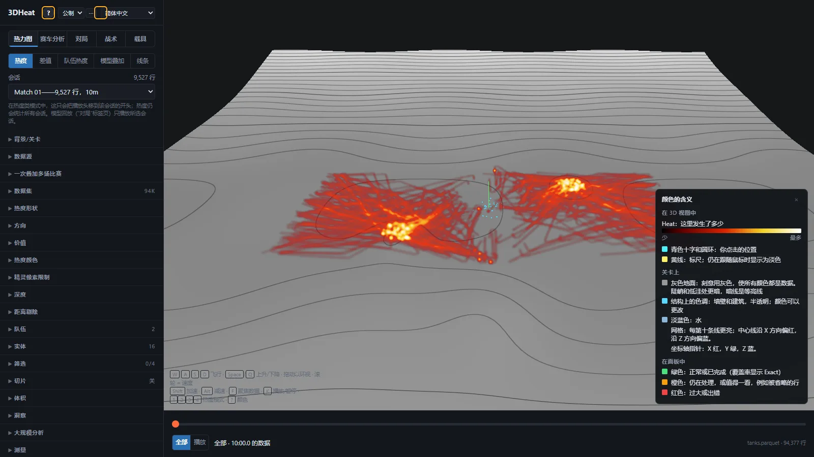
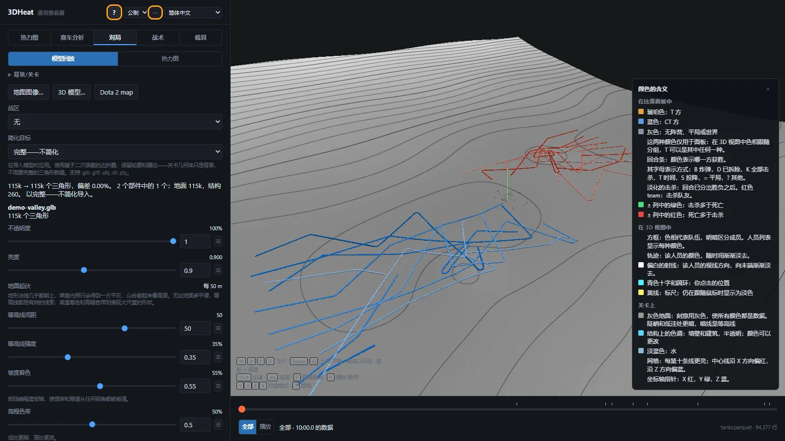

# 设置、单位和按键

侧边栏顶部的小控件用于改变查看器与你交流的方式：语言、单位（米或英尺、公里每小时或节）以及解释颜色的帮助模式。你的选择会记录在你的浏览器中。

## 顶部栏 {#the-header}

侧边栏顶部：

| 控件 | 作用 |
|---|---|
| **?** | 帮助模式：每种颜色的含义（也可按 `?` 或 `F1`） |
| **单位** 菜单 | 公制、英制、航空或航海 |
| **单位** 旁的 **...** 按钮 | 打开"为每个量选择单位"：每个量各有一个下拉菜单 |
| **语言** 菜单 | 查看器的语言：[40 种语言](languages.md)，或浏览器的语言 |

你在输入框中输入的数字可以使用小数点或逗号（`0.35` 或 `0,35`）。查看器两种都能读取，并会按照查看器语言的书写习惯显示数字。

## 单位 {#units}

1. 在 **单位** 菜单中选择一个预设。所有量会一起切换。
2. 如果只想更改一个量，点击它旁边的 **...** 按钮，为该量选择一个单位。之后菜单会在预设后面显示 `*`。
3. 你没有设置的量会跟随预设。选择"跟随预设"即可恢复。

| 量 | 公制（默认） | 英制 | 航空 | 航海 |
|---|---|---|---|---|
| 距离 | km | mi | NM | NM |
| 高度、长度 | m | ft | ft | m |
| 速度 | km/h | mph | kt | kt |
| 垂直速度 | m/s | ft/min | ft/min | m/s |
| 温度 | °C | °F | °C | °C |
| 气压 | hPa | inHg | hPa | hPa |
| 质量、燃油 | kg, l | lb, gal | lb, gal | t, m³ |
| 角度 | 度 | 度 | 度 | 度 |

你可以为单个量选择的其他单位：距离 km、mi、NM；速度 km/h、m/s、kt、mph；垂直速度 m/s、ft/min、m/min；温度 °C、°F、K；气压 hPa、inHg、mmHg、psi；质量 kg、lb、t；角度为度或 NATO 密位（一圈 6400 密位）。这些单位在查看器的各处都相同：标签、卡片、图表、统计数据。

## 帮助模式 {#help-mode}

按 `?` 或 `F1`，或点击 **?** 按钮。它会显示 *颜色的含义*：三维视图的图例、热度色带、队伍颜色、关卡颜色、面板的状态颜色、对局面板和赛车视图。在你将它关闭之前，它一直保持开启。在对局标签页中，它也会解释对局面板的颜色。

## 浏览器会记住的内容 {#what-the-browser-remembers}

这些设置会在两次访问之间保存在你的浏览器中（不会发送到任何地方）：

- 语言、单位和帮助模式；
- 回放的图形、符号、标签、相机和战术显示设置；
- 播放速度和镜像；
- 每个录像的书签、每个数据集的音量、目标图层；
- 外部 AI 设置（只有勾选 *记住* 时才保存密钥）。

热度设置、过滤器和模式在每次加载时都会重新开始。完整的自动生成列表：[已保存的设置](ref-settings-storage.md)。

## 查看器保留的浏览器按键 {#keys-the-viewer-keeps-from-the-browser}

加载大量数据的会话需要一些时间，所以查看器会阻止浏览器无意中把它丢弃：

- 在文本框之外，会输出字符、保存、打开、重新加载、关闭或打开新窗口的 `Ctrl`/`Cmd` + 字母组合不起作用；`F1`、`F3`、`F5`、`F6` 和 `F7` 也不起作用。
- 在已加载数据或关卡时关闭或重新加载标签页，会先询问。
- 全屏时，查看器会锁定它使用的按键（W、T、N、S、R、P、Q、Esc），因此浏览器不会接管它们。

完整列表：[浏览器按键](ref-browser-keys.md)。查看器自身的所有按键：[键盘和鼠标参考](keyboard-reference.md)。
