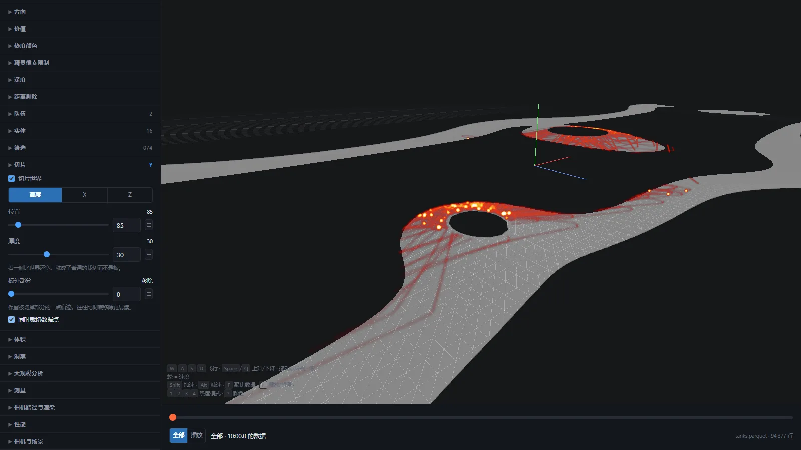

# 切片

**切片** 像切蛋糕一样切开世界，让你可以看到建筑物内部。当墙壁挡住了你感兴趣的热度时使用它，例如查看建筑物的某一层。

## 试一试 {#try-it}

1. 加载一个关卡和一些数据，然后打开 **切片**。
2. 勾选 **切片世界**。轴选择 **高度**。
3. 上下拖动 **位置**：切片板会在关卡中移动。
4. 把 **厚度** 调薄以查看平面图，或调宽以查看"这里以下的所有内容"。
5. 将 **板外部分** 保持为 0 以去除其余部分，或将其调高以保留淡淡的痕迹。



切片板会**同时**切开**关卡几何体和数据点**——只切开关卡的话，热度会悬浮在原来建筑物所在的位置。它与[深度遮挡](depth-and-culling.md)相对应：一旦关卡正确地遮挡了其后方的内容，建筑物的内部也会被遮挡。当有可切片的内容（数据集或三维关卡）时会显示此面板；开启时其标题显示轴，关闭时显示 *off*。

```
侧视图            位置 = 切片板所在的位置
 ----------       厚度 = 切片板有多高
 | 第三层  |
 |=========|  <--- 切片板（保留）
 | 第二层  |  <--- 板外：去除（或淡化）
 | 第一层  |
 ----------
```

## 控件 {#controls}

| 控件 | 默认值 | 含义 |
|---|---|---|
| **切片世界** | 关 | 开启切片板。如果位置仍为初始值 0 且厚度仍为初始值 500，开启时会把它们移到该轴的中间，并把厚度设为该轴跨度的 15%。 |
| 轴 | **高度** | *高度*（Y）、*X* 或 *Z*。切换轴会把切片板移到新轴的中间。 |
| **位置** | 中间 | 切片板的中心，以世界单位表示，沿该轴的跨度（500 个步进）。 |
| **厚度** | 跨度的 15% | 从跨度的 1/500 到跨度的两倍，按对数步进。当它与跨度一样宽时会显示 *超出世界范围*：此时一侧会超出世界，它就成为普通的切割，而不是切片板。 |
| **板外部分** | 0，*去除* | 位于板外的内容有多少仍然可见，范围 0–100%。被切掉部分的淡淡痕迹通常比直接去除更容易阅读。 |
| **同时裁切数据点** | 开 | 关闭则热度保持完整，因此它会透过切口显示——适用于查看切片板上方和下方的内容。 |

某个轴的跨度，在加载了三维关卡时取该关卡的跨度，否则取数据集的跨度。

切片与[距离剔除](depth-and-culling.md#distance-culling)是相互独立的，后者沿视线方向而不是沿世界轴切割；两者可以组合使用。任何切片设置的改变都会重新开始热度累积。

## 开发者须知 {#for-developers}

切片板会在顶点着色器中对每一行的世界位置进行测试：位于其外的行，其贡献会乘以 *板外部分* 的值，因此当该值为 0 时，它在绘制任何片段之前就会被剔除。关卡着色器对地面、结构和水体的每个片段都应用同样的测试。
