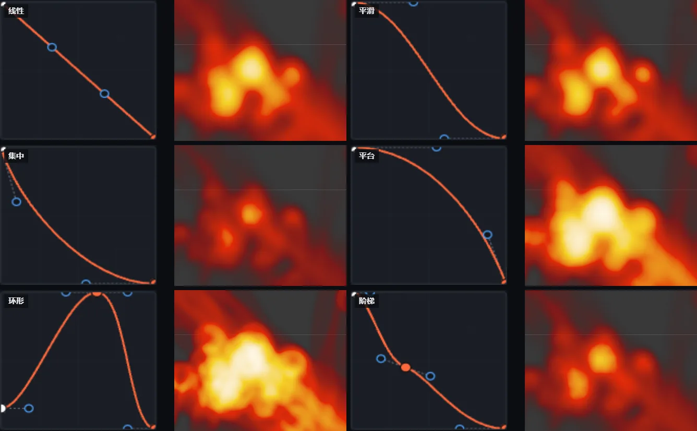

# 精灵形状

每一行都会被画成一个始终正对摄像机的圆形精灵。它的大小，以及从中心到边缘的轮廓——即**衰减形状**——决定一个热点看起来是紧凑的点、柔和的云、圆盘还是环。这些控件位于侧边栏的**热度形状**和**精灵像素限制**区，适用于[热度](heat.md)、[差值](difference.md)、[队伍热度](team-heat.md)，并且在作为线宽的一半时适用于[线条热度](line-heat.md)。

改动其中任何一项都会重新开始累积（用新形状重绘整个场）。

可以把每个点想象成一团柔和的光。小的光团只显示单个的点；大的光团会把相邻的点合并成一片云。形状决定边缘有多柔和。



## 精灵半径 {#sprite-radius}

精灵以**世界单位**（标注为米）表示的半径。默认为 6，并且每次加载时都设为数据水平范围 / 120——足够大，使路径上相邻的采样合并成一条带，而不是显示为一根细线。对数滑块范围为 0.05-2000，拖动手柄可到 50,000。


远处的东西看起来更小，因此精灵会随距离在屏幕上缩小。在平行投影下，它在各处的大小都相同，这也是平行视图适合用来比较热点的部分原因（[摄像机](camera.md#projection)）。

## 像素限制 {#pixel-clamps}

**精灵像素限制**（默认关闭）会在上面的换算之后限制屏幕上的半径。

| 控件 | 默认值 | 范围（拖动） | 原因 |
|---|---|---|---|
| **最小像素半径** | 1 px | 0-16（512） | 防止远处的数据缩小到一个像素以下而消失。 |
| **最大像素半径** | 96 px | 2-1024，对数刻度（8192） | 过度绘制保护。覆盖 N 个像素的精灵会产生 N 次混合运算，所以靠近摄像机时不加限制的半径，会把快速的一帧变成慢帧。超过视口高度后，它不再限制任何东西。 |

**任意缩放下密度一致**（位于热度形状区，默认开启）与像素限制配合使用。被限制变大（远处）或变小（近处）的精灵，仍会添加它真实大小所应添加的热度，因此在任何缩放级别下，颜色都表示每单位地面面积的相同行数。关闭时，被限制的精灵会以其限制后的大小添加全部权重，于是飞近时画面会发生变化。

## 中心与边缘强度 {#centre-and-edge-intensity}

精灵在其正中心添加的热度（**中心强度**，默认 1，范围 0-10，拖动 1000）以及在其边缘添加的热度（**边缘强度**，默认 0，范围 -2-10，拖动 1000）。轮廓值 *t*（中心为 1，边缘为 0，由下面的衰减或曲线塑造）在两者之间进行混合（公式见[开发者信息](#for-developers)）。

**负的边缘强度**会让边缘做减法，从而在每个热点周围刻出一圈冷色光晕，并使各个簇之间的边界更清晰。可见性包括[遮挡](depth-and-culling.md)和[切片](slice.md)；渐隐是[生命周期](timeline.md#history)渐隐；符号在[差值](difference.md)中为 ±1。

## 轮廓形状：衰减或曲线 {#ramp-shape-falloff-or-curve}

**衰减形状**在两种方式之间切换，用来塑造 *t* 在精灵上的变化。设 *d* 为从中心（0）到边缘（1）的距离：

### 衰减 {#falloff}

选择*衰减*（默认）时显示。

- **衰减**（默认 1.6，范围 0.1-8，拖动 64）：`t = (1 - d) ^ 衰减`。1 是笔直的线性渐变；更高的值会把热度拉向中心，使热点更集中；低于 1 则会把它压平成圆盘。
- **平滑衰减**（默认开启）：对 *t* 应用 smoothstep 的 S 形曲线，使精灵在边缘处渐入，而不是在一条可见的边界处结束。

### 曲线编辑器 {#the-curve-editor}

选择*曲线*时显示。这是精灵截面的直观呈现：横向为距中心的距离（左侧为*中心*，右侧为*边缘*），纵向为热度。曲线是经过控制点的分段三次贝塞尔曲线，每个控制点有两个手柄。

| 操作 | 效果 |
|---|---|
| 在图上双击 | 在该距离处添加一个点（保持在 0.02 到 0.98 之间），位于曲线上，并带有该处曲线的斜率，因此在你拖动它之前，添加它不会改变任何东西。 |
| 拖动一个点 | 移动它。高度保持在 0 到 1 之间。 |
| 拖动一个小圆圈 | 弯曲它旁边的线段（移动该手柄）。 |
| Alt 点击或右键点击一个点 | 删除它。两个端点无法删除。 |
| 一个预设按钮 | 用该预设替换当前曲线。 |

端点固定在中心和边缘；它们的高度仍由你决定。

**预设**（[`curve.ts`](https://github.com/Holdi601/3DHeat/blob/main/src/state/curve.ts)）：

| 预设 | 形状 | 用途 |
|---|---|---|
| **线性** | 从 1 到 0 的直线 | 与*衰减* 1 且*平滑衰减*关闭时完全相同。 |
| **平滑** | S 形曲线 | 默认曲线；在衰减 1 时*平滑衰减*给出的效果。 |
| **集中** | 陡峭的核心，加上一圈长而淡的裙边 | 稀疏的数据。 |
| **平台** | 先平坦，然后快速滚降 | 读作圆盘，而不是一团光。 |
| **环形** | 中心为 0.15，半径的 62% 处为 1，边缘为 0 | 中空的精灵：显示路径经过的地方，而不是停止的地方。 |
| **阶梯** | 两段式衰减，在 35% 处为 0.45 | 把密集的核心与其周围分开。 |

## 压平到地平面 {#flatten-onto-ground-plane}

**压平到地平面**（默认关闭）会忽略每一行的高度，把所有热度画在同一高度上——即数据集的最低 Y 值——也就是经典的二维地图热度图。开启后，深度遮挡和*隐藏地形后方*都会关闭（每个点都会恰好位于它被测试的表面上），深度区会对此加以说明。

## 开发者信息 {#for-developers}

### 公式 {#formulas}

屏幕上的像素半径：`radius × P[1][1] / w × 视口高度 / 2`，其中 `P` 为投影矩阵，`w` 为该点的视图深度。

一个精灵添加的热度：

```
heat added = mix(edge, centre, t) × sample weight × sign × fade × visibility
```

### 曲线 {#the-curve}

手柄在水平方向上被限制在其所属的线段内，因此曲线始终是距离的函数：把一个手柄拖到下一个点之外很远，它会贴着那个点压平，而不会把曲线折叠回来——否则结果会取决于求解器恰好找到哪个根。

### 曲线如何绘制 {#how-the-curve-is-drawn}

每当曲线改变时，它都会被烘焙成一个 256 项的表，上传为 16 位浮点纹理，并在每个片段上以线性过滤采样，同时内缩半个纹素，使两端保持精确。为 x 求解贝塞尔曲线需要迭代，这在程序最热的着色器中没有位置；而表查找也比衰减所用的 `pow()` 更便宜。使用 16 位而不是 8 位，是因为当数千个精灵叠加后，8 位会显示出色带；16 位半精度浮点在 WebGL2 核心中可过滤，而 32 位则需要扩展。
