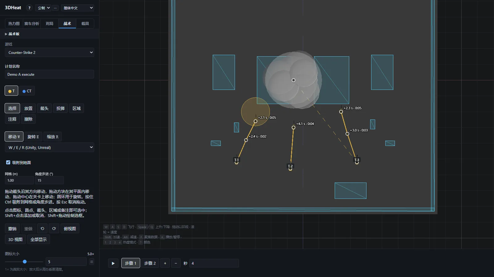

# 战术面板

**战术** 标签是一块团队方案的绘图板：你在地图上放置小图标，画出箭头表示它们的走向，然后按下播放，看它发生。用它在比赛前规划一回合或一次进攻。它与其他标签共用画布、摄像机和[关卡](levels.md)，此外别无关联；方案不是数据，也不绘制热度。

## 你的第一个方案 {#your-first-plan}

1. 打开 **战术** 标签。选择 **游戏**（例如 Counter-Strike 2）；若是 Valorant，则按 **加载 Valorant 地图**，再选择一张 **地图**。或者先载入一个[关卡](levels.md)。
2. 选择一个 **阵营**（它决定颜色），然后按 **俯视图**。
3. 选择 **地点**，在 **图标** 中选一个图标（使用 **搜索图标** 来查找），然后在地图上点击。放下两到三个图标。
4. 选择 **箭头**，点击一个图标，沿它应该走的路线逐点点击，然后按 **Enter** 结束箭头。
5. 按视图下方的 **+** 添加第 2 步。每个图标都从上一步箭头的终点开始。在那里画更多箭头。
6. 按 **▶**（或 `K`）从所显示的步骤播放到结束。
7. 在 **计划名称** 中为方案命名，然后按 **保存**。

## 开始一个方案 {#starting-a-plan}

| 控件 | 作用 |
|---|---|
| **游戏** | 选择调色板提供的阵营和图标：Counter-Strike 2（T、CT；玩家和道具）、Valorant（进攻、防守；玩家和通用技能）、Battlefield、Squad、Arma（步兵、地面车辆、飞机、船只）、DCS / War Thunder / IL-2（喷气机、螺旋桨飞机、直升机、防空、地面、舰船、武器），以及其他。游戏更改时，已有图标的方案会保留其阵营。 |
| **计划名称** | 方案保存时使用的名称。 |
| **地图**、**加载 Valorant 地图** | 选择 Valorant 时：**加载 Valorant 地图** 从 [valorant-api.com](https://valorant-api.com) 获取地图列表；**地图** 则把所选地图的小地图作为关卡铺开，从上方取景。图片在选择时获取，从不随程序提供。Riot 的声明在它显示在屏幕上时会出现（见下文）。 |
| **阵营** | 下一个图标、箭头或区域所属的阵营；它采用该阵营的颜色。 |

没有关卡时，面板是平坦的地面。在 **关卡** 中载入一个关卡，即可在真实地图上规划：用 CS2 工具导出的 CS2 地图、关卡库中的关卡，或地图图片。

## 工具 {#tools}

| 工具 | 点击 | 说明 |
|---|---|---|
| **选择** | 点击一个图标、路点、箭头、区域或注释即可选中它。 | Shift+点击 添加或移除；Shift+拖动绘制一个框，框住要添加的内容。选中后会出现变换操纵器（见下文）；`Delete` 或 `Backspace` 删除它。`M` 把选中的图标移动到下一次点击的位置。 |
| **地点** | 放下所选的图标。 | 图标在 **图标** 调色板中选择（使用 **搜索图标**）。没有选中任何东西时，`R` 会在放置前将下一个图标转动 15°（`Shift+R` 反向转动）。 |
| **箭头** | 每次点击添加一个点；Enter、双击或右键结束它，Esc 则放弃它。 | **移动**、**进攻**（箭头头部更宽）或 **监视**（眼睛高度的细线）。从某个图标开始的箭头就是该图标在此步的路线：播放时，图标会沿着它行走，下一步则从它的终点开始。 |
| **投掷** | 投掷者，然后是落点。 | 从一个点到另一个点之间是一条虚线弧，所选的道具（烟雾、闪光、燃烧瓶……）出现在落点，并从此步起一直保留。 |
| **区域** | 中心，然后是边缘。 | 一个以阵营颜色绘制的圆盘。 |
| **注释** | 注释的位置；会要求输入其文字。 | 显示为一个图钉，其文字显示在它上方。 |
| **擦除** | 一个图标、箭头、区域或注释。 | 从此步起将其移除；若在它的第一步，则直接删除。 |

**撤销** 和 **重做**（`Ctrl+Z`；`Ctrl+Y` 或 `Ctrl+Shift+Z`）会逐步回退或重做每一次更改。方案下方的一行会显示它有多少图标、箭头和步骤。**俯视图** 垂直向下看（正交投影），**3D 视图** 则回到透视；**帧耗时** 会把方案取景到画面中，若方案为空则框住关卡。

**图标大小** 缩放面板上的每一个图标；1× 为真实大小，从很远的高处看，一个人只有几个像素。

## 移动、转动与缩放 {#moving-turning-and-scaling}

面板上的一切都可以像在 3D 编辑器中一样移动：图标、道具、标记、单个路点和整条箭头、区域和注释。被选中的内容会在其中心出现一个操纵器：

| 模式 | 按键 | 手柄 |
|---|---|---|
| **移动** | W（或 G） | 每个轴一个箭头（X 红色，Y 绿色且朝上，Z 蓝色）沿该轴移动；一个方块沿其所在平面移动；中心在指针下方的关卡上移动。 |
| **旋转** | E（或 R） | 每个轴一个圆环，绕该轴转动。单个图标的圆环是其自身的偏航、俯仰和翻滚；一组对象则绕其中心，沿世界坐标轴转动。 |
| **缩放** | R（或 S） | 从选中内容的中心，沿某个轴或全方向扩散或收拢；区域的半径随之增大。 |

**按键** 在 W / E / R（Unity、Unreal）与 G / R / S（Blender）之间切换；只有选中了东西时，按键才会选择模式，否则则控制摄像机飞行。因此，选中东西时，`R` 在 W / E / R 按键下是 **缩放**，在 G / R / S 按键下是 **旋转**；没有选中东西时，它则转动下一个待放置的图标。所有面板按键都列在[键盘参考](keyboard-reference.md#tactics-board)中。拖动时按住 **Ctrl**，可以让移动对齐到 **网格**（米），或让转动对齐到 **角度步长**。**吸附到地面**（默认开启）会把移动后的人、车辆、标记、路点和区域放到关卡表面上；飞机和直升机保持其高度，沿 Y 轴箭头的拖动从不吸附。拖动手柄从不移动摄像机。**Esc** 取消拖动；每一次更改都是撤销的一步。

路点会以圆点显示在当前步骤箭头上：点击它即可选中，拖动即可移动，按 Delete 将其去除。**选中** 一节以米为单位显示选中内容的位置，图标的偏航、俯仰和翻滚（度），以及区域的半径，每项都可以直接输入。

## 计时 {#timing}

图标的路线按时间计算：每段耗时等于其在关卡上的长度——沿表面大约每两米采样，因此山坡或两点之间的台阶也计算在内——再除以该图标在该游戏中所选移动 **方式** 的速度，外加在路点处的任何 **等待**。步兵可以爬行、蹲行、慢走（静音）、跑步或冲刺；车辆和船只可以爬行、小心前进、正常行驶或全速冲刺；飞机和直升机可以低速飞行、巡航、战斗速度或最大速度飞行。游戏中没有的方式（CS2 没有冲刺）会取它最接近的一种。坡度如何减速取决于游戏：在 CS2 和 Valorant 中只计水平距离，与游戏中一样；军事模拟类游戏中，步兵上坡会减速（Tobler 的徒步函数），车辆则按坡度减速。

速度来自各游戏的表格及其来源（参见[移动速度](tactics-speeds.md)）：CS2 按所持武器，取自游戏的武器定义；Valorant 按武器；Battlefield、Squad、Arma 和空战类游戏按载具类型和等级。**移动方式** 选择图标的配置（一种武器、一种车辆类型）；**自定义 (m/s)** 为该图标覆盖任何模式。模式的名称与面板上显示的一致：*爬行*、*蹲行*、*慢走（静音）*、*跑步*、*冲刺*；*小心*、*正常*、*急速*；*低速*、*巡航*、*战斗*、*最大*。

每个路点显示距上一个路点的时间，以及距方案开始的时间（"+3.9 秒 · 0:12"）。选中图标的路线会列出每一段的模式、长度和时间、等待时间和到达时刻。**计时** 下的 **到达** 会把每个有路线的图标放在同一条时间线上，最先到达的在顶部。开启 **实时播放**（默认开启）时，一个步骤会持续到其最慢的路线到达为止，每个图标按各自的速度移动；此时 **秒数** 为该步骤的最短长度。**每米关卡单位数** 说明关卡以什么为单位：CS2 地图为 39.37（游戏单位），米制地图为 1。

## 与对局数据比较 {#compare-with-match-data}

**加载对局文件…** 读取该地图的 CS2 对局表（CS2 工具生成的 Parquet 文件，数量不限；只读取所需的列，在后台进行）；**使用已加载数据** 则使用查看器中已载入的数据。然后：

- **最早到达地图** 会按每个玩家第一次到达每个地点的回合开始后的时间给地图着色——**最快** 按钮显示所有回合中最快的，**典型（中位数）** 显示中间回合——从早（绿色）到晚（红色），可选一方或双方。它显示什么是可能发生的，以及何时发生。
- 所选的路线会与玩家从其起点（或回合开始）到其终点所达成的成绩相比较，每个终点为一个半径为设定值的圆盘："最快观测 14.2 秒，p10 15.0 秒，中位数 18.3 秒，共 41 次；你的方案 15.1 秒"。
- 玩家实际达到的速度——跑步、步行、蹲行，取自表格中的步行和蹲伏列——单位为 m/s。

## 步骤 {#steps}

视图下方的栏放着各个步骤。方案一开始有一个步骤；**+** 添加一个，每个图标都从上一步路线的终点开始；**−** 移除所显示的那一步。**秒数** 是所显示的步骤播放时需要的时间。**▶**（K）从所显示的步骤播放到结束：有路线的图标沿路线行走，在下一步移到新位置的图标则滑到那里，其余的保持静止。显示某一步时，每个图标在下一步中的位置会以淡色的幽灵标出，上一步的箭头则淡淡地显示在本步的箭头之下。

## 保存 {#saving}

**文件** 一节包含 **保存**、**打开** 和 **清除**。**保存** 会把方案写成 `<名称>.h3dplan.json`（纯 JSON：阵营、步骤、每一步中有一个位置的图标、箭头、区域、注释）；**打开** 则读回一个方案。其他版本的文件，或不是方案的文件，会被拒绝并附上原因。**清除** 会清空方案；撤销可以把它找回。

## 图标 {#figures}

每个图标都由查看器本身绘制：按类型公布的尺寸画出的简单形状，并带有能将其与邻近图标区分开来的特征——坦克的负重轮和炮塔，防空车辆的火炮、导弹和雷达，飞机的机翼平面、尾翼和发动机，直升机的旋翼和短翼。没有任何东西取自游戏。游戏中虚构的设计，显示为其类别的通用图标。关于数据如何找到图标，参见[图标](figures.md#which-figure-a-unit-gets)。

## Riot 的声明 {#riots-notice}

Valorant 地图根据 Riot Games 的 "Legal Jibber Jabber" 政策显示，该政策允许免费的社区项目使用这些地图，并要求在出现的任何地方附上此声明：*3DHeat 是根据 Riot Games 的 "Legal Jibber Jabber" 政策，使用 Riot Games 拥有的素材创建的。Riot Games 不认可或赞助本项目。* 面板上的技能是通用形状，而不是 Riot 的美术作品。
