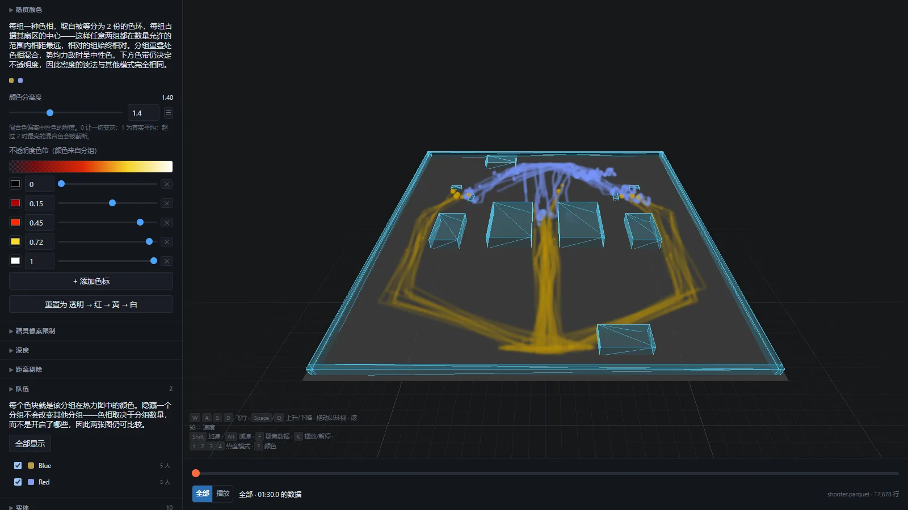

# 队伍热度

队伍热度显示每支队伍曾经在哪里，每支队伍使用自己的颜色。队伍重叠的地方，颜色会混合。

**队伍热度**（按键 3）是 [热度](heat.md) 的密度场，每个 [分组](glossary.md) 都有自己的色相。分组重叠时，它们的色相会混合；势均力敌的对抗会呈现中性色。不透明度仍然像其他模式一样表示密度，所以画面可以同时回答*多少*和*属于谁*。它需要一个分组列。

它不是 [图形叠加](box-replay.md)：图形叠加为每个人画一个图形；这里则是一个由同一列着色的热度场。

## 如何使用 {#how-to-use-it}

1. 按 `3`（或在模式栏中选择 **队伍热度**）。
2. 打开 **热度颜色**。色块显示每个分组的颜色；将鼠标悬停在色块上可看到队伍名称。
3. 如果一切都显示为灰色，请提高 **颜色分离度**。
4. 在 [队伍列表](teams-list.md) 中取消勾选某个分组即可将其移出；其他颜色保持原位。

## 控件 {#controls}

在 **热度颜色** 部分中：

| 控件 | 默认值 | 含义 |
|---|---|---|
| 色块 | | 每个分组的颜色，仅显示前 12 个分组，之后为 *+N 个更多*。将鼠标悬停可看到分组名称和颜色。 |
| **颜色分离度** | 1.4 | 混合色被推离中性色的程度，范围 0–4。为 0 时所有颜色都是灰色；为 1 时是真实的平均值；超过约 2 后，最亮的混合色会超出可显示范围，并按通道被截断，这会改变它们的色相。 |
| **不透明度色带（颜色来自分组）** | 默认热度色带 | 这里只使用色带的 **alpha**：没有内容的地方透明，顶端不透明。它的颜色会被忽略。 |

标签表示"无分组"的分组（`0`、空、`none`、`unknown`、`null` 或 `-1`）会被画成灰色。

所有其他热度控件——形状、饱和度、响应、最小热度、深度、剔除——的工作方式与 [热度](heat.md) 中相同。

在此模式下，[队伍列表](teams-list.md) 会把每个分组的队伍热度颜色显示为其色块。隐藏一个分组不会改变其他分组的颜色：色相来自分组的总数，而不是来自当前开启的分组，因此两张画面保持可比较。

## 开发者须知 {#for-developers}

### 调色板 {#the-palette}

来自 [`colors.ts`](https://github.com/Holdi601/3DHeat/blob/main/src/render/colors.ts)：

- 颜色位于 **Oklab** 色彩平面上，明度（0.7）和色度（0.115）固定，因此每个分组同样明亮，红色分组不会比蓝色分组看起来更"热"。
- 有 *n* 个分组时，色相环被平均分成 *n* 份，分组 *i* 取其所在部分的**中心**，即 `(i + 0.5) / n` 圈。无论数量多少，任意两个分组之间的距离都尽可能远，对立的颜色始终保持对立。
- 最多使用 **16** 种不同的色相。分组更多时，编号通过反复二分的方式分配（位反转编号：0、½、¼、¾、⅛……），因此相邻编号不会共用一个色相；超过 16 个的分组必然会有共用的色相。
- 标签表示"无分组"的分组——`0`、空、`none`、`unknown`、`null` 或 `-1`，忽略大小写——会被画成**中性灰色**，而不是占用色相环的一段。分组列表中只有第一个这样的标签会被这样处理。

默认分离度是 1.4 而不是 1，因为在 1 时，五个均匀分布的色相的混合*确实*就是灰色：正确但无法辨认。略高于 1 的值能保持并列情况的真实性，同时让 60/40 的分配清晰可见。

### 工作原理 {#how-it-works}

在此模式下，热度目标有四个通道。每个精灵把它的密度 *v* 加到第一个通道，并把 *v* × 该分组的 Oklab *a* 和 *b* 坐标分别加到第二和第三个通道。合成时，像素的混合色是按密度加权的平均值：*a* = G / R，*b* = B / R，再按颜色分离度缩放，并在调色板的明度下转换为 sRGB。除以累积密度，使色相与数据量多少无关，这也是为什么每个密度控件都只作用于不透明度。

在相同分辨率下，四通道的热度目标占用的 GPU 内存是单通道热度目标的四倍。
