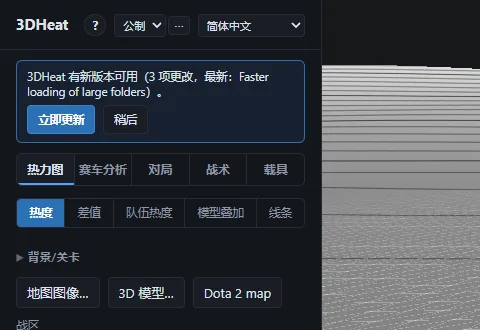

# 更新

当存在更新的版本时，查看器会告诉你，并且只有在你同意时才会自行更新。没有你的同意，你的电脑上的任何内容都不会被更改。

## 更新查看器 {#update-the-viewer}

1. **在页面中。** 当存在更新的版本时，侧边栏顶部名称下方会出现一个方框：“3DHeat 有更新的版本可用”。点击**立即更新**。完成后页面会自行重新加载。**稍后**会隐藏该方框，直到你重新加载页面。
2. **如果它提示运行 restart.bat**，请关闭服务器窗口（`start.bat` 打开的黑色窗口），然后双击 `restart.bat`。
3. **启动查看器时。** `start.bat` 也会检查。如果存在更新的版本，它会询问**立即更新？[Y/N]**。按 `Y` 即可更新。按 `N`，或在 60 秒内不作回答，则会启动你当前拥有的版本。



你自己做过修改的副本永远不会被自动更新；该方框只会告诉你有更新在等待，并提示你提交或暂存（stash）你的更改，然后运行 `git pull`。未通过 git 安装的副本（例如 zip 文件）不会显示任何内容。

检查的工作方式，逐步说明：

```
page ---(after 4 s, then every 6 h)---> dev server ---> git fetch
   behind?  no  -> nothing is shown
            yes -> your own changes or commits?  yes -> tell you only
                                                 no  -> [Update now] -> git pull
                                                        -> reload, or "run restart.bat"
```

## 安全规则 {#the-safety-rules}

- **只允许快进**（`git pull --ff-only`）：更新从不会合并、变基或重写任何内容。
- **没有本地更改**：有对已跟踪文件的未提交更改的检出（`git status --porcelain --untracked-files=no` 的输出非空）永远不会被自动更新——别人自己的工作不应被更新覆盖。它只会被告知有更新在等待。未跟踪的文件（数据、导出内容）不计为更改。
- **没有本地提交**：有上游没有的提交（“分叉”）的检出不会被更新——快进无法将其带上，而合并应由你手动通过 `git pull` 完成。页面和 `start.bat` 都会以相同的措辞说明这一点，`start.bat` 会启动那里的版本。
- **只能来自页面本身**：开发服务器的更新请求必须带有自定义头部，并且在浏览器发送 `Origin` 时，必须来自服务器自己的主机（见下文）。
- 只有带有上游分支的 git 检出才会被更新；其他任何情况（没有 `.git` 的副本、没有安装 git、静态构建）都保持不变，也不会给出任何提示。

## start.bat 做什么 {#what-startbat-does}

`start.bat`（双击运行；该窗口即服务器）按顺序执行以下操作：

1. 查找 Node.js——在 `PATH` 中查找，若无则在 `%ProgramFiles%\nodejs`、`%ProgramFiles(x86)%\nodejs` 或 `%LOCALAPPDATA%\Programs\nodejs` 中查找——若缺少，则提议使用 `winget install -e --id OpenJS.NodeJS.LTS` 安装（会询问 Y/N；之后必须重新打开窗口，以便 Windows 读取新的 `PATH`）。
2. **更新**，当安装了 git 且文件夹中有 `.git` 时：
   - `git fetch --quiet`（无网络或无上游：静默跳过）；
   - 统计 `git rev-list --count HEAD..@{u}`；落后为零：不作任何提示；
   - 有本地更改：“3DHeat 有更新的版本可用（N 项更改），但此副本有本地更改，因此不会被更新。请提交或暂存它们，然后运行 git pull。”——并启动那里的版本；
   - 有自己的提交（`git rev-list --count @{u}..HEAD` 不为 0）：“3DHeat 有更新的版本可用（N 项更改），但此副本有自己的提交，而最新版本没有这些提交，因此不会被更新。请用 git pull 更新它。”——并启动那里的版本；
   - 否则显示“3DHeat 有更新的版本可用（N 项更改）。”以及问题**立即更新？[Y/N]**。按 `N`，或 60 秒内无回答，会打印“未更新；正在启动你当前拥有的版本。”并启动那里的版本。按 `Y` 时：显示“正在更新…”，注明 `package.json` 或 `package-lock.json` 是否有变化，运行 `git pull --ff-only`（若仍然失败——例如网络问题——会显示：“更新未完成；正在启动你当前拥有的版本。”），然后运行 `git submodule update --init`（固定的工具，参见[维护文档](maintaining.md#the-tools-under-exporters)），当包文件有变化且存在 `node_modules` 时运行 `npm install`，最后显示“已更新。”
3. 拒绝启动第二个服务器：若端口 **5273** 已被占用，它会说明并指向 `restart.bat` / `stop.bat`。
4. 首次运行时（没有 `node_modules`），在下载依赖之前会询问（约 300 MB，放在 `node_modules\` 中，不会改动系统）。
5. 在 `127.0.0.1:5273` 启动开发服务器（`--strictPort`），并在其就绪时打开浏览器。

`restart.bat` 会（通过端口）停止服务器，然后再次运行 `start.bat`，因此它会问同样的问题。`stop.bat` 只会停止服务器。


## 开发者信息 {#for-developers}

### 运行时：更新路由 {#while-it-runs-the-update-route}

开发服务器（`vite.config.ts` 中的 Vite 插件 `heat3d-self-update`）提供 `/__heat3d/update`。它只存在于开发服务器上——不在静态构建中，也不在 `vite preview` 中。

**`GET /__heat3d/update`** 回答检出是否落后：

```json
{ "checkout": true, "upstream": "origin/main", "behind": 3, "ahead": 0, "dirty": false, "latest": "the newest commit's subject" }
```

- 当文件夹不是 git 检出时，`checkout: false`；
- 它**最多每 30 分钟**运行一次 `git fetch --quiet`（期间的请求会以上次获取的结果作答）；
- `behind` / `ahead` 来自 `git rev-list --count HEAD..@{u}` / `@{u}..HEAD`，`dirty` 来自 `git status --porcelain --untracked-files=no`，`latest` 是上游最新提交的主题；
- 没有上游分支时，`upstream: null` 且 `behind: 0`。

**`POST /__heat3d/update/apply`** 将检出更新到最新：

1. 除非请求带有头部 `X-Heat3d-Update: 1`，并且（若带有 `Origin`）该 origin 的主机与请求的 `Host` 相同，否则以 `403 { ok: false, reason: "forbidden" }` 拒绝。跨站表单若没有 CORS 预检便无法发送自定义头部，而此服务器从不授予预检。
2. 无事可做（不是检出、没有上游、未落后）：`{ ok: true, updated: false }`。
3. 有本地更改：`{ ok: false, reason: "dirty" }`；有本地提交：`{ ok: false, reason: "diverged" }`。
4. 否则：记录将要更改的文件（`git diff --name-only HEAD @{u}`），运行 `git pull --ff-only`（超时 2 分钟），运行 `git submodule update --init`（失败则忽略），当 `package.json` 或 `package-lock.json` 有变化时运行 `npm install`（超时 15 分钟），并回答 `{ ok: true, updated: true, restart }`——`restart` 说明为什么正在运行的服务器无法获取该更新：当依赖被重新安装时为 `"dependencies"`，当只有 `vite.config` 文件有变化时为 `"config"`，当无需重启时为 `false`。
5. 失败的 git 或 npm 命令会回答 `{ ok: false, reason: "<the error, up to 300 characters>" }`。

响应为 JSON，带有 `Cache-Control: no-store`。服务器只监听 `127.0.0.1`，因此该路由无法从网络访问。

### 页面中的提示 {#the-notice-in-the-page}

`UpdateBanner`，位于侧边栏顶部名称的下方：

- 页面加载后 **4 秒**询问该路由（不在最初几秒内：页面还有数据集要加载、GPU 要启动），并在页面保持打开期间**每 6 小时**再次询问。
- 当没有该路由（静态构建）、文件夹不是检出，或没有更新的版本时，它**不显示任何内容**——每次启动都出现的提示会让人学会忽略它。
- 落后且没有本地更改时：“3DHeat 有更新的版本可用（N 项更改，最新：<主题>）。”并附带**立即更新**和**稍后**（*稍后*会将其隐藏，直到页面重新加载）。
- 落后且有本地更改时：同样的句子，加上“此副本有本地更改，因此不会被自动更新；请提交或暂存它们，然后运行 git pull。”——没有按钮。
- **立即更新**会向 `/apply` 发送请求（显示“正在更新…”）。然后：
  - “已更新。页面将重新加载。”——并在 1.5 秒后重新加载（服务器已经在提供新文件）；
  - 当依赖被重新安装时：“已更新。其依赖已更改：请关闭服务器窗口并运行 **restart.bat** 以完成。”；
  - 当只有服务器设置有变化时：“已更新。其服务器设置已更改：请关闭服务器窗口并运行 **restart.bat** 以完成。”；
  - 结果发现无需更新（`updated: false`——例如此副本已被 `start.bat` 更新）：“无需更新：此副本已经是最新版本。”——并且不会重新加载；
  - 被拒绝：显示上述有本地更改的句子，或“此副本有自己的提交，而最新版本没有这些提交；请用 git pull 更新它。”，或“更新未完成：<原因>”。
