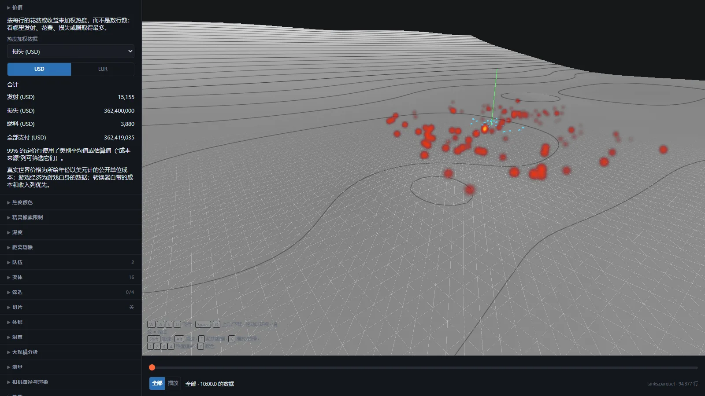

# 价值加权

每一次射击、每一种弹药、每一辆损失的车辆和每一升燃油都有价格。查看器会计算每一行的花费或收益，并可以用它来对热度加权，因此地图显示的是**钱花在了哪里**，而不是行在哪里。

## 如何使用 {#how-to-use-it}

1. 加载带有事件（射击、击杀、死亡）以及车辆或武器名称的数据。
2. 打开热度侧边栏中的 **值**。
3. 选择 **热度加权依据**，例如 *损失（USD）*。现在热度会加上每一行的价格，而不是 1。
4. 查看 **合计**：所显示内容（应用过滤器和时间窗口）的每个值列之和。
5. 如果价格是现实世界的货币，会出现一个 **USD / EUR** 切换开关。

选择菜单中空白的第一项，即可重新按行计数。

## 可以加权的内容 {#what-can-be-weighed}

值列在加载时添加，每种类别和货币各一个：

| 类别 | 落在哪些行上 | 如何定价 |
|---|---|---|
| **发射** | 射击和发射 | 该武器；否则取该类弹药的平均价格 |
| **花费** | 购买、出生 | 游戏的金钱列（例如射击游戏的购买菜单） |
| **损失** | 死亡、被摧毁 | 自己的车辆；否则取其类别的平均值 |
| **被摧毁** | 击杀 | 目标车辆 |
| **造成伤害** | 命中 | 目标价值的一部分 |
| **燃油** | 位置 | 所用燃油，取自燃油列，或根据类别和时间估算 |
| **全部支付** | | 发射 + 花费 + 损失 + 燃油 |
| **获得** | 奖励 | 游戏自身的奖励列（`earn_…`） |
| **净额** | | 获得减去支付；以带符号的热度绘制（获得更多的地方为正色带，支付更多的地方为负色带） |

列名为 `cost_<类别>_<货币>`、`earn_<货币>` 和 `net_<货币>`。如果转换器知道游戏自身的货币（例如写入游戏内点数的回放转换器），它会优先于内置的价格表。

## 价格表 {#the-price-tables}

| 表 | 货币 |
|---|---|
| 现实世界的军事装备：导弹、炸弹、弹药、对抗措施、飞机、直升机、地面车辆、舰船、燃油 | USD（EUR = USD × 0.92，即 [`cost.ts`](https://github.com/Holdi601/3DHeat/blob/main/src/data/cost.ts) 中固定的 `EUR_PER_USD`；它不是实时汇率） |
| 射击游戏的购买菜单和击杀奖励 | 游戏的点数 |
| 坦克和舰船游戏 | 游戏的点数 |
| 战略游戏（多种资源） | 每种资源一列，外加一列合计 |
| 战争游戏 | 分数 |

游戏是根据数据中的名称识别的。现实世界的价格来自公开来源（预算文件、百科全书），或标记为估计值；它们没有经过通货膨胀调整。生成的表格列表见[价值表](ref-value-tables.md)。

## 估计值 {#estimates}

额外的分类列 **成本来源** 说明每一行是如何定价的：`table`（表）、`class average`（类别平均）、`estimate`（估计）或 `none`（无）。"值"部分会显示有多少比例的已定价行是平均值或估计值。若只保留精确定价的行，请在 [过滤器](filters.md) 中的 **成本来源** 下取消勾选 *estimate* 和 *class average*。

## 价值还会在其他地方显示 {#where-else-value-shows}

- [洞察](insights.md)：*昂贵的地面* 和 *赚钱的地面* 发现。
- [细分](breakdown.md)：按队伍、玩家或武器统计的获得、损失和净额。
- [卷](volumes.md)：统计和比较中的值列。
