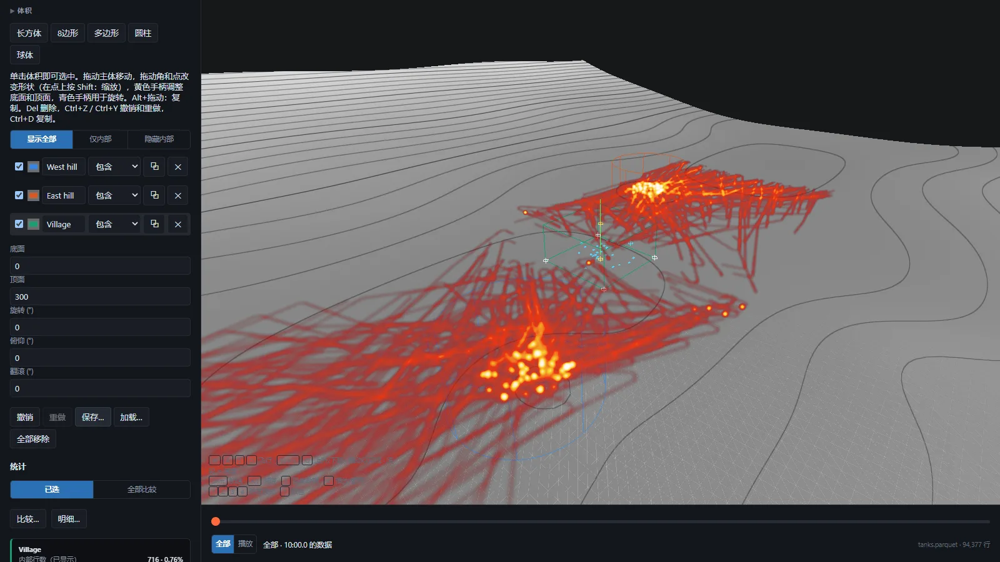
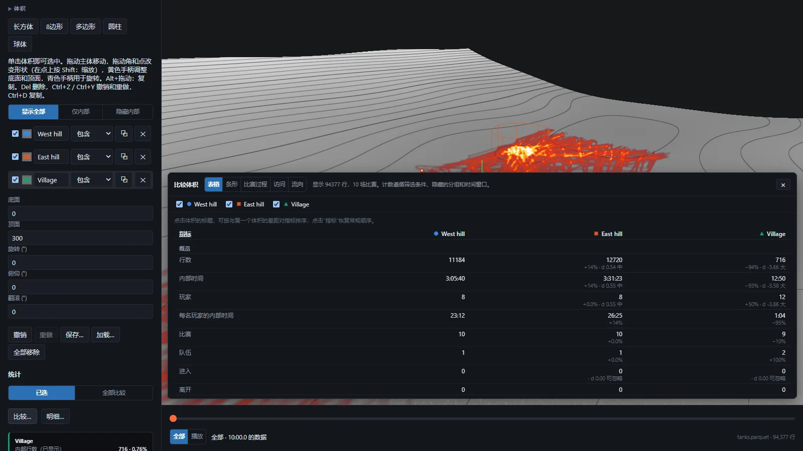
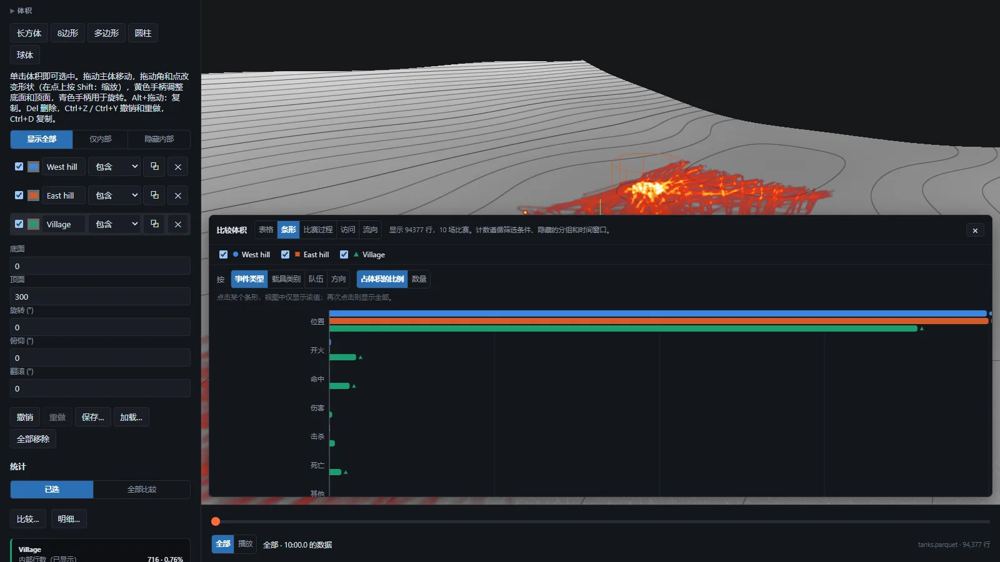

# 体积与对比

**体积**是一个看不见的方框（或圆柱，或球体），你围绕某个地点绘制它，用来询问：这里面发生了什么？可以用它统计某座桥上的击杀数，比较两座山丘，或只显示某个区域内的活动。

```
 top view                 You draw a shape ->  the viewer counts
 +------------+           what is inside:
 |   ( A )    |            rows, players, kills, time ...
 |        [B] |           Compare A with B, side by side.
 +------------+
```



体积用于测量其内部发生的事情，将视图筛选为仅其内部，导出其中的行，并可以并排比较。关于行、人员和对局，另见[术语表](glossary.md)。

## 绘制体积 {#draw-a-volume}

1. 在侧边栏中打开**体积**。
2. 选择一个工具，然后在 3D 视图或 2D 地图上绘制。地板和天花板从其下方的数据开始。按 Esc 取消。
3. 点击体积以选中它；其**统计**随即出现。

| 工具 | 绘制方法 |
|---|---|
| **长方体** | 拖出一个矩形（按住 Shift：正方形）。单击则放置一个默认长方体。 |
| **n 边形** | 从中心拖动（按住 Shift 保持正多边形）。*角数*设置 n，范围 3 到 64（默认 8，因此按钮显示 **8 边形**）。 |
| **多边形** | 依次点击各个角；双击、按 Enter 或点击第一个角即可闭合。按 Backspace 删除最后一个角。 |
| **圆柱** | 拖动以设置半径。 |
| **球体** | 拖动以设置半径；球体落在地面上。 |

## 编辑 {#edit}

- 点击体积以选中它。拖动其主体可移动，拖动角点可改变形状（在角点上按住 Shift 可缩放）。
- **黄色**手柄设置地板和天花板，**青色**手柄用于旋转。
- Alt+拖动可复制，Del 删除，Ctrl+Z / Ctrl+Y 撤销和重做，Ctrl+D 复制。**全部移除**会删除所有体积。
- 精确数值：地板、天花板、旋转 / 俯仰 / 翻滚（长方体），半径（球体、圆柱）。

每个体积行都有显示复选框、颜色、名称、**包含**或**排除**、复制和删除按钮。体积会为每个数据集保存在浏览器中，而**保存…** / **加载…**则读写 `volumes.json` 文件。

## 筛选视图 {#filter-the-view}

| 筛选 | 效果 |
|---|---|
| **全部显示**（默认） | 体积仅用于测量。 |
| **仅内部** | 热度、回放和[命中分析](hit-analysis.md)只绘制包含体积内部、排除体积外部的内容。 |
| **隐藏内部** | 与之相反。 |

GPU 筛选最多支持 8 个体积，总共 64 个轮廓点；超出的体积会标记一个“!”。统计和导出仍会计入它们。

## 统计 {#statistics}

**统计**区域会跟随筛选、时间窗和隐藏的分组。*已选*显示选中的体积，*比较全部*则将每个体积并排放置。它显示：

- **内部行数（已显示）**和**内部行数（全部数据）**、**玩家**、**队伍**、**比赛**、**内部时间**、**进入 / 离开**、**峰值热度**、**平均热度**、**体积 / 占地**，以及一个**时间**直方图；
- 每列：类别显示**Lift**（内部占比除以所有已显示数据中的占比），数值则显示范围、中位数和第 5 至第 95 百分位。

**统计为 CSV / JSON** 可将其保存。**导出内部数据**将内部的行写入 CSV 或 Parquet（默认开启*仅导出已显示的行*），可以导出一个体积或全部体积，并附带一列说明每行属于哪个体积。

## 比较体积 {#compare-volumes}

当有两个或更多可见体积时，按**比较…**。

1. 绘制三个体积，例如西山丘、东山丘和村庄。
2. 在统计下按**比较…**。
3. 在**表格**中，查看每个数值与第一个体积的差值。
4. 切换到**条形**，以条形图查看占比。



| 视图 | 显示内容 |
|---|---|
| **表格** | 行数、内部时间、玩家、比赛、队伍、进入、离开、访问、访问次数、访问时长、击杀、死亡、每次死亡的击杀数、每分钟击杀数、每名玩家的时间、数值列；按事件、载具类别、玩家或 AI、队伍和朝向分组。每个数值都显示其与第一个体积的差值以及效应大小（可忽略、小、中、大）。点击某个体积的标题可按与第一个体积的距离排序。 |
| **条形** | 按事件、类别、角色、队伍或方向统计的计数或占比。点击某个条形可将视图筛选为该条形。 |
| **比赛过程** | 每个体积一张图，按比赛的分钟展示：在场情况、行数或击杀。点击即可跳转到该时刻。 |
| **访问** | 访问持续时长的箱线图和小提琴图（对数刻度）。 |
| **流向** | 轨迹离开每个体积后去往何处：转移矩阵或流向带。 |



## 提示 {#tips}

- 从一个发现开始：在[洞察](insights.md)中，**此处体积**会在该发现的位置周围添加一个圆柱。
- **明细…**会为选中的体积打开[明细](breakdown.md)：在其中谁、什么表现最好。
- [方向热度](directional-heat.md)可以绘制选中体积内的方向图表。
- [载具标签页](hit-analysis.md#restrict-to-an-area)使用相同的体积作为其区域筛选。
