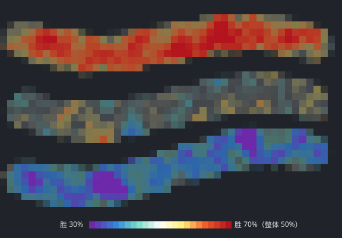

# 胜率：一个位置、一条路线或一次战术多常获胜

玩家站在哪里，往哪个方向走，把道具扔到哪里 - 以及之后他所在的一方多常赢下这一回合。**胜率地图**按每个位置上属于该行所在一方赢下的回合的行所占的比例为它着色，并与所有显示内容上的这一比例相比：更高处为暖色，更低处为冷色，相同处不着色。

*图中是虚构的数据：空关卡上的三条路线，它们的行中分别有 68%、50% 和 33% 属于赢下的回合。*

它需要说明谁获胜的数据：[结果列](data-formats.md#outcome-columns)（`won`、`matchWon`、`roundEndReason`）。CS2 和 War Thunder 的转换器会写入这些列，Tacview 转换器会为 DCS 服务器的战役写入它们（[DCS 服务器](tacview-acmi.md#dcs-servers-who-won-and-how-each-sortie-ended)）；任何文件都可以带有它们。

## 试一试 {#try-it}

1. 载入带有结果列的比赛，按 `2`（**差值**）。
2. 在 **差值拆分** 中按 **回合胜率**（或 **比赛胜率**）。它把赢下的回合放在 **+**，输掉的放在 **−**，并把面板切换到 **+ 的占比**。
3. 读颜色。面板会给出总体占比：*总体上 1,200,000 行中有 52.0% 在 +。*
4. 用 [筛选](filters.md) 缩小范围：一方（T 或 CT），一种事件类型（*位置* 看人们站在哪里，*开火* 或 *发射(导弹、火箭、炸弹)* 看他们从哪里射击或投掷），一种购买，一张地图。

用 *位置* 行显示为暖色的地方，是占据它的人往往赢下回合的地方。用 *击杀* 行时，是在那里取得的击杀带来了赢下回合的地方。

## 设置 {#the-settings}

| 设置 | 作用 | 默认值 |
|---|---|---|
| **差值** / **+ 的占比** | 差值本身，或两方的行中 + 方所占的比例 | 差值 |
| **满色于** | 一个位置高于或低于总体占比多少时以满色显示，单位为百分点 | ± 20 个百分点 |
| **为位置着色的最少行数** | 行数更少的位置不着色；从这个数的一半开始逐渐显现 | 12 |
| **向总体占比收缩（行）** | 每个位置都先从这么多处于总体占比的行开始，这样只有 3 行、全部获胜的位置不会显示为 100% | 12 |

这三项都作用于完成的图像：拖动它们从不会重新开始累积。

这个占比可以是任何拆分的，而不仅是胜负：按阵营拆分时，*+ 的占比* 显示 T 方在哪里占了存在的更大部分；按两张地图的文件拆分时，显示哪里一个文件的行比另一个文件的更重。

## 是行，不是回合 {#rows-not-rounds}

这张地图数的是行。一个玩家在一个地方站二十秒，每次采样都加一行，但都来自同一个回合，所以一个位置上的证据是它附近的行，而不是回合。这就是最少行数和收缩以行为单位、而且比一个回合的量更大的原因。

要看回合本身：

- 在一个点、视图或体积上的 **[明细](breakdown.md)**：*胜率 %* 把每个玩家的回合只算一次，并以同样的方式向该位置的总体比率收缩（4 个回合）。
- **[体积](volumes.md)** 统计：*胜率* - 体积内有玩家的回合，每个只算一次，向所有显示内容上的比率收缩，并附有计数。

## 结果筛选 {#outcome-filters}

[筛选](filters.md) 面板把结果列紧接在查看器自身的列之后列出：**回合结果** 和 **比赛结果**（*任意*、*胜*、*负*）以及 **回合结束方式**（全歼、炸弹爆炸、炸弹拆除、时间耗尽、投降、平局、目标、占领区域、票数耗尽、全部载具损失），使用查看器的语言。

## 开发者须知 {#for-developers}

热度通道把三个总和写入团队热度所用的四通道目标：热度 `R = Σ|v|`、+ 方的热度 `P`，以及 `S = Σ v²/w`，其中 `w` 是该通道的权重（采样权重乘以帧增益）。合成时读取占比 `P/R`（核加权平均）和它所依据的行数 `n = R²/S`（Kish 有效样本量），把占比向总体占比收缩，`p = (n·P/R + m·r0)/(n + m)`，并在差值色带上按跨度为 `p - r0` 着色。

`n` 会除去一个像素上各行共有的每个因子 - 帧增益、采样权重、被限制的精灵的面积权重 - 因此在任何缩放和采样密度下图像都相同，每隔 k 行的帧也会合并成整体而颜色不跳变。总体占比来自 CPU 的各方计数，精确到百分之零点一；不从 GPU 读回任何东西。算法及其检查：[`render/rateMap.ts`](https://github.com/Holdi601/3DHeat/blob/main/src/render/rateMap.ts) 及其测试。

它的开销与团队热度相同：四通道目标使热度通道的混合带宽变为四倍，但仅在 *+ 的占比* 打开时。
