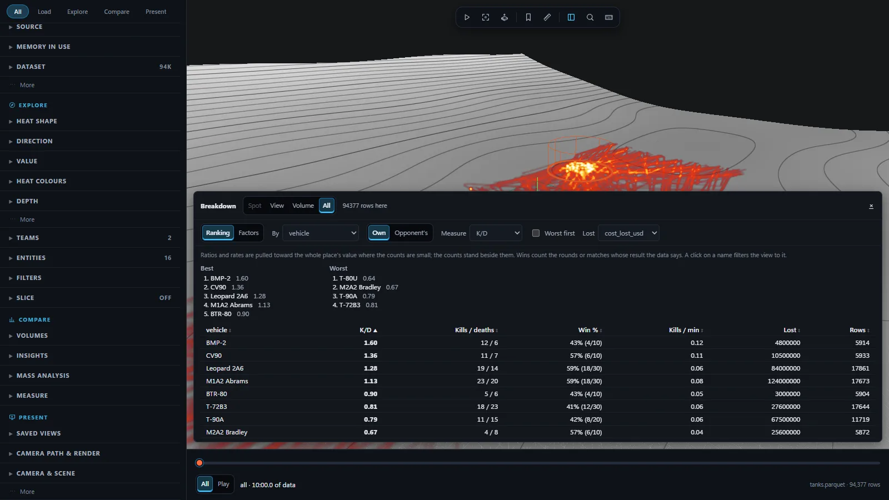
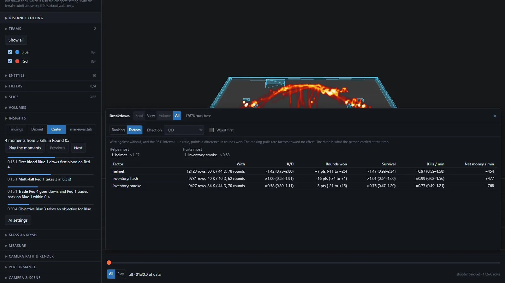

# Breakdown: who and what does best where

The **Breakdown** answers one question: in this place, which vehicle, player or weapon does best? Use it to find the tank that wins at the bridge, or to see whether wearing a helmet really helps.

It ranks what happens in one place (a picked spot, the view, a volume or everything shown) by any category, and measures every state factor with against without.

## Try it

1. Load a match with kills and deaths, and open **Volumes**.
2. Draw a volume round the place you care about and select it.
3. Press **Breakdown...** under Statistics.
4. Under **By**, pick *Vehicle*, and pick the measure *K/D* (kills per death).
5. Read the list, best first. Press **Worst first** to turn it round. Click a name to filter the view to it; click again to let it go.

## Open it

| From | Region it starts with |
| --- | --- |
| **Breakdown...** in [Volumes](volumes.md) (Statistics) | the selected volume |
| **Breakdown here** on the pick card, after clicking a point | a sphere round that point (**Radius**, default 3% of the data's size) |
| the **Difference** split panel | the view |

The header switches the region: **Spot**, **View** (what the camera saw at the last count; **Count again** after moving), **Volume** (pick one) or **All**. It counts in the background; the status line says how many rows are in the region.

## Ranking

Pick what to rank by and a measure:

| Measure | What it is |
| --- | --- |
| A, B | rows on each side of the difference map, split as the heat splits them |
| A / B, A - B, A / (A + B) | the two layers against each other |
| K/D | kills against deaths |
| Win % | rounds (or matches) won, where the data says who won |
| Kills / min | kills per minute present (movement samples' gaps) |
| Earned, Lost, Net money | sums of the `earn_*` and `cost_*` columns; a picker chooses the currency |

Kills, deaths, presence, wins and money count every row the view shows in the place, on either side of the split or none.

Ratios and rates are pulled toward the whole place's value where the counts are small, so 2 kills in 1 life does not top the list. The counts are shown beside them.

You can rank by the groups, players and matches, any category column (a vehicle, a weapon, a side, a buy type, an agent or kit), any number column in ranges (armour, a loadout's value), a weapon column's **class** (rifle, sniper, SMG, pistol...) and how many pieces of **utility** a list column such as `inventory` holds.

**Own** ranks by the row's own value. **Opponent's** ranks by the other party's value: the victim's weapon on a kill, the killer's on a death (needs an `other` / `victim` column naming them).

## State at the time

A row's value is its own unless the row logs none (an event row without gear) or it is a death (whose weapon column may name the killer's weapon); then it is what the same person last carried earlier in the match.

## Factors: with against without

Switch from **Ranking** to **Factors**, pick **Effect on**, and read *Helps most* and *Hurts most*:

Each factor's effect on K/D, rounds won, survival (minutes per death), kills a minute and net money a minute, with a 95% interval: ratios as x, rounds won as a difference in points. The ranking pulls each estimate toward no effect by its own uncertainty, so a rare factor needs a clear effect to rank high; the interval shown is the unpulled one.

Data with rounds adds the close-quarters **situations** ([Close quarters and rounds](close-quarters.md)), worked out once a dataset: *blinded* (the row's `state_flashed`, or an enemy flash within 15 m in the last 3 s), *death traded*, *opening duel*, and *man up*, *even numbers* or *man down* (players alive on the row's side against the enemy). A death counts in the situation its victim was in just before it.

At most 256 factors are measured in one pass.

## For developers

### Pulling small samples

The ranking value is `(n + m*r0) / (d + m)`: `n` and `d` are the counts, `r0` the whole place's ratio and `m` the weight of that prior.

### For converter authors: naming factor columns

A converter adds a factor by naming its column:

| Column | Factor |
| --- | --- |
| `state_<name>` number | on while non-zero (`state_scoped`, `state_suppressor`) |
| `state_<name>` category | one factor per value (`state_ammo` = AP, HE...) |
| `active_<name>` | the same, for something switched on or used recently: an ability, an ultimate, a gadget, a buff (`active_ult`, `active_stim`) |
| list column (`inventory`, `loadout`, `perks`, `abilities`, `attachments`, `modules`, `buffs`, `debuffs`, `upgrades`, or a `state_`/`active_` name ending in `s`) | one factor per item of an `a\|b\|c` value |
| gear flags already common (`helmet`, `defuser`, `armor`, `scoped`, `airborne`, `duck`, `flashed`...) | on while non-zero |
| `ammoType`, `shellType`, `ammoName` | the round last fired |

Results: a 0/1 `won` column (the row's side won the round or match) and a `round` column. Money: `earn_<currency>` and `cost_<kind>_<currency>`; an income by kind alone (`earn_round_cs2`, a converter's exact round rewards) replaces only the cost model's income of that kind (`round` also covers plants and defuses), and the model still prices the rest.

The mapping loads these columns by itself, beside the file's own list: every `state_*`, `active_*`, `won`, `round` and list column, except those a Parquet file's statistics show hold one value throughout (each loaded column is 4 bytes a row).
