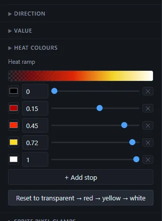

# Colour and exposure

These controls decide which amount of heat gets which colour. **Saturation point** is how much heat counts as white-hot.

## Quick fixes

- Everything is white: raise **Saturation point**, or press **Auto-expose from the field**.
- Nothing is visible: lower **Saturation point**, or press **Auto-expose from the field**.
- Only a few single dots show: turn up **Minimum heat**.

Every control on this page acts when the heat is turned into a colour, so dragging any of them redraws immediately and **never restarts the accumulation**.

## Saturation point

**Saturation point** (Heat shape section): the accumulated heat that maps to the top of the colour ramp (with the *Linear* response; see below for the others). Logarithmic slider 0.1-4000, drag handle up to 10,000,000, because accumulated heat grows with the row count. Default 24; on every load an **analytic estimate**, then **metered** from the picture.

Getting it wrong is the difference between a heatmap and a blank (or white) screen, and it cannot be derived reliably: telemetry clusters so hard - a spawn, a doorway, a chokepoint - that the ratio of peak to mean density varies by an order of magnitude between datasets and between camera angles.

## Auto-exposure

**Auto-expose from the field** meters the field the shader actually produced. It ignores empty pixels, takes the 98th percentile of the lit ones and puts it at 85% of the way to the saturation point, so the top of the ramp is kept for the real peaks.

The panel then reads *metered X% of the frame; 98th percentile R placed near the top of the ramp*. With the *Saturating* response, a value at 85% of the saturation point lands at about 57% of the ramp rather than 85%.

It also runs **automatically**:

- 8 rendered frames after a dataset loads;
- 8 frames after the [filters](filters.md) change (filtering every position down to a hundred events changes the density by orders of magnitude);
- 8 frames after switching between point heat and [line heat](line-heat.md), or changing which routes line heat draws, because a line lays down far less heat per sample than a sprite.

None of these while the [scale is locked](#the-colour-scale).

When nothing is lit, the automatic run leaves the saturation alone; the button falls back to the analytic estimate and says *nothing lit to meter - used the analytic estimate*.

### Follow the view

**Follow the view** (Heat shape section, default on) meters again each time the camera comes to rest, so a region you fly into uses the whole colour ramp instead of the scale metered for the whole map. Small changes are ignored and the scale glides rather than jumps. It runs in the four heat modes, not in the figure overlay.

Untick it to keep the scale while the camera moves. Dragging **Saturation point** by hand does that too. To keep it through filters and loads as well, use **Lock the scale** (below).

## The colour scale

The box at the bottom right of the view (**Show the colour scale over the view** in Heat shape) says what the colours mean:

- **Heat** and **Lines**: the ramp from none to the top, with the values at none, the middle and the top. A saturating response never quite reaches the top, so the last value reads *≥*.
- **Difference**: both arms around a middle line, the **−** side on the left and the **+** side on the right, each named (*lost* and *won*, or the teams on each side), with the values at both ends, both middles and 0.
- **Share of +** ([win-rate map](win-rate.md)): the share won at both ends and in the middle, around the share overall.

The values are **rows per km²** (per 100 m² for sprites under 30 m), smoothed over the sprite: the heat at a place divided by what one sprite adds over its disc (its radius² times 2π∫ramp(s)·s ds), so the reading is the same at any zoom. A row is one sample or event of the data, after the filters. Under a difference scaled per row they are *% of the side's rows per km²*, scaled per match *rows per km² in one match of the side*. [Line heat](line-heat.md) and heat weighed by a [value](value-weighting.md) are given in the heat's own units.

**Lock scale** on the box (and **Lock the scale** in Heat shape) keeps the scale where it is: nothing meters the exposure again by itself - not a new filter, a new load, a new kind of heat or the camera coming to rest. Two views - won and lost, two filters, two loads - are then coloured on one scale and can be set side by side; the box says *locked at saturation N*. **Auto-expose** and the **Saturation point** slider still set it by hand. Unlocked, the scale follows the view again and is metered anew.

## Density response

**Density response** - how *k* (heat / saturation) maps onto the ramp:

| Response | Formula | Use |
|---|---|---|
| **Saturating** (default) | t = 1 - e^(-k) | Approaches the top of the ramp asymptotically, the way stacked translucent sprites do. Nothing ever clips to flat white, which makes it the safe default on unfamiliar data. |
| **Linear** | t = k | The only mapping where equal colour means equal count. Use it to compare two datasets or two time windows. |
| **Log** | t = log₂(1 + 7k) / 3 | Compresses a long tail, so one extreme hotspot stops flattening everything else to the bottom of the ramp. Lifts sparse areas. |

## Minimum heat

**Minimum heat** (default off, 0-100%): every pixel carrying any heat at all is lifted to at least this point of the ramp. Turn it up, and the sprite radius down, to see *where something ever happened* - single datapoints become clearly visible instead of sitting just above transparent. Leave it off when judging density, since it flattens the bottom of the ramp by design. The threshold (k > 0.0001) keeps genuinely empty pixels empty.

## The ramp editor

In the **Heat colours** section. Its label says what the ramp is for: *Heat ramp* in Heat and Lines, *Positive (additive teams)* in Difference, *Opacity ramp (colour comes from the group)* in [Team heat](team-heat.md), where only its alpha is used.



The bar at the top previews the ramp. Below it, one row per stop:

| Part | Meaning |
|---|---|
| Colour swatch | The stop's colour (the browser's colour picker). |
| Number | The stop's position along the ramp, 0 to 1 (0 = no heat). |
| Slider | The stop's opacity, 0-100%. |
| ✕ | Removes the stop; disabled when only two are left. |

**+ Add stop** adds a stop halfway between the last two stops, with the last stop's colour and opacity. **Reset to transparent → red → yellow → white** restores the default.

Stops may be given in any order; they are sorted when the ramp is built. The **alpha** is what blends the heat over the scene, which is why the zero end of the default ramp is fully transparent.

### The default ramps

| Position | Positive (Heat, Lines, Difference +) | Negative (Difference −) |
|---|---|---|
| 0.00 | black, alpha 0 | black, alpha 0 |
| 0.15 | rgb(180, 0, 0), alpha 0.55 | rgb(20, 70, 190), alpha 0.55 |
| 0.45 | rgb(255, 40, 0), alpha 0.85 | rgb(30, 125, 245), alpha 0.85 |
| 0.72 | rgb(255, 220, 40), alpha 0.95 | rgb(110, 190, 255), alpha 0.95 |
| 1.00 | white, alpha 1 | rgb(225, 245, 255), alpha 1 |

## While the camera moves

When the camera moves, the accumulation restarts every frame. With **Draw every row each frame** on (the default) each moving frame is still exact; with it off, a moving frame shows one sampled estimate - brighter, weight-scaled clumps - which converges to the smoother true picture when you stop. That is expected; see [Accumulation](accumulation.md).

## For developers

### The composite pass

After the heat has been accumulated, each pixel's value is turned into a colour in one composite pass ([`COMPOSITE_FS`](https://github.com/Holdi601/3DHeat/blob/main/src/render/webgl2/shaders.ts)). The steps are:

```
k = |heat| / saturation point
t = response(k)                         clamped to 0..1
if minimum heat > 0 and k > 0.0001:  t = minimum + (1 - minimum) × t
colour, alpha = ramp(t)                  (the negative ramp when heat < 0, Difference only)
pixel = mix(scene, colour, alpha)
```

### The analytic estimate

**The analytic estimate** ([`estimateSaturation`](https://github.com/Holdi601/3DHeat/blob/main/src/data/calibrate.ts)) assumes the rows spread over the X-Z footprint of the data: mean heat = rows × (π r² / footprint area) × 1/3 × centre intensity (1/3 being the disc average of a linear ramp), times an assumed peak-to-mean ratio of 25, clamped to 0.1-1,000,000. It only has to be within an order of magnitude of right.

### Metering

[`exposure.ts`](https://github.com/Holdi601/3DHeat/blob/main/src/render/exposure.ts):

1. the heat target is read back from the GPU, subsampled to at most 40,000 values;
2. empty pixels (heat ≤ 0.0001) are discarded - most of a heat field is empty, and averaging them in would under-expose everything, as a camera meter pointed at a black background would;
3. the 98th percentile of the lit pixels is the reference;
4. the saturation point becomes reference / 0.85, so the reference sits at 85% of the way to the saturation point and the top of the ramp is kept for the real peaks.

### The colour table

The ramp is baked into a 256 × 2 RGBA table (positive ramp in the first row, negative in the second) ([`buildColorLut`](https://github.com/Holdi601/3DHeat/blob/main/src/render/colors.ts)). Colours are interpolated in linear light and stored as sRGB; opacity is interpolated linearly.
