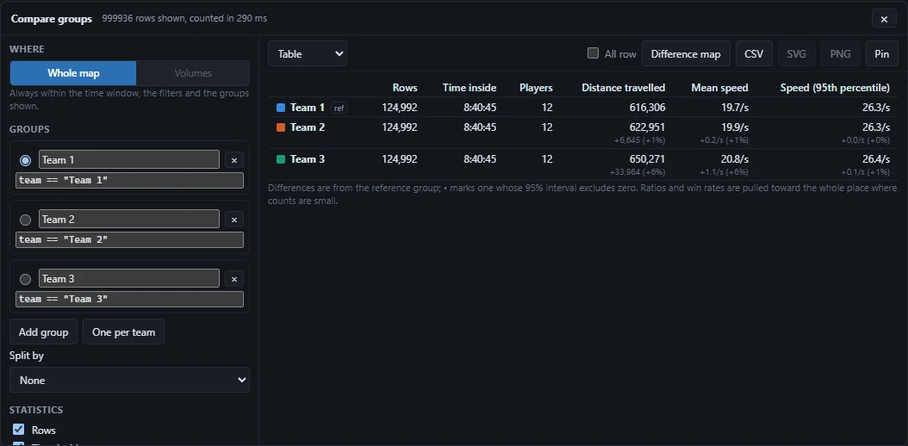
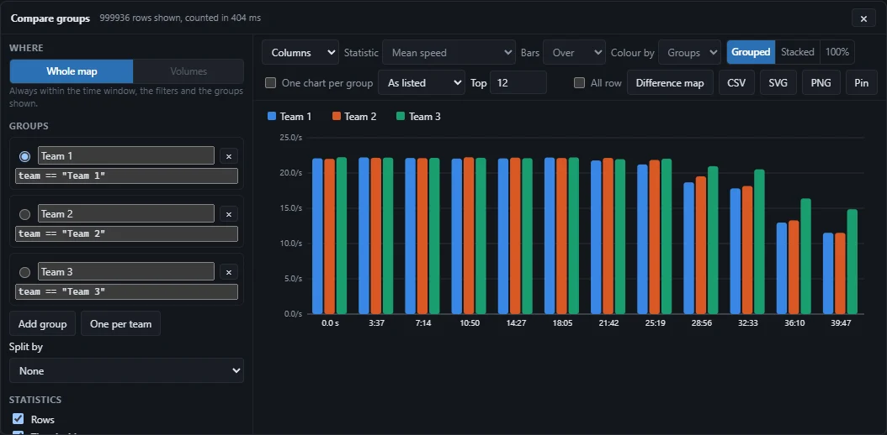

# Compare groups: team against team, vehicle against vehicle

**Compare groups** puts groups of rows side by side: one team against the other, the T-34 against the Panther, the T-34s of each team, this file against that one. Pick where (the whole map or your volumes), pick the groups, pick the statistics - the built-in ones or your own - and read the table or a chart.

It always counts only what the view shows: the time window, the [filters](filters.md) and the groups shown.

*Made-up data: the viewer's synthetic battle royale.*

## Try it

1. Load a dataset and open **Volumes** in the sidebar.
2. Press **Compare groups...**. With teams in the data, the first two teams are the groups.
3. Tick the statistics you want under **Statistics**.
4. Read the table: each value, and under it its difference from the reference group (the one with the dot on the left).
5. Pick another chart under the chart list (top left of the results), for example **Bars**.

## Where

| Setting | What it counts |
|---|---|
| **Whole map** | every row the view shows |
| **Volumes**, **Combined** | the rows inside any ticked [volume](volumes.md), each row once even where volumes overlap |
| **Volumes**, **Each volume** | every ticked volume on its own: each group appears once per volume, so the volumes can be compared with each other |

## Groups

A group is a filter over any column, written in the panel's small language (see [Expressions](#expressions)):

| Filter | The group |
|---|---|
| `team == "Allies"` (or `team = Allies`) | one side |
| `vehicle == "T-34"` | one vehicle, all sides |
| `vehicle == "T-34" and team == "Allies"` | the Allies' T-34s |
| `vehicle in ["T-34", "KV-1"]` | two vehicles together |
| `contains(vehicle, "Panther")` | every vehicle whose name has "Panther" |
| `alt > 1000` | rows above 1000 units |
| (empty) | every row |

- **Source** keeps a group to some loaded files (the `Source file` column of a [multi-file load](loading-files.md#several-files-become-one-dataset)) or some matches: *match A against match B*, *this season's files against last season's*. Source and filter combine.
- **One per team** makes one group per team (up to 8).
- **Split by** cuts every group by a column's values: the most common **Top** values each get a row, the rest are added up as *Other*. *Vehicles per team* is groups by team, split by vehicle.
- The radio button marks the **reference**: differences are taken from it.
- **All row** adds the place's *All* group (every row in the region) to the table and charts.

## Statistics

The list holds what the data can answer:

| Statistic | What it is |
|---|---|
| Rows | rows counted |
| Time inside | seconds present, from each row's gap to the next sample (capped as the [volume statistics](volumes.md#statistics) cap it) |
| Players, Matches, Rounds | how many different ones |
| Kills, Deaths, K/D, Kills a minute | from the event column; K/D and kills a minute pulled toward the whole place's value where counts are small, as the [Breakdown](breakdown.md#pulling-small-samples) does |
| Win rate | rounds won where the data says ([outcome columns](data-formats.md#outcome-columns)), each player's round once, pulled toward the rate over everything shown by 4 rounds |
| Distance travelled, Mean speed, Speed (95th percentile), Mean altitude | from each track's movement samples, in the data's units |
| Earned, Spent, Net | per currency, from the `earn_*` and `cost_*` [value columns](value-weighting.md) |
| Events: *kind* | rows of one event kind |
| Share of rows | the group's rows over the place's |

### Your own statistics

**New statistic...** opens the editor: a name, a unit (`%`, `s`, `count`, `ratio`, or any word) and an expression. The editor checks the expression as you type and says what is wrong and where. *Functions and columns* lists every column; a click inserts it.

| Expression | What it counts |
|---|---|
| `countIf(event == "kill" and weaponClass(weapon) == "smg") / countIf(event == "death")` | SMG kills per death |
| `sum(earn_usd) - sum(cost_spent_usd)` | money earned minus spent |
| `avg(speed) where alt > 1000` | mean speed above 1000 units |
| `perMinute(kills())` | kills a minute present |
| `shrink(kills(), deaths(), 4)` | K/D, pulled toward the place's by 4 deaths |
| `distinct(person) / matches()` | players a match |
| `percentile(speed, 90)` | the 90th percentile of speed |
| `ofAll(count())` | the group's share of the place's rows |

Your statistics stay in this browser. **Export...** saves them as a JSON file and **Import...** adds a file's statistics, so they move between computers and people.

## Expressions

| Part | Written |
|---|---|
| Columns | by name: `team`, `person`, `match`, `x`, `y` (also `alt`), `z`, `time`, `matchTime`, `speed`, `step` (distance since the last sample), `dwell`, and every loaded column. A name with spaces in backticks: `` `Source file` ``. `event`, `class` and `actor` are the [columns the viewer adds](filters.md#columns-the-viewer-adds); `event == "kill"` matches the event kind whatever the game called it ([event types](ref-event-types.md)). |
| Values | text in quotes (`"T-34"`), numbers; a bare word after `==` is read as text (`team = Allies`) |
| Comparisons | `==` (or `=`), `!=`, `<`, `<=`, `>`, `>=`, `in [...]`; `and`, `or`, `not` |
| Arithmetic | `+ - * / %`, parentheses; `abs`, `sqrt`, `log`, `exp`, `round`, `floor`, `ceil`, `min(a, b)`, `max(a, b)`, `clamp(x, lo, hi)`, `if(c, a, b)` |
| Text tests | `contains(col, "s")`, `startsWith(col, "s")`, `endsWith(col, "s")`, `weaponClass(col)` (rifle, sniper, smg, shotgun, mg, pistol, melee, utility, launcher, vehicle, other) |
| Aggregates | `count()`, `count(cond)`, `countIf(cond)`, `sum(x)`, `sumIf(x, cond)`, `avg(x)`, `avgIf(x, cond)`, `min(x)`, `max(x)`, `median(x)`, `percentile(x, p)`, `stdev(x)`, `distinct(col, ...)`, `presence()`, `players()`, `matches()`, `rounds()`, `kills()`, `deaths()`, `wins()`, `played()`, `winRate()` |
| Rates | `perMinute(v)`, `perMatch(v)`, `perRound(v)`, `perPlayer(v)`, `ofAll(v)`, `shrink(a, b, m)` |
| `where` | at the end, filters every aggregate: `avg(speed) where alt > 1000` |

A statistic is arithmetic over aggregates; a column on its own must sit inside one (`avg(speed)`, not `speed`). Nothing is run as code: the panel parses the text itself.

## Reading the differences

Each value in the table shows its difference from the reference group, in the statistic's unit and in per cent.

- **•** and a colour mark a difference whose 95% interval does not include zero: green where it is better, red where it is worse (fewer deaths is better).
- The interval comes from resampling the matches (or, with one match, the players) 200 times, the same draws for every group, so two groups of the same matches are compared pair by pair. A plain count without matches gets a Poisson interval, a win rate a Wilson interval.
- **few** marks a group with fewer than 30 rows or fewer than 3 matches or players: read it with care.
- Hover a value for its interval and how it was found.

## Charts

| Chart | Shows |
|---|---|
| **Table** | groups (and their split) against the statistics, with the differences |
| **Bars**, **Columns** | one statistic: **Bars** by groups, the split or **Over**; **Colour by** another of them; grouped, stacked or 100% |
| **Lines**, **Areas** | one statistic over **Over** (time into the match, time, round, match, day): a line per group or split value; areas stacked |
| **Pie**, **Donut** | one statistic's shares by groups, the split or **Over** |
| **Scatter** | one point per group: x and y two statistics, **Size** a third |
| **Histogram** | rows (or any statistic) in each range of a number column: pick *column in ranges* under **Over** |
| **Box plot** | the 5th, 25th, 50th, 75th and 95th percentiles of a column per group |
| **Heat table** | groups against **Over**, or against the statistics, coloured by value |
| **Radar** | several statistics per group, each axis scaled to its largest value |
| **Waterfall** | earnings up and costs down for one group (pick it in the legend) |
| **Funnel** | the ticked statistics in order as shares of the first (spawns, shots, hits, kills) |
| **Cards** | each statistic's value for the reference group, and the others' differences |

- **One chart per group** draws the same chart for every group (small multiples).
- Hover a mark for its values; click a legend entry to pick it out.
- Click a group (a row of the table, a bar, a slice, a point) to filter the view to it - its filter becomes the [view's filters](filters.md) where it is plain column values. Click again to get the view's filters back.
- **Difference map** shows the first two groups against each other as a [difference heat map](difference.md), when each picks values of one and the same column (two teams, two vehicles).
- **CSV** saves the numbers behind the table and charts; **SVG** and **PNG** save the chart.

## Other datasets

Only one dataset is loaded at a time. To compare with another, **Pin** the table: it stays in this browser. Load the other dataset, open **Compare groups** and tick the pinned table under **Pinned results**: its groups appear beside the new ones, matched by statistic. Within one load, groups with a **Source** compare its files and matches directly.

## Animations

Charts grow, draw and morph when the data changes. **Animations** under [Performance](performance-and-stats.md) sets them: **Auto** (the default) turns them and visual extras off while the 3D view runs below 30 frames a second (the median over one second above 33 ms) and back on after three seconds below 25 ms; **On**; **Off**. A system setting for reduced motion always turns them off.

## For developers

- The pass runs in a worker ([`versus/engine.ts`](https://github.com/Holdi601/3DHeat/blob/main/src/versus/engine.ts)) over chunks of the columns it needs, copied off the dataset a slice at a time ([`versus/run.ts`](https://github.com/Holdi601/3DHeat/blob/main/src/versus/run.ts)); a change aborts the running pass. The main thread only copies memory and draws the aggregated result. `node tools/probe-versus.mjs [url] [rows]` measures the 3D view's frame times while the panel counts and while its charts animate.
- The language ([`versus/expr.ts`](https://github.com/Holdi601/3DHeat/blob/main/src/versus/expr.ts)) is parsed by hand into a tree, checked against the columns and handed to the worker as data; the worker turns it into closures. Equal aggregates are counted once across statistics.
- Percentiles keep a sample of 4,096 values per cell; the tooltip says when a value came from one.
- Motion ([`ui/motion.ts`](https://github.com/Holdi601/3DHeat/blob/main/src/ui/motion.ts)): duration and easing tokens (also as `--motion-*` CSS properties), one animation loop for every tween (`useTween`), and the quality state (`data-motion`, `data-quality` on the root) other panels can read.
