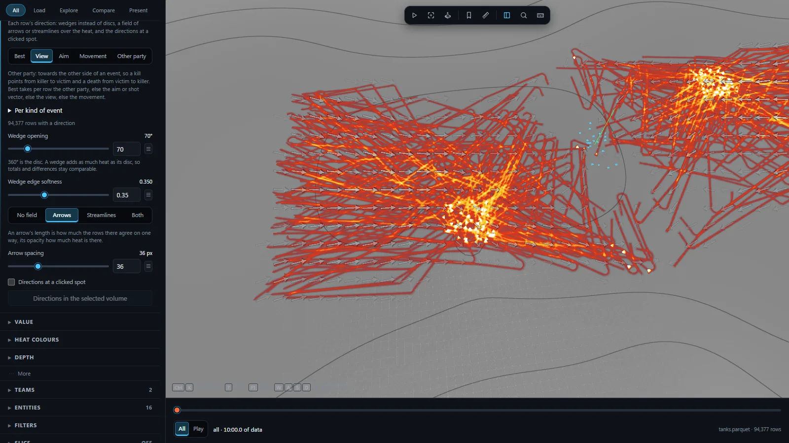

# Directional heat

Plain heat says **where** things happen. Directional heat also says **which way**: which way people were looking, aiming, moving, or where the other side of a fight was.

## How to use it

1. Load data with a direction in it (see [What gives a row a direction](#what-gives-a-row-a-direction)).
2. Pick **Heat**, **Difference** or **Team heat** in the mode bar.
3. Open the **Direction** section in the sidebar.
4. Pick a **source** (which direction to use), then turn the drawing on:
   - lower **Wedge opening** below 360° to draw each row as a wedge pointing its way instead of a disc;
   - pick a **Field** to draw arrows or streamlines over the heat;
   - tick **Directions at a clicked spot** and click the heat to get a polar chart of that spot.

The status line says how many rows have a direction from the chosen source.

## Settings

| Setting | Default | What it does |
|---|---|---|
| Source: **Best**, **View**, **Aim**, **Movement**, **Other party** | Best | Which direction each row gets. *Best* takes, per row, the other party, else the aim, else the view, else the movement. |
| **Per kind of event** | as above | A different source for each event kind, for example *Other party* for kills and *View* for positions. Shown when the data has an event column with at most 40 values. |
| **Wedge opening** | 360° | 360° is the normal disc (off). Smaller is a narrower wedge. A wedge adds as much heat as its disc, so totals and differences stay comparable. |
| **Wedge edge softness** | 0.35 | 0 is a sharp-edged wedge, 1 a soft fan. |
| **Field**: No field, Arrows, Streamlines, Both | No field | Arrows: an arrow's length is how much the rows there agree on one way, its opacity how much heat is there. Arrows show only where there is heat. |
| **Arrow spacing** | 28 px | Distance between arrows on the screen. |
| **Animate the streamlines** | on | Streamlines flow while on. |
| **Directions at a clicked spot** | off | Click the heat to see the directions there (below). |
| **Directions in the selected volume** | | The same chart for everything inside the selected [volume](volumes.md). |

## The polar chart at a spot

With **Directions at a clicked spot** on, click the heat. The rows close to that point (within 1.5 sprite radii) are gathered into a rose of 24 slices of 15°:

- **orange** petals: outgoing directions (where the rows point to);
- **blue** petals: incoming directions (where they came from);
- a petal's **area** grows with its count; an arrow shows the main direction;
- the lines under the chart give the main bearing, how strongly the rows agree (R, 0 to 1), the spread in degrees, and the number of rows.

0° is up on the chart, which is world −Z (north for Tacview recordings). The spot is also marked in the 3D view with an arrow and a ring.

## What gives a row a direction

| Source | Needs in the data |
|---|---|
| View | a yaw column (mapped as the look direction): `yaw`, `heading`, `azimuth`, `view_yaw`, `rot_z` |
| Aim | number pairs such as `aim_x`/`aim_y`, `shot_x`/`shot_y`, `fire_x`/`fire_y`, `hit_dir_x`/`hit_dir_y` (an optional `…_z`) |
| Movement | nothing extra: the step from the same person's previous sample (at most 10 s earlier, same session) |
| Other party | a column naming the other side of an event (`other`, `victim`, `target`, `killer`, `attacker`, `shooter`, `other_player` ...) whose values are person names; a kill points from killer to victim, a death from victim to killer |

## Tips

- Wedges need some size on screen; below a few pixels they are drawn as discs again.
- Use *Other party* on kill rows to see **from where** fights were won, and *View* on position rows to see **where people watch**.
- With **Difference**, wedges of the two sides point in their own directions, so contested lines of fire stand out.
