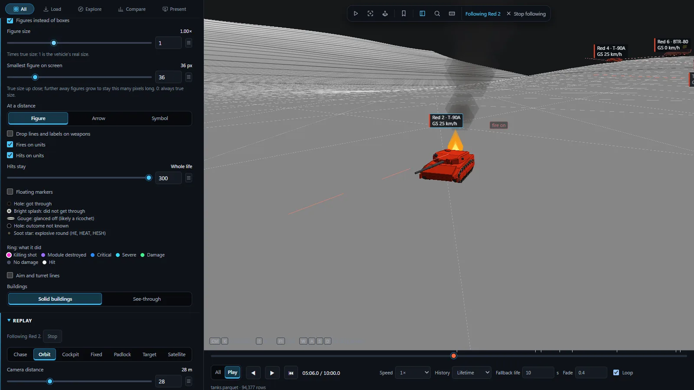

# Figures

A **figure** is a small 3D model of what a unit really is: a tank, a jet, a ship, a soldier. The [replay](match-replay.md) draws every unit as its figure at true size, instead of a plain box.

There are about 2,000 named vehicles, aircraft, ships, weapons and soldiers, all built by the viewer itself.

## What is in the catalogue

| Domain | Examples |
|---|---|
| People | soldier standing, crouching, prone; sniper, anti-tank, medic, crew |
| Ground | tanks, infantry fighting vehicles, air defence, artillery, trucks and cars, trains and trams |
| Air | fighters, attack aircraft, bombers, transports, helicopters, from biplanes to modern jets |
| Sea | warships by class, carriers, submarines, boats, merchants |
| Weapons | missiles, rockets, bombs, torpedoes, flares and chaff |
| Markers | smoke, flash and fire grenades, planted bombs, flags, spawns, waypoints |
| Close quarters | soldiers in plate carriers with an assault rifle, SMG, shotgun, DMR, LMG, handgun or shield; drones, cameras, barbed wire, shields, wall reinforcement, barricades, breaching charges, traps, windows, grenades, the defuser |

## How the figures are made

- **Built from published dimensions.** Most figures are made by the viewer's own figure builder from public numbers: length, width, height, road wheels, turret and gun, wings and tail. Their shape is then tuned against public photographs, drawings and published dimensions. No game's models are used.
- **Free models.** A few figures use free 3D models (CC0 or CC BY) where those are truer, sometimes combined with the built hull. Authors of CC BY works are credited on [Figure credits](figure-credits.md); CC0 works need no credit and are not listed there.
- Every figure has a full, a coarse and a far version (levels of detail, LOD), so thousands can be drawn at once.

## Which figure a unit gets

The viewer looks at the data's own columns:

1. **Names** - columns called *Name*, *Vehicle*, *Unit*, *Unit type*, *Model*, *Aircraft*, *Plane*, *Tank*, *Ship*, *Craft*, *Loadout*, *Kit* or *Figure* - are matched against the catalogue: exactly, through about 4,000 aliases (game unit ids of several games), by the longest known beginning (`F-16C_50` is the F-16C), or by the shortest figure name that starts with it.
2. A name whose figure does not fit the unit's **type** is not used (a truck called *Typhoon* is not the fighter).
3. **Types** - columns called *Type*, *Class*, *Kind*, *Category*, *Icon*, *Role* or *Domain* - give a class figure: Tacview tags (`Air+FixedWing`, `Ground+Heavy+Armor+Vehicle+Tank`, `Sea+Watercraft+Warship`, `Weapon+Missile`), map icons, or plain words (tank, helicopter, infantry).
4. Data with neither is data of people: everyone is a soldier.

So the easiest way to get the right figures is a `vehicle` column with the real names, or a `type` column with Tacview tags.

**My unit shows as a box or a soldier.** Add a `vehicle` column with the real name, or a `type` column with a Tacview tag. Hover the unit to see which name was matched. Data that has such columns but says nothing about a unit leaves it a box; data with neither is drawn as soldiers.

## Close-quarters figures (Rainbow Six Siege)

Tables written like the Rainbow Six Siege replay reader's (columns `operator`, `pawn`, `primaryClass`, `side`) get figures of their own:

- **Players** are their operator: each of the 78 operators has a figure of their own, about 1.8 m tall, in their own clothes - two or three colours for jacket, trousers and gear after their usual public look (black, olive, tan, urban grey, white, navy, with red, orange or teal gear) - and with their own shapes, a third larger than life where they have to show from above: headgear (helmets, a visor or heavy helmet, caps, beanies, berets, a wide boonie or fur hat, hoods, scarves, hair), the face (goggles, a gas mask, glasses, a mask, a beard, three-lens goggles), a light, medium or heavy build (heavy ones broad, with big shoulder plates and a collar), a long coat or a suit, a ghillie, what they carry on the back (a hammer, charges, drones, canisters, a fuel tank, a launcher tube, a crossbow, panels, a jammer, a shield) or on the arm (a launcher, a metal arm), their own shield (a tall one, a riot shield, one with lights), and an accent colour on the shoulders. They hold the class of their primary weapon. An operator the viewer does not know is a plain soldier in a plate carrier in the team's colour.
- **The side** shows apart from the clothes: a ring on the ground under each operator, **amber for attack, pale cyan for defence**, with the team's colour inside it, and arm and head bands in the same colour. A `stance` and a `lean` column pose them (see [Stance and lean](#stance-and-lean)); without them they stand.
- **Told apart at replay distance:** rendered 48 pixels tall from above and from three-quarters, every two operators on a side differ by a clear colour difference or a different shape (checked by the viewer's tests).
- **Labels** name the player and the operator played at that moment, with the operator's role as a symbol: ✸ hard breacher, ⚒ soft breacher, ➤ entry, ✦ fragger, ✚ support, ⬟ shield, ◉ intel, ◇ flex, ↺ flank watch, ⚓ anchor, ✕ trapper, ⇄ roamer, ↯ anti-gadget, ▣ anti-breach.
- **Drones** are a two-wheeled throwable drone, about 30 cm across, each a track of its own named after its owner ("Ash · drone 2").
- **Placed gadgets** stand where they were put, from then until the round ends, each as the figure of what it does: a camera, barbed wire, a deployable shield, a breaching charge, a hard-breach charge, a small sticky charge, a floor trap, a claymore with its trip laser, a one-way window, an armour panel, a grenade, a gas canister, a jammer, a sensor, a laser gate, a supply box. One figure serves every gadget that does the same job. A gadget whose kind the data does not say is a small device with a light.
- **The defuser** stands where it was planted for its 45 seconds.

Each drone and gadget becomes a track of its own when the file loads, so the player's own figure stays on their body. The operators are simplified shapes after their public descriptions and art (what they wear, the device that is their ability), and the gadgets are shaped by what they do. All of these are the viewer's own designs at the real-world size of the thing (a claymore about 22 cm wide, a door-sized panel 1 m by 2.1 m), not models from the game.

## Stance and lean

People are drawn in the stance and lean the data gives, in every game's data:

- **Stance**, from a column `stance` (or `posture`, `pose`): standing, crouching, prone on the belly, or supine on the back. Common words are understood (standing, upright, crouched, kneeling, crawling, lying, on back...), and the codes 0 stand, 1 crouch, 2 prone, 3 supine.
- **Lean**, from a column `lean` (or `leaning`, `peek`): `left`, `right` or `none`, or a number from -1 (left) to 1 (right) for a partial lean; numbers over 1 are read as per cent (up to 100) or degrees (45 a full lean).

Stance and lean combine: a crouching or prone figure can lean too. The lean tilts the upper body sideways from the hips, up to 25 degrees. A change of stance blends over a fifth of a second and the lean eases into place; with motion turned off, or when the frame rate drops below 30, both change at once. Without these columns people stand upright.

## Settings

The **Figures** section of the replay sidebar sets the size, the smallest size on screen, what far units become (figure, arrow, symbol), and the effects drawn on them. See [Match replay](match-replay.md#figures). Smoke, fire and other timed effects: [Figures in the figure overlay](figure-replay.md).

## An optional local figure pack

You can keep an optional pack of your own figures on your own machine. Its figures take the place of catalogue figures of the same names. It is never part of the repository or a published build; without one, nothing changes.

## Optional local model packs

You can also keep packs of per-unit vehicle models on your own machine, one per game. A unit in a pack is drawn as its own model, at its true size and about its own origin, instead of the figure it would otherwise get. Its turret and gun turn and raise with the data, as on the figures, and hit marks and the vehicle heatmap land on its surface. The packs are never part of the repository or a published build; without one, nothing changes.

A unit is drawn as the first of:

1. its own model: a unit of its id in a pack;
2. another pack's model of the same vehicle: a unit that stands for the same catalogue figure, or whose real vehicle name matches the unit's (see [Names across games](#names-across-games)), drawn on the unit's own figure;
3. its figure.

A model is lent only to a unit of its kind: an aircraft's to an aircraft, a helicopter's to a helicopter, a drone's to a drone, a ground vehicle's to a ground vehicle, a ship's to a ship. A helicopter's model never stands on a fighter's figure, nor the other way round. Units a pack marks as `static` (barriers, buildings, containers, sandbags) stand for no unit and are never offered as a model.

The viewer loads the packs from `HEAT3D_MODEL_PACK` (paths separated by `;`), or the `modelPack` entry of `tools/local-data.json`: one path, a list, or `{ "<game>": path }`, earlier packs first where two have the same vehicle. A pack is a folder with `model-pack.json` and one `.glb` per unit:

- `model-pack.json`: `{ "format": "3dheat-model-pack", "version": 1, "game": "...", "units": { "<unit id>": { "file": "<unit id>.glb", "name": "T-80UD", "names": [...], "aliases": [...], "domain": "ground", "type": "..." } } }`. `name` is the real vehicle's name, the same in every game's pack; `aliases` are further unit ids drawn with the same file. An optional top-level `scale` multiplies every model of the pack, for a pack measured otherwise than its game's data.
- Each `.glb` has a root node `unit`; under it `lod0`, `lod1` and `lod2` (full, coarse, far), each with mesh nodes `hull`, `aerial` (antennas and other thin parts: drawn, but left out of the unit's size), `gear`, `turret` (extras `joint: "yaw"`, `pivot`), `gun` (extras `joint: "pitch"`, `pivot`) and `rotor` (a helicopter's main rotor). A unit with several turrets numbers them: `turret.2` (extras `joint: "yaw"`, `pivot`, `rest`: the yaw it was built facing, `3.14` for an after turret) with its `gun.2` (`parent: "turret.2"`); every turret turns with the data's turret yaw about its own pivot. `rotor.N` is a propeller or rotor (extras `spin: "rotor"`, `pivot`, `axis`, `diameter`): it turns on its own about its axis (a main rotor 3 turns a second, a propeller or tail rotor 4: at 60 frames a second it reads as turning with up to six blades), slower with the data's throttle where there is one; a propeller also gets the faint disc of a turning one. Positions are metres, x forward, y up, z right, about the unit's origin.
- An aircraft's landing gear is a `gear` node with extras `retract: true` and `pivot`: it is down while the aircraft is on the ground or slow and low, and folded away in flight. The data's `LandingGear` column says where it has one; otherwise the height above the ground (an `AGL` column, else the height over the lowest the aircraft was) and the speed decide: down below 5 m, and below 300 m at under 90 m/s (a helicopter: below 30 m at under 25 m/s). A ground unit's `gear` is its running gear.
- A `dm` node holds the unit's armour plates and modules, `dm:<name>` each, extras `part` (the model part it moves with: `hull`, `turret`, `gun`, a ship's `turret.N`; War Thunder's from the damage model's own node tree, where many plates named for the turret hang from the hull and stay put when it turns), `mm` or `thickness` (mm), `class`, and where the game has them `group` (`zone`, `piece`, `shell`, `armour`, `engine`, `fuel`...), `zone` (`front`, `rear`, `left`, `right`, `top`) and `hp`. They are not drawn with the figures; the vehicle heatmap asks for them per unit when it shows plates, and puts a hit on a `turret` or `gun` plate back by the turret's yaw and gun elevation at the hit.
- `hit-parts.json` beside it (optional): `{ "format": "3dheat-hit-parts", "names": [...] }`, the part names a game's hit numbers stand for, in order. A hit's `hitPart` number names its plate there; a hit without one goes on the plate nearest its point.

In the **Vehicles** tab, **Armour plates** draws a pack unit's plates or hit regions in place of its surface, each in the colour of its hits over every match the filters and volumes keep: War Thunder's armour plates and modules, Battlefield 4 and 1's direction zones (each part's front, rear, sides and top) and destructible pieces, Arma Reforger's hit zones and armour by thickness, and DCS World's collision shells. The region under the pointer shows its name, kind, the side it faces, the part it is on, thickness, hit points, class and how many hits went through, did not, bounced (where the game says) or killed. A hit that names no region goes on the region nearest its point; where several regions share a box (a part's direction zones), on the one whose surface is nearest. Hit marks on the replay figures use the same regions to keep a turret hit on the turret.

The game tools write these packs with their `models` command: War Thunder, Dota 2 (`heat3d-dota-maps models`: heroes with their default items and units, in their idle pose), World of Warships (`heat3d-wows-replay models`: each ship's armour model as the hull, and its plates by thickness under `dm`), Counter-Strike 2 (agents and weapons), Battlefield 6, 4 and 1 (vehicles; Battlefield 4 and 1 with their hit zones under `dm`), DCS World (`heat3d-dcs-maps models`: aircraft, helicopters, ground units and ships at rest, with the turret, gun and main rotor their animation arguments move, and their collision shells under `dm`) and Arma Reforger (`heat3d-reforger-maps models`: vehicles with wheels, turret, gun and rotor, and their hit zones and armour plates under `dm`). A Dota table's `hero` column names the figure like a vehicle column.

### Names across games

Games name the same vehicle differently: "T-72B3 obr. 2016" and "T-72B3", "2K22 Tunguska" and `2S6 "Tunguska"`, "MiG-29A Fulcrum" and "MiG-29". The viewer compares the names in three steps and takes the first that finds a model (`src/figures/vehiclenames.ts`):

1. **The same vehicle.** The name as written, and the name without what only qualifies it: a year or "obr."/"mod.", a bracket, a nickname in quotes, a class word in front ("MBT", "Tk"), a variant tag at the end ("SEP", "ERA", "Export"), "Pz.Kpfw." written "Pz.", Mk numerals as digits. Also the designation without its nickname ("AH-1Z Viper" is an AH-1Z), and a table of other names of the same vehicle: NATO reporting names, Soviet index numbers, export names ("SA-19", "2K22" and "2S6"; "Fulcrum" and "MiG-29"; "Cheetah" and "Gepard").
2. **The nearest of its family.** The designation's letters and first number ("Leopard 2", "T-72", "Su-25"): the model whose name shares the longest start, the parent before a sibling (an F-4E-45MC takes the F-4E before the F-4EJ), the nearest variant ("Leopard 2A7" takes a 2A7V, else the 2A6 before the 2A4). Families too wide to stand for one vehicle (M2, M3) are left out.
3. **The same nickname.** "M2A4 Bradley" takes an M3 Bradley, "Saint-Chamond" the `Char d'assaut "Saint-Chamond"`.

Aircraft only take aircraft, helicopters helicopters, ground vehicles ground vehicles and ships ships. A catalogue item's further `names` count like its name.

## Optional unit catalogues

Each game's ext tool also writes the game's own list of vehicles, weapons and items (`catalog` command) to `<levels>/<game>/catalog.json`: id, display name, class, side and the real vehicle each stands for. When the levels folder holds them, the viewer names units the data gives no display name for (a DCS `F-16C_50` reads as the game names it), the unit list finds them by class and side and sorts them by class (**Kind**), and a unit no pack of its own game covers is drawn with another game's model of the same real vehicle. Like the packs, the catalogues stay on your machine.
