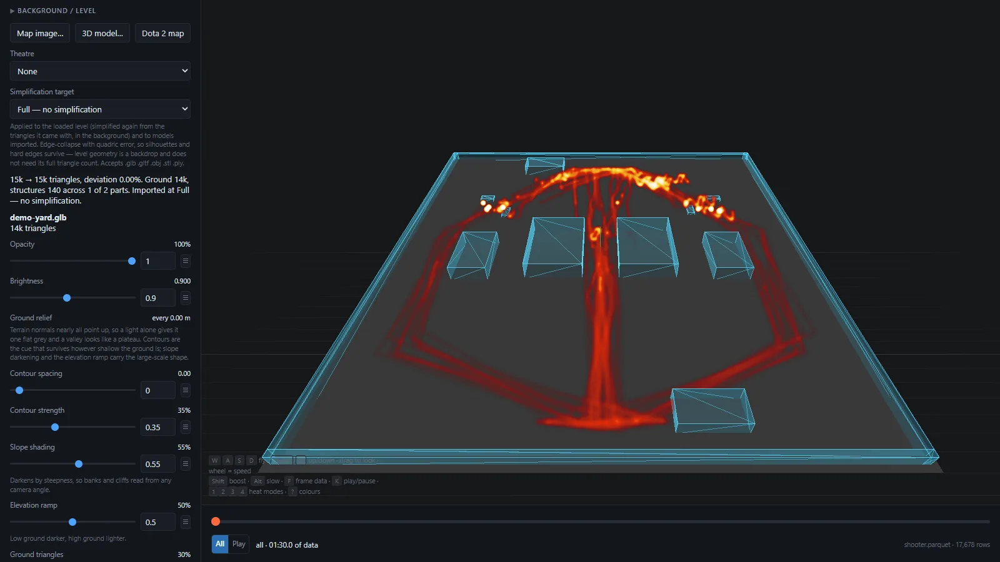

# Heat

Heat paints the places where lots of things happened: red where it happened a bit, white-hot where it happened a lot. It answers "where does this happen, and how much".

**Heat** (key 1) is the default mode. Every visible [row](glossary.md) contributes a camera-facing round [sprite](glossary.md); overlapping sprites add up in a floating-point buffer; the sum is mapped through a colour ramp - by default transparent → red → yellow → white - and drawn over the scene.

The picture shows the heat of a shooter round on a level with buildings: hot spots sit in the rooms and on the stairs, not just on the ground.

## How to use it

1. Load data and press `1` (or pick **Heat** in the mode bar).
2. If everything is white or blank, press **Auto-expose from the field** in the **Heat shape** section.
3. Change **Sprite radius** until neighbouring dots merge into bands: smaller shows single spots, bigger shows areas.
4. Open **Heat colours** to change the colours, or **Depth** to let hills and walls hide the heat behind them.

The same panels shape [Difference](difference.md), [Team heat](team-heat.md) and [Line heat](line-heat.md); they differ in what is added (signed, coloured, or along lines), not in how.

## The panels and their defaults

Every control below maps to a shader parameter, so changing it costs nothing but a redraw. Sliders have a typed box beside them and a drag handle (the small grip on the right: drag up or down, further is faster, Shift for fine); where a slider's track ends before a real limit, the handle can push past it up to the *jog ceiling* given here. Values marked *on load* are recalculated for every new dataset.

### Heat shape (open)

| Control | Default | Range (jog ceiling) | Details |
|---|---|---|---|
| **Sprite radius** | 6 m; on load extent / 120 | 0.05-2000 m, logarithmic (50,000) | [Sprite shape](sprite-shape.md#sprite-radius) |
| **Centre intensity** | 1 | 0-10 (1000) | [Sprite shape](sprite-shape.md#centre-and-edge-intensity) |
| **Edge intensity** | 0 | -2-10 (1000) | [Sprite shape](sprite-shape.md#centre-and-edge-intensity) |
| **Ramp shape** | *Falloff* | *Falloff* / *Curve* | [Sprite shape](sprite-shape.md#ramp-shape-falloff-or-curve) |
| **Falloff** (Falloff only) | 1.6 | 0.1-8 (64) | [Sprite shape](sprite-shape.md#falloff) |
| **Smooth ramp** (Falloff only) | on | | [Sprite shape](sprite-shape.md#falloff) |
| Curve editor (Curve only) | *Smooth* preset | | [Sprite shape](sprite-shape.md#the-curve-editor) |
| **Saturation point** | 24; on load an estimate, then metered | 0.1-4000, logarithmic (10,000,000) | [Colour and exposure](colour-and-exposure.md#saturation-point) |
| **Minimum heat** | off (0) | 0-100% | [Colour and exposure](colour-and-exposure.md#minimum-heat) |
| **Density response** | *Saturating* | *Saturating* / *Linear* / *Log* | [Colour and exposure](colour-and-exposure.md#density-response) |
| **Auto-expose from the field** | | button | [Colour and exposure](colour-and-exposure.md#auto-exposure) |
| **Follow the view** | on | | Meters the exposure again each time the camera comes to rest, so a region you fly into uses the whole colour ramp. Small changes are ignored and the scale glides. Untick it, or drag **Saturation point**, to lock the scale and compare places on one scale. [Colour and exposure](colour-and-exposure.md#follow-the-view) |
| **Same density at any zoom** | on | | A colour means the same number of rows per area of ground however close you are. A sprite the pixel clamps enlarge (far away) or shrink (close up) keeps the heat its true size would add, so a picture exposed from far away does not fade as you fly into it. Off, a clamped sprite adds its full weight at its clamped size. [Sprite shape](sprite-shape.md#pixel-clamps) |
| **Flatten onto ground plane** | off | | [Sprite shape](sprite-shape.md#flatten-onto-ground-plane) |

### Heat colours (closed)

| Control | Default | Details |
|---|---|---|
| Group swatches and **Colour separation** (Team heat only) | 1.4 | [Team heat](team-heat.md) |
| **Heat ramp** editor (*Positive (additive teams)* in Difference, *Opacity ramp* in Team heat) | transparent → red → yellow → white | [Colour and exposure](colour-and-exposure.md#the-ramp-editor) |
| **Reset to transparent → red → yellow → white** | | |
| **Negative (subtractive teams)** ramp (Difference only) | transparent → green → blue → purple | [Difference](difference.md#colours) |

### Sprite pixel clamps (closed)

| Control | Default | Range (jog ceiling) | Details |
|---|---|---|---|
| **Min pixel radius** | 1 px | 0-16 (512) | [Sprite shape](sprite-shape.md#pixel-clamps) |
| **Max pixel radius** | 96 px | 2-1024, logarithmic (8192) | [Sprite shape](sprite-shape.md#pixel-clamps) |

### Depth (open)

| Control | Default | Details |
|---|---|---|
| **Hide behind terrain** | on | [Depth and culling](depth-and-culling.md#hide-behind-terrain) |
| **Hidden behind geometry** | 0.8 (*80% dimmer*) | [Depth and culling](depth-and-culling.md#hidden-behind-geometry) |

### Distance culling (closed)

| Control | Default | Range (jog ceiling) | Details |
|---|---|---|---|
| **Near** | off (0) | 0.5-5000 m, logarithmic, bottom of the track = off (200,000) | [Depth and culling](depth-and-culling.md#distance-culling) |
| **Far** | off (0) | 1-200,000 m, logarithmic, bottom = off (10,000,000) | [Depth and culling](depth-and-culling.md#distance-culling) |
| **Cut at a plane** | on | | [Depth and culling](depth-and-culling.md#distance-culling) |
| **Cut the level too** | on | | [Depth and culling](depth-and-culling.md#distance-culling) |

Keys: `[` and `]` push the far bound in and out, `\` toggles it ([Depth and culling](depth-and-culling.md#keyboard)).

### Direction and Value

Two more sections sit below Heat shape. **Direction** draws each row as a wedge and adds arrows: see [Directional heat](directional-heat.md). **Value** weighs the heat by what each row cost or earned: see [Value weighting](value-weighting.md).

## What is saved

The heat settings above are not stored between sessions: reloading the page restores the defaults. Two things are kept in the browser: the last playback speed (`heat3d.speed`, see [Timeline](timeline.md)) and the far-off figure settings of the [figure overlay](box-replay.md) (symbol style, size, hit marks and so on). So are the language, the [inverted world axes](camera.md#invert-world-axis), the race tab's remembered car names and the [level library](level-library.md). The full list is on [Stored settings](ref-settings-storage.md).
