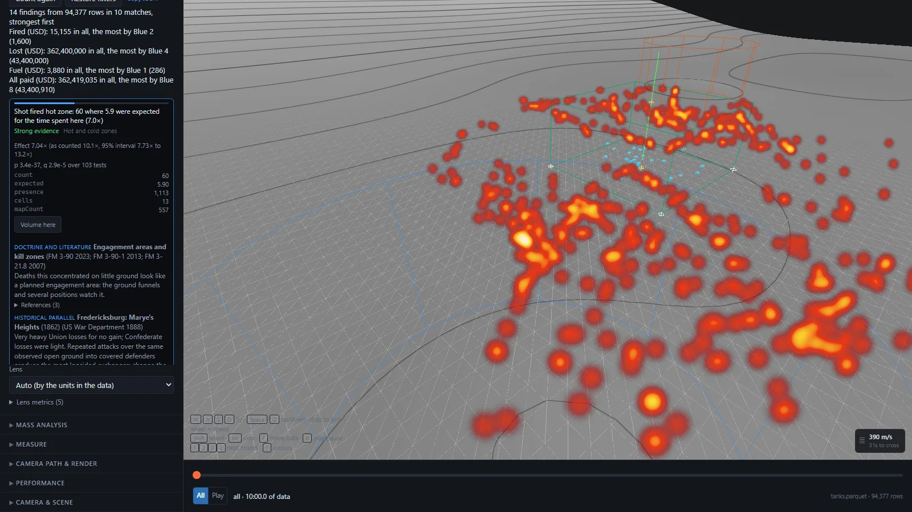

# The knowledge lens

When [Insights](insights.md) finds something, this part explains it with ideas from military history, game design and sport analysis, and names the book or paper it comes from. Use it to learn *why* a pattern matters, not only that it exists.

## Try it

1. Load data and open **Insights**, then press **Find insights**.
2. Click a finding to open it.
3. Read **Doctrine and literature** and **Historical parallel**; the full references are folded underneath.
4. Change **Lens** (for example to *Military doctrine*) to read the same finding through another body of literature.

## How it works

The Insights panel judges its findings the way a professional analyst would: through military doctrine and operations research, historical engagements, and the game design, level design and analytics literature. It does this offline, from a curated knowledge base in the viewer, and hands the same material to an external model when one writes the debrief.

## What the panel shows

- **Lens** picks the body of literature the findings are read through: *Auto* (chosen by the kinds of units in the data: aircraft, ships, ground vehicles, infantry), *Military doctrine*, *Air combat*, *Naval*, *Urban*, *Game design and balance*, *Esports*. Entries outside the picked lens are left out.
- Each opened finding shows its closest **doctrine and literature** entry and its closest **historical parallel**, with the full references folded underneath.
- **Lens metrics** lists the measures of operations analysis computed over the same rows (below), each with what it means and its literature.
- The **Debrief** adds lines for the leading findings and the lens metrics: "Doctrine and literature: ..." and "Historical parallel: ...", each with author-year citations and the references folded under it.
- **Write with AI** sends the most relevant entries (summary, lesson, the findings they relate to, full references) with the report, and asks the model to cite them by id - `{concept.lanchester-square}` - and to use no other sources.

The labels are translated; the knowledge itself is English.

## Lens metrics

Computed in the insight worker, in the same pass over the rows as the detectors (`src/insights/lensMetrics.ts`). Each is left out when the data cannot carry it.

| Metric | What it measures | Needs |
|---|---|---|
| Lanchester fit | Each side's losses per 20 s regressed on both sides' alive strengths (Poisson, quasi-likelihood errors); the exponents on enemy and own strength, tested against the square law (aimed fire) and the linear law (area fire) | time, teams, kills and deaths |
| Exchange ratio | Kills per death by side and by place; the share of deaths on the deadliest ground holding 5% of the time spent, against the share chance alone gives with that many deaths; Gini of deaths against time; Moran's I of death rates | kills and deaths |
| Local force ratio | Friendly and enemy units alive within engagement range of each kill (range set from the data: twice the median distance to the nearest enemy); the share of kills by the locally superior side, and its excess over what numbers alone predict | time, teams, persons |
| Fields of fire | Viewsheds of the busiest kill places on a 2.5D obstruction surface (level geometry up to wall height, or the ground walked) against the average place, and the rank correlation of view and kill share | positions; a loaded level makes it sharper; not for air |
| Energy state | Specific energy (height plus the height speed could buy) of air killers and air victims, compared by the Mann-Whitney statistic | aircraft classes, time, altitude |
| Key terrain | How often each place is among a match's three busiest kill places | several matches |
| Mutual support (trades) | Deaths answered by a teammate's kill within the engagement range and 5 s | time, teams |
| First strike | Engagements - kills grouped by match, by 20 s of quiet and by three engagement ranges of distance - won by the side that scored first | time, teams |
| Salvo model | Hughes' salvo equation fitted to 20 s periods of ships in contact: ships put out of action per attacking ship, and saved per defending ship; a Lanchester fit on ships alone | ship classes, time, teams |
| Combat effectiveness | Kills per unit-hour in action of each side and the ratio of the two largest (a combat effectiveness value in Dupuy's sense) with its 95% interval, and each side's share of kills at even local numbers | time, teams |
| Engagement ranges | Distance to the nearest enemy at kills, at launches and at each life's first shot (detection to engagement), by kind of unit | time, teams; launches where the data has them |
| Kill chain | Seconds from the killer's last launch to the kill, and from its first shot of the fight to the kill | time; launches or fire events |
| Concentration or dispersion | In each 20 s period, the spread of the two largest sides and the share of kills taken by the tighter one | time, teams |
| Sorties | Per side: sorties (takeoffs, or aircraft spawns), landings, aircraft lost and kills by aircraft; loss rate and kills per sortie | aircraft classes; takeoffs or spawns |

Data with rounds adds the close-quarters and esports measures - round win probability, value of actions, opening duels, trades, peeker against holder, aim, crossfire, utility, man advantage, clutches, setups, post-plant, fatal funnels and player impact: see [Close quarters and rounds](close-quarters.md).

Tracks and teams add the collective-behaviour measures of crowd science, collective motion, behavioural economics and military psychology - alignment and milling, route herding, lanes and trails, crowding, leaders and followers, stragglers, the breaking point, risk after losses, streaks, buy agreement and suppression, each against its own null model: see [Collective behaviour](collective-behaviour.md).

Weapons, decoys and buildings are not counted as units. Where weapon rows name their launching unit (a `Shooter` or `Launcher` column, as Tacview-derived data has), the launch is credited to that unit, matched by its name or its object id.

## How findings meet the literature

Entries and findings meet through a **pattern taxonomy** (`src/insights/knowledge/patterns.ts`): concentration, local superiority, aimed and area fire, chokepoints, kill zones, fields of fire, reverse slope, flanking, mutual support, energy advantage, spawn pressure, balance and so on. Each detector kind and each lens metric says which patterns its numbers show (`src/insights/lens.ts`); each knowledge entry says which patterns it speaks to, with a weight. The relevance of an entry to a finding is the weighted overlap, scaled by how well the entry's domain (land, air, sea, urban) fits the data and by the finding's own strength. The rationale shown is the finding's numbers in a sentence followed by the entry's lesson.

## Catalogue

Every pattern, concept, method, historical case, design principle and study, with the bibliography: see the [Knowledge catalogue](knowledge-catalogue.md).

## For developers

### Adding entries

1. Pick the file by type: `concepts.ts` and `concepts-more.ts`, `methods.ts`, `cases.ts`, `cases-land.ts`, `cases-air-sea.ts`, `cases-esports.ts`, `design.ts` (design principles) or `studies.ts` in `src/insights/knowledge/`.
2. Give it a new id `<type>.<slug>` (never reuse one), its lenses, domains, and the patterns it speaks to with weights 0..1. Add a pattern to `patterns.ts` only when a finding can show it, and map it from a finding or metric in `lens.ts`.
3. Write the summary and the lesson **in your own words**. Quotes only from public-domain works (`pd: true` in the reference), and short.
4. Cite: add any new work to `refs.ts` with authors, year, title and publisher (journal with volume and pages); a URL or DOI where there is a public record.
5. Run `npx vitest run src/insights/lens.test.ts` (unique ids, known patterns, resolving references, public-domain quotes, cases with date and outcome) and `node tools/knowledge-doc.mjs` to refresh the [catalogue](knowledge-catalogue.md).
