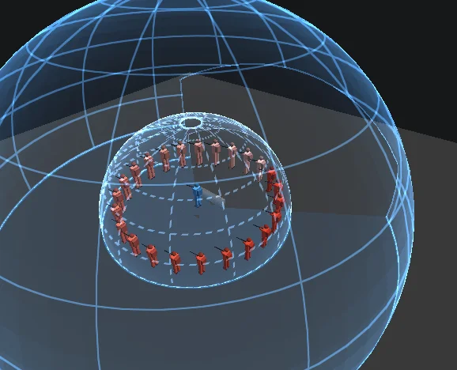

# Match replay

The replay is a film of the match with every player drawn as the thing they drove. Use it to watch a fight again, follow one unit and see who hit whom.

Shots, hits, fires and wrecks are drawn on the units and objectives on the level. Cameras, labels and a tactical display help you read the fight. Do you know Tacview? [Tacview parity](tacview-parity.md) shows where each of its tools is.

## Start a replay

1. Load a recording with **Source → Files…** or by dropping it on the Source panel (any table with a **person** and a **time** column, a Tacview file, a converted replay, a [`.3dheat`](container.md) match). See [Getting data in](getting-data-in.md).
2. Open the **Match** tab and pick **Figure replay**, or pick **Figure overlay** in the Heatmap tab's mode bar.
3. Under **Matches in the replay** pick one match, all at once, or several.
4. Press **Play** on the timeline (or `K`). Drag the timeline to jump.

Figures replace boxes for every unit whose name or type is known (see [Figures](figures.md)). Data with no name or type column is drawn as soldiers.

## Figures

| Setting (section **Figures**) | Default | What it does |
|---|---|---|
| **Figures instead of boxes** | on | Off draws plain boxes. |
| **Figure size** (times true size) | 1 | 1 is real size; 0.25 to 20 times (log scale). Larger helps from far away. |
| **Smallest figure on screen** | 36 px | Far-off figures grow to stay this long, 0 to 200 px; 0 keeps true size. |
| **At a distance**: Figure, Arrow, Symbol | Figure | What a far unit becomes. |
| **Symbols** | NATO (APP-6) | NATO (APP-6), Russian tactical signs, **Game map** icons, or **Shape only (colour-blind safe)**. |
| **Symbol size**, **My side**, **Hostile / Neutral**, **Heading ticks** | 28 px (12 to 64), automatic, hostile, on | How symbols look and which side is friendly. |
| **Drop lines** | on | A line from each unit straight down to the ground, so heights read in 3D. |
| **Drop lines and labels on weapons** | off | Lines to the ground and labels on missiles and bombs. |
| **Fires on units** | on | Flames from the moment a unit catches fire until it is put out. |
| **Hits on units** | on | Marks where shots struck (below). **Hits stay**: 1 to 300 seconds, or **Whole life**. **Floating markers**: marks drawn above the surface. |
| **Aim and turret lines** | off | Dashed: where the player looks; solid: where the gun points. |
| **Buildings** | solid | Solid or see-through buildings, when the level paints them. |

### Symbols at a distance

When a unit would be smaller than **Smallest figure on screen**, it can become a symbol that stays readable. The shape tells the kind (for example a rounded box with a track mark for armour); the colour tells the side. Open the **Symbols** menu to change the style.

### Hit marks, wrecks and fires

- **Hit marks** sit on the surface the shot met, at the figure's scale. Their look tells what happened: a hole (got through), a bright splash (did not get through), a gouge (glanced off), a soot star (explosive round). A coloured ring says what it did: killing shot, module destroyed, critical, severe, damage, no damage, hit. Hover a mark for the round's name.
- A destroyed unit is drawn **charred** as a wreck from its death until it respawns or is removed; its symbol is crossed out.
- **Fires** burn on a unit from the moment it catches fire until it is put out.
- **Turrets** turn to where the data says the gun points (or, without that, where the player looks).

### Weapons, decoys and tracers

With **Weapons, shots and hits** on (Team viewer section): missiles, rockets, bombs and torpedoes fly as their own figures with a smoke trail; bullets and shells are tracers; impacts and explosions flash. A tracer drawn **dashed** was worked out from a hit, because the data had no shot. Flares and chaff are drawn as decoys; they are hidden from the unit list unless *Decoys and shells* is ticked.

## Cameras

Click a unit or its label to **follow** it; the **Replay** section offers **Chase**, **Orbit**, **Cockpit** (with a head-up display, `H`), **Fixed**, **Padlock**, **Target** and **Satellite**. `V` cycles them, **Camera distance** sets how far. Esc stops.

- **Two-unit view**: pick a **Target** (or Ctrl/Alt-click a unit) to look at it from the followed one; **Swap** exchanges them.
- **Measure**: Shift-click two units for the bearing, range and height difference between them.
- **2D map** (`M`): corner or full view, with trails and names.
- **Bookmarks** (`B`): save the moment and the camera; the recording's own kills, deaths and marks are listed too.
- **Events**: every event in time order; a click jumps there. `Page Up` / `Page Down` jump between events; **Pause on event** stops at each.

## Tactical display

The **Tactical display** section draws, for no unit, the selected ones, all, or one kind (aircraft, ground, ships, weapons): velocity vectors and the path ahead, nose and lift lines, radar cones, locks, data links, engagement zones and lines, lines of sight, where players look (view cones), turret aim, and the recorded camera.

War Thunder's server replays give the radar cones, locks and sight lines from their own sensor columns: a radar (or IRST) the recording has on, drawn as the catalogue has it (the installation's own catalogue where you built one), the line to the point the sensors track (`lockX/Y/Z`), and dashed lines to where the sight, pod or drone camera looks (`sightX/Y/Z`) and to the point an optical sensor tracks (`opticX/Y/Z`). Where an aid has nothing to draw, its row says which column the recording lacks; for a War Thunder file converted before its converter wrote that column, it says so, and converting the replay again adds it.

A tank's turret turns as the recording has it, whatever the look and aim aids show. Where a turret column has nothing to do with where its player aims (as far apart as random angles: War Thunder's server replays of game version 101421 on, converted before heat3d-wt-replay 0.2.1, read every turret a bit off), the turrets are taken from where the players look instead.

### Display style

`T` (or the **Show as tactical display** toggle) switches the look to a radar-screen style: glow, outlines, contour lines, a measurement grid, scan lines, range rings, altitude ladders, panels with kills and events, and a **Director** that moves the camera to events by itself.

## Engagement ranges

The **Engagement ranges** section draws, around the units in question (the selected, followed, target and measured ones), their side, or all of them (nearest the camera first, up to **Most units**), how far their weapons reach:

- one shell per weapon and band: the **least range** dotted and grey, the **best range** dashed, the **most range** solid. Shells are see-through and added onto the picture, so the inner ones show through the outer ones, from outside and from inside;
- shapes follow the weapon: a dome cut at its elevation limits and lowest and highest target height for guns and surface-to-air missiles, a cone along the nose for aircraft guns, rockets and air-to-air missiles, a cone down and ahead for bombs (as far as the fall from the current height carries them);
- **Cut by line of sight**: each shell ends where terrain or buildings block the unit's view, with a bright edge there. Indirect fire (artillery, torpedoes) is not cut. **Shade the ground it sees** tints the ground the unit sees within reach;
- colours: each unit's weapons in shades of its side's colour (a red side red, orange, pink...; a blue side blue, cyan, violet...), also lighter or darker, so they stay apart for colour-blind eyes;
- **Weapons** turns kinds of weapon on and off (small arms, machine guns, cannon, main guns, anti-tank, SAM and MANPADS, air-to-air, bombs and rockets, torpedoes, artillery); **Bands**, **Look** (glass, lines, both) and **Opacity** set how they are drawn.

What a unit carries comes from the data where it says (weapon, ammunition and loadout columns on the rows where the unit fires, launches or equips; the weapons an ACMI recording says it launched), and otherwise from its vehicle's usual armament. The figures come from the game the data is from where it is known (War Thunder, DCS, Counter-Strike 2, Rainbow Six Siege, Valorant, Battlefield 4, 1 and 6, Squad, Arma 3, World of Tanks, World of Warships, IL-2), else from general figures. Each figure is marked: the game's own, a rounded published figure, or an estimate (`*`); hover a weapon in the list for its source.

The line of sight is worked out on the graphics card from the level itself, a few views a frame, only again when a unit has moved; nothing is read back, so the frame rate holds.

### View cone

**View cone** draws what a unit sees: a frustum from its eyes along where it looks (the player's view or sight where the data has it, else its heading), as wide as its game's field of view, cut by the line of sight like the ranges, as far as **View reach** (left at its start: the game's visual range where known, else a usual one for people, vehicles, ships and aircraft). Where the data says the player aims or looks through a sight (a `fov` column, a `zoom` or magnification column, a sight name the game's optics are matched against, or an `ads`/`aiming`/`scoped` flag), the cone narrows to that sight's view, easing over a fifth of a second as the game's own zoom does. The list shows each unit's view across in degrees. With **Weapon ranges** off, the ground shaded is what lies in the cone.

### Sensors

**Sensors** draws what a unit's radars, infrared search and track, laser rangefinders and designators, targeting pods, sonar and warning receivers cover: the sector they search about its nose (all round as a dome cut at its elevation limits, else a frustum as wide and high as the sector) out to their reach, cut by the line of sight (warning receivers and sonar are not). For a radar the solid shell is the reach for the reference target, the dashed one for a target with a tenth of its radar cross-section and the dotted one for a hundredth (the reach goes with the fourth root of the cross-section). The figures are the game's specifications from its catalogue, marked as such; where a Tacview ACMI recording has the radar's own state (`RadarMode`, `RadarRange`, `RadarAzimuth`, `RadarElevation`, the beamwidths), the radar is drawn as recorded while it is on, and the list says so. War Thunder's server replays (converted since heat3d-wt-replay's build of 2026-11-17) record which of an aircraft's sensors are on (`sensors`): a sensor the recording has off is left out, one it has on is marked recorded. A drone's or camera's sector turns with where its player looks (`viewYaw`, `viewPitch`: a targeting camera's own direction), not with the drone's nose.

## Objectives

When a match comes with its objectives, the **Objectives** section draws them on the level: capture zones (with owner and capture progress), spawns, airfields, areas and bombing targets, each layer switchable, with labels. They are seen through the ground. With several game modes loaded, **Mode** filters the matches by mode. Objectives come from a converter's match file beside the recording or inside a [`.3dheat`](container.md) container.

Rainbow Six Siege matches bring their bomb sites: each site's two rooms are drawn on their floor as outlines with their names, worked out from where the players stood while the game named the room; a site of the map not played in the match comes from the converter's table of sites as a circle. In the replay the site of the round at the playhead lights in amber, the others stay grey. They are part of the capture-zone layer.

## Labels and statistics

- **Labels**: rules per kind (**Selected**, **Aircraft**, **Ground**, **Ships**, **Weapons**, **AI**): shown or not, which values, and a **Priority** for who gets the space when labels overlap. **Keep labels apart** moves a label beside its unit when it would cover another, and leaves it out where there is no room. **Label size** is 60 to 250 %. **Back to name, vehicle, altitude and speed** resets the rules.
  - Ground units start with name, vehicle and speed.
  - Aircraft start with name, vehicle, altitude and speed.
  - Ships start with name, vehicle, speed and heading.
  - Hover a unit to see every value it has.
- **Statistics**: per team and unit: kills, deaths, shots, hits, hit ratio, take-offs, landings, time airborne, top speed, height and G, distance. CSV export.
- **Charts**: a unit's values over time, two units compared, or one value against another.

## Many matches at once

To lay hundreds or thousands of matches over each other, see [Many matches at once](many-matches.md). Figure details (smoke, fire, other timed effects): [Figures in the figure overlay](figure-replay.md). Tacview feature list: [Tacview parity](tacview-parity.md), a child page of this one.
