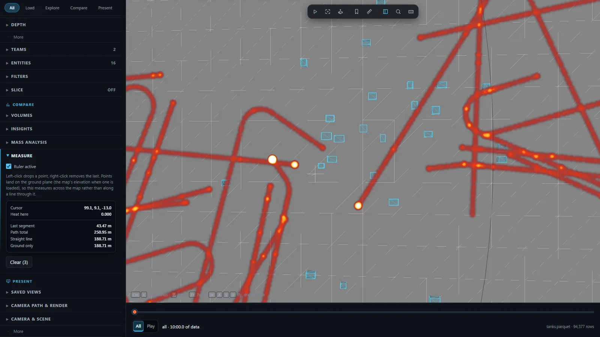

# Measure

**Measure** turns the mouse into a ruler and tells you how busy the spot under the cursor is. Use it to find out how far apart two places are, or how much traffic one spot has.

## Try it

1. Open **Measure** in the sidebar and tick **Ruler active**.
2. Left-click three places on the map. Each click drops a point.
3. Read **Path total** (the length of the whole path) and **Last segment** (the last leg).
4. Right-click to remove the last point, or press **Clear (3)** to remove all.

| Action | Effect |
|---|---|
| Left-click | Drops a point where the cursor meets the ground plane. A click that moved more than 4 pixels between press and release is a camera drag, not a point. |
| Right-click | Removes the last point. |
| Move | The cursor position and the heat under it update live. |

The camera keeps working while the ruler is on: dragging still looks around, keys still fly. While the ruler is on it takes every click, so [click-to-pick](camera.md#click-to-pick) waits until it is off.

**The ground plane** is the [map image's](map-images.md) elevation when a map image is loaded, otherwise the lowest Y of the dataset (0 without one). Points land on it, so the ruler measures across the map, not along a line through it. With a 3D level the plane is still the dataset's lowest Y, not the level's surface - for a point on the real surface, switch the ruler off and click it ([click-to-pick](camera.md#click-to-pick)), which reads the coordinates off the level's own triangles.

## Readouts

| Line | Meaning |
|---|---|
| **Cursor** | World X, Y, Z of the point under the cursor, on the plane. |
| **Heat here** | How much heat is at the cursor pixel. A bigger number means more traffic at that spot. It is the value the colour ramp is fed before the saturation point divides it, so you can compare it with the [Saturation point](colour-and-exposure.md#saturation-point). |
| **Last segment** | Distance from the last point to the cursor (or between the last two points). |
| **Path total** | Length of the polyline through every point and the cursor. |
| **Straight line** | 3D distance from the first point to the cursor (or the last point). |
| **Ground only** | The same, on X and Z only. |
| **Clear (N)** | Removes all points. |

Distances are shown in centimetres below 1 unit, metres below 1,000, kilometres above - assuming one world unit is a metre ([Axes, units and time](axes-units-and-time.md#unit-scale)). Coordinates are world coordinates, including when an axis is [inverted for display](camera.md#invert-world-axis).

The points and the line between them are drawn as an overlay in the view, sized from the grid spacing. The ruler's points are not saved in views; they stay when you load other data.

## For developers

**Heat here** is read from the GPU at most every 120 ms, because a single-pixel readback stalls the pipeline. It uses the same path as `engine.readHeatProbe()`: divided by the gain the frame was written with, so on the half-float accumulation path (`?heat=f16`) it is in the same units as on a 32-bit target ([Half-float accumulation](half-float-accumulation.md)).
