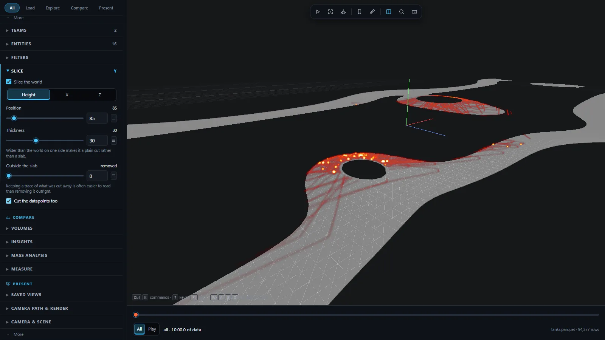

# Slice

**Slice** cuts the world like a slice of cake, so you can look inside buildings. Use it when walls hide the interesting heat, for example to see one floor of a building.

## Try it

1. Load a level and some data, and open **Slice**.
2. Tick **Slice the world**. Axis is **Height**.
3. Drag **Position** up and down: the slab moves through the level.
4. Make **Thickness** thin for a floor plan, or wide for "everything below here".
5. Keep **Outside the slab** at 0 to remove the rest, or raise it to keep a faint trace.



The slab cuts **level geometry and datapoints together** - slicing only the level would leave heat floating where its building used to be. It is the counterpart to [depth occlusion](depth-and-culling.md): once the level correctly hides what is behind it, the inside of a building is hidden too. The panel is shown when there is something to slice (a dataset or a 3D level); its header shows the axis while on, *off* otherwise.

```
side view         Position = where the slab is
 ----------       Thickness = how tall the slab is
 | floor 3 |
 |=========|  <--- slab (kept)
 | floor 2 |  <--- outside: removed (or faint)
 | floor 1 |
 ----------
```

## Controls

| Control | Default | Meaning |
|---|---|---|
| **Slice the world** | off | Turns the slab on. While the position is still at its initial 0 and the thickness at its initial 500, switching on moves them to the middle of the axis and 15% of its span. |
| Axis | **Height** | *Height* (Y), *X* or *Z*. Switching the axis moves the slab to the middle of the new axis. |
| **Position** | the middle | Centre of the slab, in world units, across the span of the axis (500 steps). |
| **Thickness** | 15% of the span | From 1/500 of the span to twice the span, in logarithmic steps. Reads *past the world* once it is as wide as the span: one side then reaches past the world and it is a plain cut rather than a slab. |
| **Outside the slab** | 0, *removed* | How much of what lies outside stays visible, 0-100%. A faint trace of what was cut away is often easier to read than removing it outright. |
| **Cut the datapoints too** | on | Off leaves the heat whole, so it shows through the cut - useful for seeing what is above and below the slab. |

The span of an axis is that of the 3D level when one is loaded, otherwise that of the dataset.

Slice is independent of [distance culling](depth-and-culling.md#distance-culling), which cuts along the view direction rather than a world axis; the two combine. A change to any slice setting restarts the heat accumulation.

## For developers

The slab is tested on each row's world position in the vertex shader: a row outside it has its contribution multiplied by the *Outside* value, so at 0 it is rejected before any fragment is drawn. The level shaders apply the same test to every fragment of the ground, structures and water.
